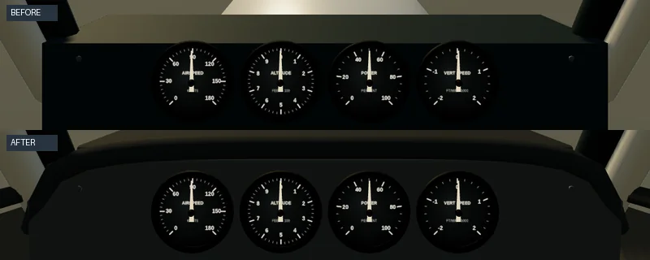

# Pilot-view panel enclosure

The fictional survey aircraft now has a recessed metal fascia, a padded
antiglare coaming and lower side sills instead of a single exposed box.
The trim is original geometry, batched by material. The eye point, field
of view, dial scales and needle inputs are unchanged. The quiet interior
fill is an approximation of light bouncing into a shaded cabin, not active
panel illumination. No new avionics, seating controls, cabin interactions or
manufacturer reproduction are claimed.

## Reproduce

On the dev server open `/tools/qa/aircraft-preview.html?pose=cockpit`, and
compare with `9035789` using the same page and dimensions. Use `?pose=chase`
as an exterior control. The chase canvas was pixel-identical in the paired
check. The cockpit fixture was unchanged in its upper 480 rows and added
two draws and 1,412 triangles; fixture counts include a shadow pass.

For cockpit camera and throttle input in the normal build, run
`python tools/qa/cockpit-player.py --dist dist --out /tmp/pei-cockpit --chromium CHROMIUM`
after `npm run check`.
