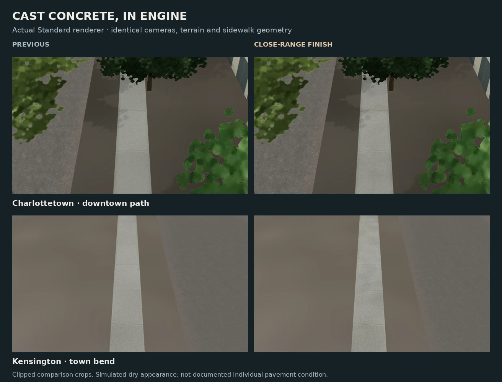

# Close concrete sidewalk finish

The Standard renderer adds broad tone variation and smaller irregular
mineral flecks to the *tops* of already mapped cast-concrete and precast
sidewalks. The goal is to break up the uniform gray seen from low camera
positions without putting artificial noise across roads or over masonry
pavers. The cast class has stronger mix mottling than the precast class.
The existing joints, lip, geometry, grade and shadow receiver are unchanged.

The two scales fade based on a screen pixel's estimated footprint in
metres. Mineral flecks fade first, then the wider colour variation. The
entire finish is inactive at 92 m eye distance, independent of the
unchanged sidewalk mesh draw range. There is no new image, mesh, download,
or inferred sidewalk. This is dry surface art, not an observation of
individual pavement condition. For the source types, available coverage
and geometric limitations, see [Registered 3D sidewalks](mapped-sidewalks.md).



## Actual renderer checks

The [raw gate](concrete-sidewalk-finish-gate.json) records paired 896 × 592
Chromium/SwiftShader frames. Each pair uses the same scene, changing only
the concrete finish. Complementary colour IDs isolate concrete including
partially covered, antialiased pixels. A third render marks other walk
classes. Road/ground and unrelated sidewalk pixels must stay unchanged.


| View | Colour changes above 2/255 | Protected changes | Added draws / triangles |
| --- | ---: | ---: | ---: |
| Charlottetown, downtown | 9,057 | 0 | 0 / 0 |
| Charlottetown, residential | 13,282 | 0 | 0 / 0 |
| Kensington | 19,500 | 0 | 0 / 0 |
| Summerside, paver control | 0 | 0 | 0 / 0 |
| Charlottetown, 105 m ground-relative camera | 0 | 0 | 0 / 0 |
| East Point, offsite control | 0 | 0 | 0 / 0 |

Summerside's small concrete sliver changed by at most two levels at each
offset; all 25,726 fully marked other-material pixels stayed exact in the
first frame. The far and offsite controls are byte-identical in RGB. The
99th percentile of the added colour signal's change stayed at or below
3/255 in 5 mm eastward camera steps through the close views. These
software-renderer results are regression checks, not device FPS claims.
The ordinary Cavendish simulation launched and continued with both the
healthy and intentionally unavailable sidewalk pack, with no layer errors.

Reproduce with node dependencies installed, Python with Pillow, NumPy
and Playwright, and a local Chromium binary:

```sh
python tools/qa/concrete-sidewalk-frames.py --checkout . \
  --out /tmp/pei-concrete --chromium /path/to/chromium
python tools/qa/sidewalk-flight-fault.py --checkout . \
  --out /tmp/pei-concrete-flight --chromium /path/to/chromium \
  --case healthy --case missing
npm run check
node tools/verify-world.mjs
```
