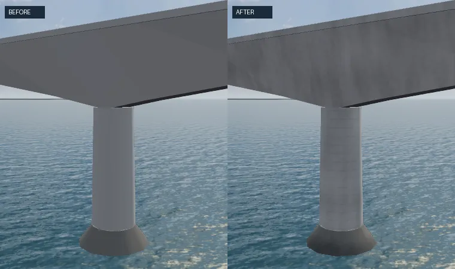
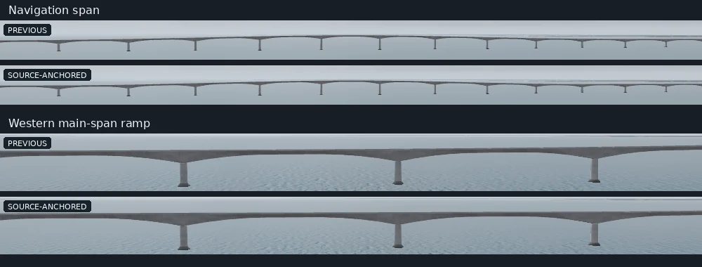
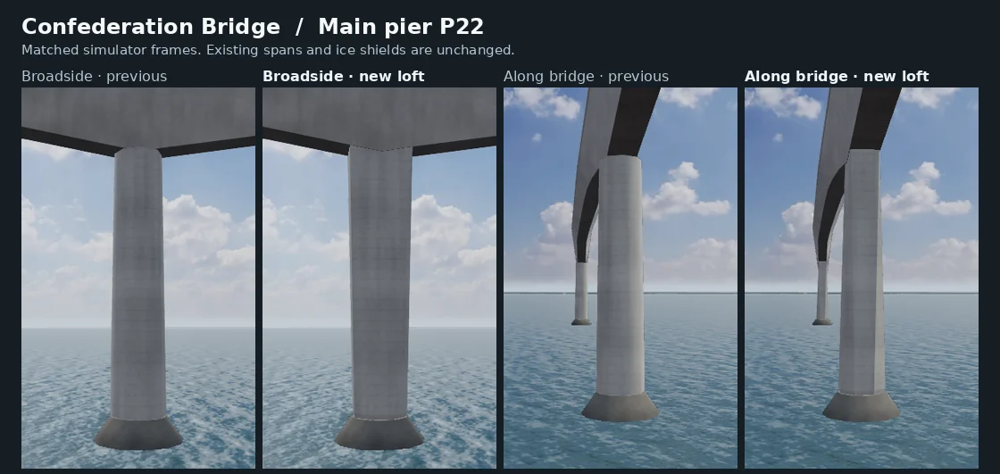
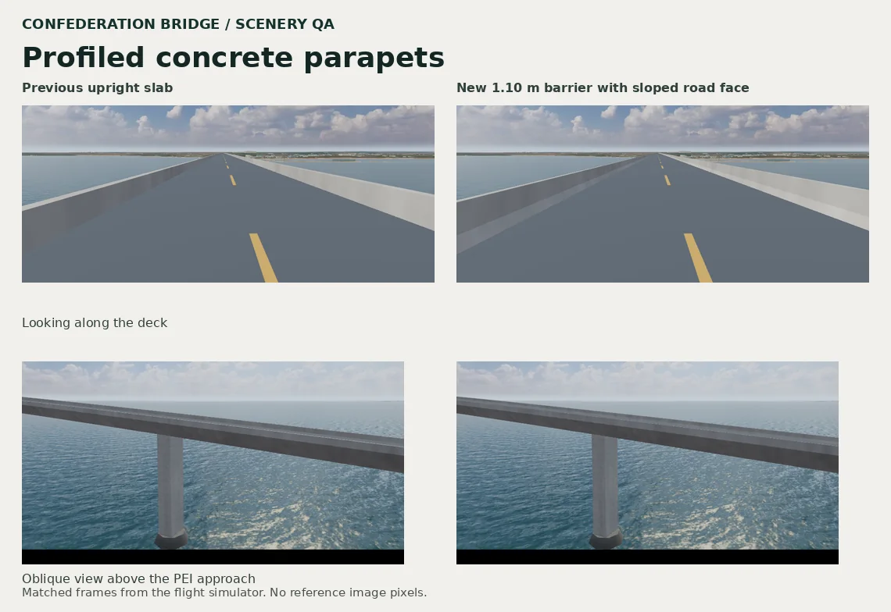
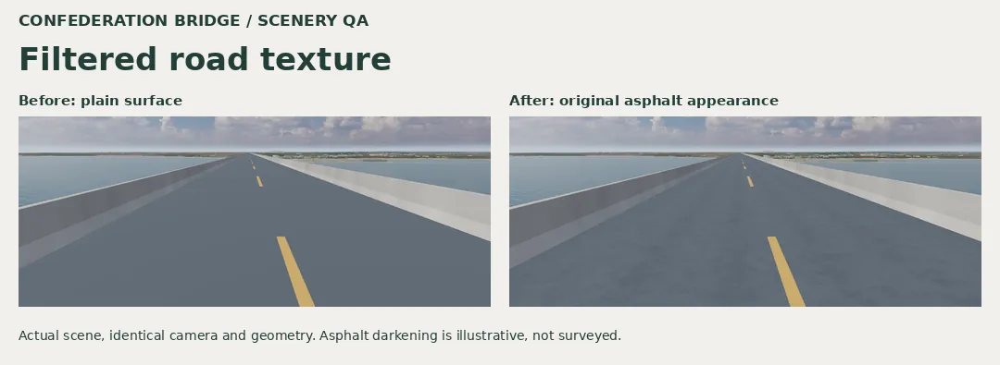

# Confederation Bridge approach and span geometry


The original road centreline and approximate deck elevations are unchanged.
Previously, a single repeat anchored to the central channel misplaced the last
New Brunswick main supports and continued the deep-haunched silhouette across
short approach spans. The renderer now distinguishes numbered main supports
from the approaches. The deeper main girder meets each shaft at its station.
The approach girders are shallower and are carried on distinct pier and
ice-shield meshes.

Eight published pier coordinates are projected onto the existing centreline.
Before this change, the nearest rendered support to P42, P43 and P44 missed
their along-line locations by approximately 14 m, 40 m and 18 m. All eight
controls are now used at their projected stations, rounded to two decimal
places in the test fixture. Their original lateral residual is under 0.95 m;
no lateral shifts were applied. The channel midpoint remains within 0.01 m
of the existing navigation crest station.

There are 44 main and 21 approach supports. The unsurveyed main stations are
interpolated between controls and stepped by the nominal span length beyond
P3. Transition lengths and unmeasured approach positions are approximate.
The physical deck clearance, below-water footing meshes and bridge contact
are not simulated. This model is not suitable for navigation or engineering.

## Reference and reproduction

- [Transport Canada TP 13681, sections 3 and 7](https://tc.canada.ca/en/marine-transportation/publications/tp-13681-guidelines-navigation-under-confederation-bridge-04-2025)
  for the eight control points and support labels.
- [Full-scale structural study, section 2](https://www.intechopen.com/chapters/38200)
  for the deck width, girder depths, and approach/main/transition spans.
- [Project scour design paper, Figure 2](https://www.issmge.org/uploads/publications/108/110/Confederation_Bridge_-_New_Scour_Design_Methodology_for_Complex_Materials.pdf)
  for visible support silhouette references.
- [Quintin Soloviev's July 2025 aerial photograph, CC BY 4.0](https://commons.wikimedia.org/wiki/File:Confederation_Bridge_aerial_view_(from_PEI_side).jpg)
  for a qualitative visual check. Its pixels are not part of the simulator.
  The captures compare simulator to simulator, not precisely registered to that photo.

Run `npm run check`, `node tools/verify-world.mjs`, then
`python tools/qa/bridge-poses.py --checkout . --out /tmp/pei-bridge-after --chromium CHROMIUM`.
For the reference frame, pass a separate checkout at `323f090` and keep this
same capture script. The paired views run the full Three.js scene with the
same pose and water phase. Rendering diagnostics add two draws and 1,584
triangles at the New Brunswick approach and navigation span.

## Concrete close-up



The concrete now has original procedural casting streaks, faint horizontal
lift marks on the shafts, and darker waterline wear. Fine variations fade at
distance. It does not ship reference photo pixels, add material downloads or
change the bridge mesh. The visible joints, color variation, and waterline
are modeled appearances, not a current inspection record.

Run the pose tool with `--views nb-concrete,pei-concrete` and use
`9035789` as the before version. These are fixed 1,000 × 600 screenshots of
the actual renderer, sampled immediately after the frame. Counts are unchanged:
17 draws and 137,731 triangles at the New Brunswick pier; 115 draws and 234,285
triangles at the PEI pier. Browser shader compilation was checked for both.

## Main deck elevation



The original bridge used a single approximate hump, placing the P26 and P17
deck shoulders at 42.69 m and 42.68 m and the crest at 60.00 m in simulator Y.
The main deck now uses the 40.80 m shoulders and 59.06 m crest described by
[Lin, Naumoski and Saatcioglu, section 2](https://doi.org/10.5772/50070).
The adjacent main spans use the documented typical 40.80 m elevation. The
intermediate curve and short connections to the existing approaches are
smooth visual interpolation, not a surveyed grade. P26 and P17 retain the
earlier estimated horizontal stations. A mesh panel break pins the crest
in the actual rendered deck; the shaft tops still meet the soffit.

The paper expresses its heights relative to mean sea level. Direct use in
simulator Y is a visual approximation, not a measured transformation to
the terrain datum, tide simulation, or a statement about clearance.
[Transport Canada's navigation diagram and air-draft limits](https://tc.canada.ca/en/marine-transportation/publications/tp-13681-guidelines-navigation-under-confederation-bridge-04-2025)
are separate and are not used to set the deck height. The road centreline,
girder depths, 65 support stations, shorelines, and aircraft behavior are
unchanged. The abutments remain at their earlier approximate elevations.

To inspect the rendered result, run `tools/qa/bridge-poses.py` as above with
`--views navigation-broadside,main-span-ramp,pei-approach`; use `40e62a0`
for the baseline. The near-orthogonal navigation view is easier to read
than an end-on approach. The compiled `bridge` departure can be replayed
with `python tools/qa/confederation-deck-flight.py --dist dist --chromium CHROMIUM`.

[Matched results](confederation-deck-gate.json) show 2,944 changed pixels
in the navigation view and 4,825 in the western ramp view (over four RGB
levels), all inside their bridge inspection bands. Each pose retains its
old draw count and adds 20 triangles for the crest station. The compiled
flight covered 242 m toward New Brunswick, switched to Cockpit and
paused without a browser or scene error. These are software-rendered
checks, not real-device frame times.

## Main pier shafts



The 44 main shafts now change from a nominal 8 m lower octagon to a nominal
10 × 5 m rectangular head. The wider dimension follows the bridge; the head
narrows across it. The artist-authored mesh follows the dimensions in
[Lester and Tadros, Final Project Design, pp. 42–43](https://doi.org/10.15554/pcij.09011995.32.44),
with the orientation inferred from
[Frederking, Kubat and Prinsenberg's PEI-end view, Figure 2](https://www.researchgate.net/figure/Cross-section-of-the-piers-observed-from-PEI-end-showing-tiltmeter-locations_fig2_44083764).
[Lin, Naumoski and Saatcioglu, §2](https://doi.org/10.5772/50070) independently
describe the change in section. The model does not reproduce a survey of
individual shafts or the concealed structure. No reference imagery is embedded.

All support stations, deck geometry, ice shields, approaches and the overall
bridge bounds are unchanged. A fitted lower cap seats against the existing
shield; the upper cap is hidden inside the stock rising girder. Tests raycast
90 points on each cap at every main pier, check outward winding and planar
face normals, and verify the stock assembly bounds. The new shaft geometry
uses the existing instanced draw and adds 528 triangles to the whole bridge.

Use `--views main-shaft-broadside,main-shaft-axial --size 960x640` with the
pose tool above, retaining the same tool for the `35e23da` baseline. In the
matched P22 pair, 14,501 broadside pixels and 13,670 axial pixels changed by
more than two RGB levels, all within the comparison mask for the old or
new shaft, including the anti-aliasing margin.
An approach-only control frame was unchanged. The compiled Borden departure
advanced about 243 m toward New Brunswick, switched to Cockpit and paused
without a scene or browser error. These are browser QA results, not device
performance measurements or information about navigation or clearance.

## Concrete parapets



The older deck depicted each barrier as an upright slab 0.96 m high. The
revised model uses the **1.10 m** height documented by researchers and the
bridge operator in [Moffatt et al., CSCE 2013, section 2 and Figure 1](https://legacy.csce.ca/elf/apps/CONFERENCEVIEWER/conferences/2013/pdfs/mechanics/123.pdf).
The traffic-facing slope, lower break and narrower cap are original geometry
that approximates the visible profile. The paper does not validate our cap
and toe widths, and its diagram and images are not included as textures.

The new face spans the existing deck panels on both sides, including both
approaches. No centreline, driving surface, stripe, deck elevation, girder,
pier, ice shield, or collision geometry changes. It uses the existing concrete
batch and adds 2,616 triangles along the entire bridge, with no new draw calls
or assets to download. Three.js rays check the cap, slope, extent and preserved
road height at six stations, including the navigation crest.

```sh
python tools/qa/bridge-parapet-frames.py --checkout . \
  --chromium /path/to/chromium --out /tmp/pei-parapet-qa
```

The comparison tool holds the camera and game frame fixed and restores the
original draw for a byte-exact repeat. A simple colour pass checks that changes
are confined to the model's edge batch. The regular compiled flight test
traversed roughly 243 m on the Borden route, switched to Cockpit and paused with
no application warnings or playback errors.
In the matched deck, PEI approach and navigation-span views, respectively,
43,347, 11,734 and 8,515 pixels changed by more than two RGB codes. No such
pixel was outside the edge-batch mask with its four-pixel anti-aliasing margin.

## Close-range deck surface



The road was previously a single flat color. Its original visual treatment
now adds subtle stone aggregate, broad color variation and less uniform
shoulders. The [bridge project profile](https://www.pppcouncil.ca/home/confederation-bridge)
describes a bituminous road surface. The texture here is illustrative, not a
measured pavement mix, a condition survey or a claim about wheel-track wear.

The shader uses metres along and across the existing ribbon. Small detail
fades based on the projected pixel footprint, and beyond that range the old
road color is used. The physical deck, lane markings, barriers, supports
and all other materials are unchanged. Only the deck's texture coordinates
and color calculation change, with the same draw calls and triangles, no
texture assets or network requests, and no collision update.

Run the paired views at deck, crossing, navigation and cruise heights:

```sh
python tools/qa/bridge-parapet-frames.py --surface asphalt --checkout . \
  --views along-deck,pei-crossing,navigation,cruise \
  --chromium /path/to/chromium --out /tmp/pei-bridge-asphalt
```

The near comparison changed 87,541 deck pixels by more than two RGB codes,
and zero such pixels outside the deck mask. A 1.36 cm camera shift changed
the 99th percentile of the 184,369-pixel central deck sample by five codes.
The two lower oblique comparisons changed at most three codes. Each fixed
view restored the old frame byte for byte. The compiled Borden flight
advanced about 244 m and switched to Cockpit without a browser error. These
are image and playback checks, not hardware performance measurements.
At the cruise fixture the deck was present in the diagnostic pass and the
normal frame was identical, including the road.
