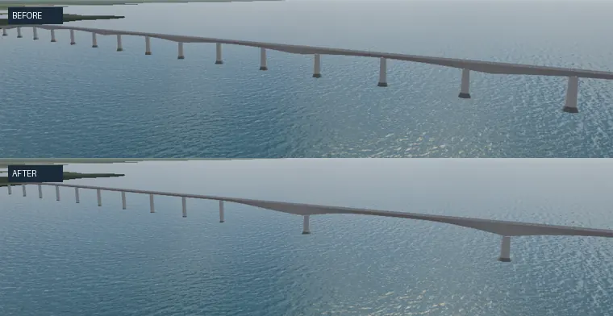

# Confederation Bridge approach and span geometry

The original road centreline and approximate deck elevations are unchanged.
Previously, a single repeat anchored to the central channel misplaced the last
New Brunswick main supports and continued the deep-haunched silhouette across
short approach spans. The renderer now distinguishes numbered main supports
from the approaches. The deeper main girder meets each shaft at its station.
The approach girders are shallower and are carried on distinct pier and
ice-shield meshes.

Eight published pier coordinates are projected onto the existing centreline.
Before this change, the nearest rendered support to P42, P43 and P44 missed
their along-line locations by approximately 14 m, 40 m and 18 m. All eight
controls are now used at their projected stations, rounded to two decimal
places in the test fixture. Their original lateral residual is under 0.95 m;
no lateral shifts were applied. The channel midpoint remains within 0.01 m
of the existing navigation crest station.

There are 44 main and 21 approach supports. The unsurveyed main stations are
interpolated between controls and stepped by the nominal span length beyond
P3. Transition lengths and unmeasured approach positions are approximate.
The physical deck clearance, below-water footing meshes and bridge contact
are not simulated. This model is not suitable for navigation or engineering.

## Reference and reproduction

- [Transport Canada TP 13681, sections 3 and 7](https://tc.canada.ca/en/marine-transportation/publications/tp-13681-guidelines-navigation-under-confederation-bridge-04-2025)
  for the eight control points and support labels.
- [Full-scale structural study, section 2](https://www.intechopen.com/chapters/38200)
  for the deck width, girder depths, and approach/main/transition spans.
- [Project scour design paper, Figure 2](https://www.issmge.org/uploads/publications/108/110/Confederation_Bridge_-_New_Scour_Design_Methodology_for_Complex_Materials.pdf)
  for visible support silhouette references.
- [Quintin Soloviev's July 2025 aerial photograph, CC BY 4.0](https://commons.wikimedia.org/wiki/File:Confederation_Bridge_aerial_view_(from_PEI_side).jpg)
  for a qualitative visual check. Its pixels are not part of the simulator.
  The captures compare simulator to simulator, not precisely registered to that photo.

Run `npm run check`, `node tools/verify-world.mjs`, then
`python tools/qa/bridge-poses.py --checkout . --out /tmp/pei-bridge-after --chromium CHROMIUM`.
For the reference frame, pass a separate checkout at `323f090` and keep this
same capture script. The paired views run the full Three.js scene with the
same pose and water phase. Rendering diagnostics add two draws and 1,584
triangles at the New Brunswick approach and navigation span.
