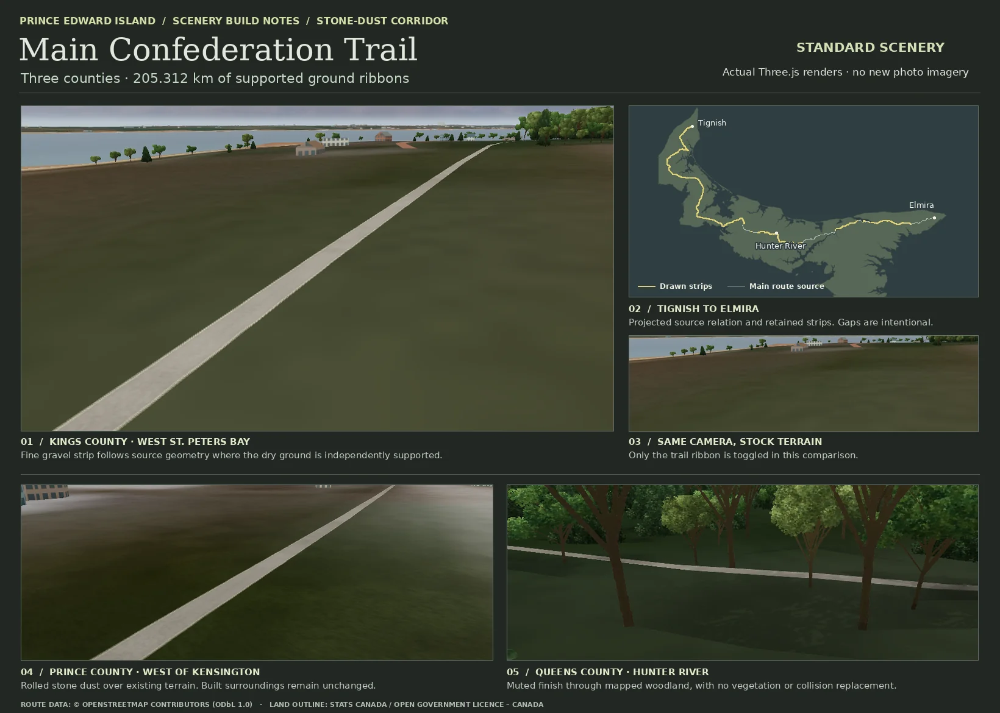
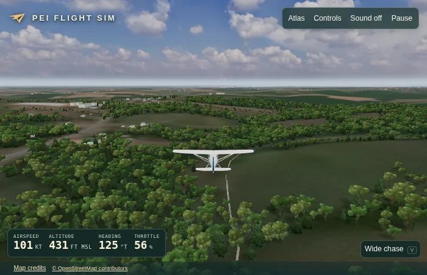

# Main Confederation Trail | Standard scenery

Standard scenery adds a mapped stone-dust ground ribbon in Prince, Queens and Kings Counties. Choose **Hunter River · Confederation Trail pass** in Dispatch, then use the Wide chase camera (press V twice) to look below the aircraft. It is a virtual sightseeing preset, not an aviation or cycling route. `?stockConfederationTrail` restores the unmodified comparison.



## Scope

The [Province's trail overview](https://www.princeedwardisland.ca/en/information/tourism-pei/hiking-and-cycling-on-the-confederation-trail) describes the former railway from Tignish to Elmira, approximately 273 km on the main line, with rolled stone dust. Only the independently supported ground subset is drawn. Branches, unsigned/unknown surface, asphalt, explicit access exclusions in this dated source, bridge or elevated works, unresolved wetland, crossings, and the unverified strings between eligible places are not reconstructed. There are no added signs, ditches, rails, trees, road grades, flight paths or collision changes; land and vegetation keep their existing owners.

| Main route input or release | Amount |
| --- | ---: |
| [OpenStreetMap main relation](https://www.openstreetmap.org/relation/4740520), version 61 | 109 ways / 273.318 km |
| After positive surface and ground/access tags, before geography | 61 ways / 214.280 km |
| After exact obstacle and conservative whole-strip land/wetland qualification | **60 ways / 205.312 km** |
| Active source tags: compacted / fine gravel | 161.193 km / 44.119 km |
| Explicit 2 m width, after clipping | 4.447 km |
| No explicit width: nominal 2 m visual strip | 200.865 km |

The retained projected lengths are 124.160 km in Prince, 39.321 km in Queens, and 41.831 km in Kings, as independently checked from the [public county geometry and compiled route](confederation-trail/independent-compiled-counties.json). The unrendered portions are unknown or protected, not claims about the real trail. For example, the named Hunter River bridge is held; a positive Kings shoreline stretch does not imply the village or its connection has been released. The 2 m nominal width is authorship, not a measurement of the right-of-way. Source metres are approximate scene metres.

## Rendering and fail-closed controls

- The [ODbL derivative](../../data/odbl/confederation-trail/) carries exact IDs, version, widths, centimetre cross-sections and a reproducible eligibility receipt. It ships independently of terrain or other map layers. There is no external map request or copied material.
- The 25,034-byte compressed atlas has 304 projected tiles, 505 paths and 3,646 sections. A firm header/byte limit and wire/decoded digest gate protect the optional loader, including HTTP-decoded gzip serving. Mode, scenery data, cover, runway and independently measured coastal terrain are checked before installation. Dispatch has no request; the archive is requested at most once after flight begins and the camera approaches at low altitude.
- Candidate strips are clipped against actual rendered road rectangles, registered building footprints, the decoded sidewalk and parking geometries, runway envelopes and other ribbons. The full encoded footprint is qualified against signed nearby Cover interpolation support and wetland/class restrictions. Once moved to the runtime, local irregular/retuned terrain and failed land checks still block seating.
- Miter sections are quantized once and shared at tile boundaries. Actual caps split on the existing nested regular 112/56/8 terrain facets. They refit to visual terrain only, with 20–33 mm of decorative separation for depth precision. No side walls, curb, terrain displacement, or collision rewiring.
- The original shader distinguishes the two dated surface tags visually with a muted aggregate finish, irregular soft edges, weathering and distance-filtered microdetail. The broad woodland response matches the pinned land-cover classification rather than claiming individual tree shadows. It uses no new imagery. Runtime caps resident tiles at 12, builds or refits at most one per frame, and fades the narrow strip at distance/height. The full decoded atlas emits 23,656 guarded terrain-conforming triangles before scene culling; no supported device frame rate is claimed.

## Verification

Independent checks compared all 3,141 emitted plan-view polygons against the protected atlas features, with zero overlap. The decoded route matches the complete licensed database; all 300 cross-tile seam pairs agree and maximum deviation of a packed center from the input centerline is 0.012 m. That is a storage/alignment bound in the simulator, not the accuracy of the OSM geometry or terrain. See the [independent static receipt](confederation-trail/independent-final-capsule.json). The [independent runtime receipt](confederation-trail/independent-standard-runtime.json) records 73 actual ground ray checks, 33 unchanged contact samples, and nine matching flight traces across the three county fixtures.

```sh
npm test
npm run build
python tools/qa/confederation-trail.py --out /tmp/pei-trail --chromium /path/to/chromium
python tools/qa/confederation-trail-player.py --dist dist --out /tmp/pei-trail-player --chromium /path/to/chromium
```

The fixed-camera test runs directly through the local Three.js Standard world and changes only visibility for the exact same-frame A/B. Its full-footprint ID is deliberately solid while the actual appearance has feathered coverage. The compiled player test uses Dispatch, flight-control camera changes and Escape pause without overriding physics or camera. Their captured states are not field observations or actual driving instructions.

### Actual Standard captures

| Camera | Changed pixels | Outside one-pixel route ID |
| --- | ---: | ---: |
| West of Kensington, Prince | 29,972 | 0 |
| Hunter River, Queens | 7,245 | 0 |
| West St. Peters Bay, Kings | 27,227 | 0 |
| Hunter River, 105 m camera | 846 | 0 |

At every positive pose, restoring the route re-created its exact first RGB frame. The independent footprint check is separate from these actual frame comparisons. The compiled app also completed a real 171.510 m segment from the named Hunter River dispatch start, switched input-driven cameras, and paused successfully. The same departure without the layer completed 170.912 m with no trail request; corrupt bytes were rejected and the aircraft still advanced 167.325 m and paused. The 520 m camera control requested no trail and matched stock. Independent three-county comparisons and a five-stage loading/eviction/visibility replay passed; see the [independent lifecycle receipt](confederation-trail/independent-standard-lifecycle.json).



© [OpenStreetMap contributors](https://www.openstreetmap.org/copyright), [ODbL 1.0](https://opendatacommons.org/licenses/odbl/1-0/). See the [world credits](../WORLD.md) for the rest of the atlas.

The [matched canvas-opacity check](path-coverage-alpha.md) measures a
separate correction to coverage without changing mapped Trail geometry.
