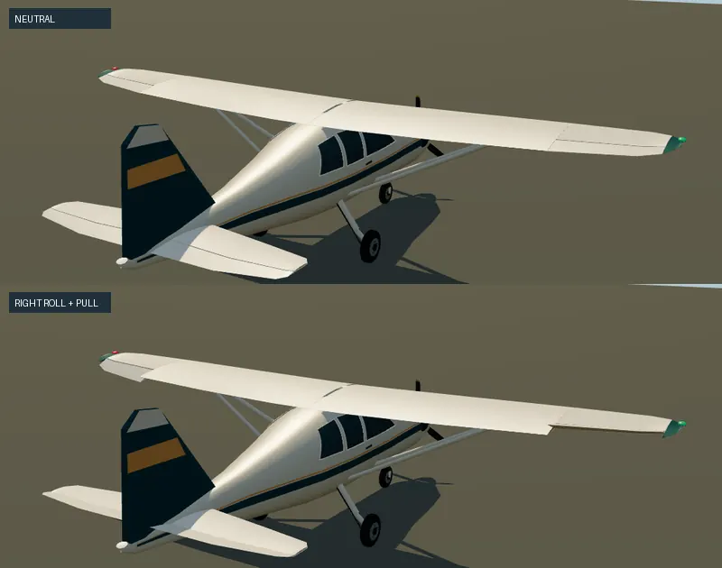
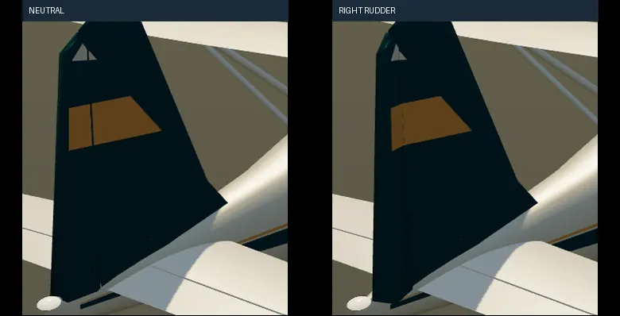

# Moving ailerons and elevators

The fictional survey aircraft's ailerons and elevators were previously part
of the fixed wing and tail geometry. They now have separate original skins
which turn about local hinge axes. Right roll raises the starboard aileron
while lowering the port side; the elevators move together when pulling or
pushing. Deflections ease into the commanded pose and back to neutral. Motion
stays still while paused. This is visual feedback, not a change to flight
forces, a replica of a particular aircraft or an animation of the rudder.

## Checks

Run `npm run check`; check neutral, right-pull and left-push in the Three.js
fixture using `tools/qa/control-surfaces.py` against the dev server. The
full-command checks reached the prescribed ±16–21° aileron and ±19° elevator
ranges, within 0.01°. Exact cockpit eye point and dials did not change.

Run `python tools/qa/control-player.py --dist dist --chromium CHROMIUM`
to verify that the normal build's keyboard input moves these surfaces and
that release brings them back to neutral.

## Vertical tail

The vertical stabilizer keeps its original outline. A closed aft shell now
turns about its hinge axis with yaw input, and the paint moves with the shell.
`tools/qa/rudder-views.py` checks neutral and both commands in the Three.js
fixture. Full right and left commands settle to ±22° within 0.01°. The
production control test also uses **E** and verifies the rudder's return
to neutral after release. This pass does not change yaw forces or establish
the throw on a specific real aircraft.
