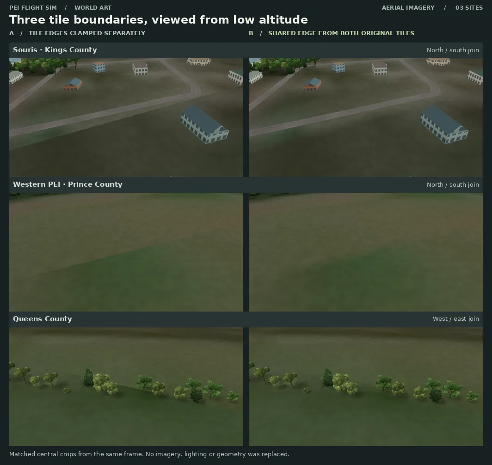

# Three field and town imagery joins in Standard

A straight line used to cross the grass near Souris, one open field in western PEI, and a tree line in Queens County. The lines followed the satellite-image tile grid, not an edge in the terrain. Close to each of these boundaries, Standard now blends between the existing pixels on both sides rather than clamping each tile to its last pixel.



| Look at | Approximate latitude, longitude | Image tiles |
| --- | --- | --- |
| Souris, Kings County | 46.361818, −62.281606 | 27-13 / 27-14 (rows) |
| Western PEI, Prince County | 46.941818, −64.017376 | 5-2 / 5-3 (rows) |
| Queens County | 46.440085, −63.596875 | 10-12 / 11-12 (columns) |

The positions identify the scenery in the simulator, not new Dispatch departures or navigation fixes. The source is the simulator's [2025 Copernicus Sentinel mosaic](../WORLD.md). There is no new photography, added spatial resolution, moved terrain, denser building geometry, or change to aircraft contact.

### What changes in flight

- In normal Standard, these three pairs and the older [Tracadie Bay pair](tracadie-aerial-join.md) are enabled independently. `?stockCountyOrtho` restores the three older edges without turning off Tracadie, marsh grass or the forest floor. `?stockTracadieOrtho` restores Tracadie without turning off these three. Combine the two flags to restore all four.
- Two original textures must match their pinned SHA-256 values and both be resident, uploaded and fully faded into the near terrain. The renderer copies two rows or columns from each into one temporary four-pixel-wide strip. If a peer is missing or corrupt, or the GPU copy fails, the renderer keeps the normal tile behaviour. An active pair uses 10,240 bytes of base-level RGBA strip storage. There is no extra imagery request, draw call or mesh.
- Sampling is confined to within 1.25 source texels on either side of the join, avoids corners, and fades for unresolved image detail. The distance fade begins at 205 m and reaches zero at 330 m from the eye. The original [explicit study](orthophoto-edge-study.md) keeps its previous footprint-based fade; the Detail setting is unchanged.

### In-engine results

The same-frame test reversed the source-strip gain without moving the camera, compared every RGB pixel, and measured the colour difference immediately across the boundary. It used the actual Standard terrain and textures, a fixed 840 × 540 viewport and two viewing directions at each site. Smaller numbers mean the artificial line is less visible.

| Location | Median cross-line colour step, first view | Median, reverse view |
| --- | ---: | ---: |
| Souris | 25.51 → 2.09 | 25.96 → 2.24 |
| Western PEI | 10.94 → 1.09 | 12.09 → 1.23 |
| Queens County | 8.33 → 1.04 | 13.51 → 1.59 |

The 90th percentile also fell at all six views. No changed RGB pixel fell outside the exact two-colour shader mask. All three high views at 380 m above the focal terrain remained byte-identical with both source tiles and their strip still resident. Draw and triangle counts matched when flipping the correction in every view. The counts are renderer evidence, not a hardware frame-rate benchmark.

[Native frame metrics, original PNG hashes and camera controls](county-aerial-joins/rendered-standard.json) · [Reference shader checks](county-aerial-joins/shader-scope.json) · [Independent linked WebGL sampler census](county-aerial-joins/independent-standard-land-linked-census.json)

In the compiled build, four flights from the existing Souris waterfront
departure travelled 132–135 m, entered Cockpit and paused successfully.
The standard build and each comparison used the same two world imagery
packs. With a byte of one source image altered, the corresponding tile
failed authentication, the pair allocated no strip, and the other imagery
and flight remained available. This verifies streaming from the departure;
the fixed cameras above show the actual tile boundaries.

[Packaged flight checks](county-aerial-joins/compiled-player.json) ·
[Independent switch screens](county-aerial-joins/comparison-switches.json)

From the repository root, after installing the locked dependencies and the Python packages Playwright, NumPy and Pillow:

```sh
npm run check
node tools/verify-world.mjs
python tools/qa/tracadie-frames.py --checkout . --cohort counties --out /tmp/pei-county-joins --chromium /path/to/chromium
python tools/qa/tracadie-frames.py --checkout . --cohort counties --views souris,prince,queens --stock --out /tmp/pei-county-stock --chromium /path/to/chromium
python tools/qa/tracadie-frames.py --checkout . --cohort counties --views souris --peer-stock --out /tmp/pei-county-peer --chromium /path/to/chromium
python tools/qa/tracadie-frames.py --checkout . --peer-stock --out /tmp/pei-tracadie-isolation --chromium /path/to/chromium
python tools/qa/county-aerial-joins-player.py --dist dist --out /tmp/pei-county-flight.json --chromium /path/to/chromium
```

The [two later inland source windows](inland-aerial-joins.md) are independent. Their `?stockInlandOrtho` comparison does not disable any of the three county joins above or the Tracadie Bay join.
