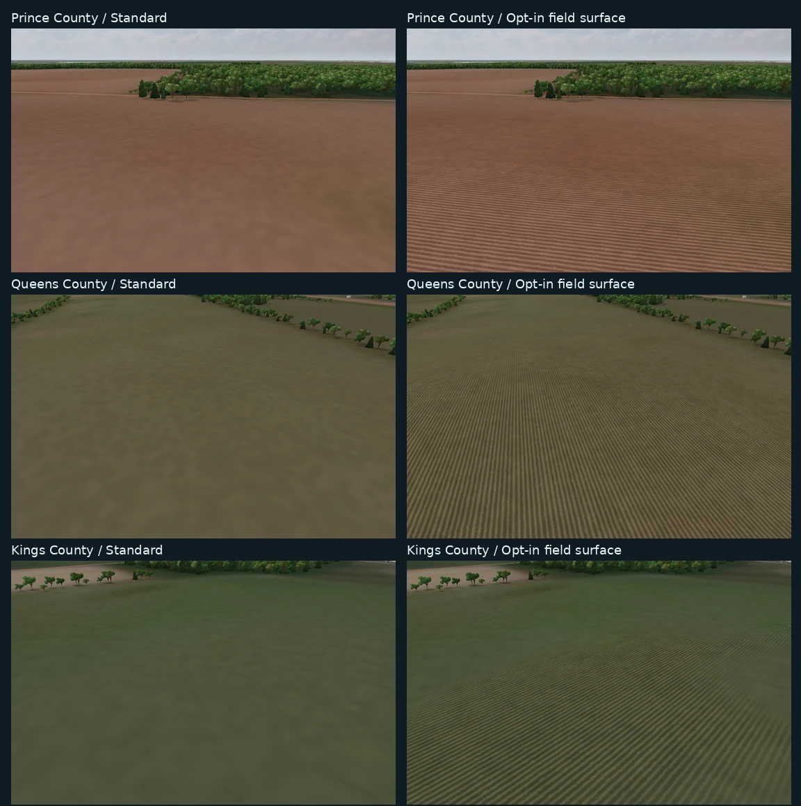

# Field surface preview: Prince, Queens and Kings

In Dispatch, open **Optional scenery studies**, select **Field surface
relief**, and choose **Apply studies**. The equivalent URL switch is
`?cropRowsReview`. Three named county field passes make it easy to
compare the original and detailed surfaces over the same ground. Standard stays unchanged. The preview adds furrow relief
and small soil variations to supported portions of five mapped field
outlines. It does not change terrain height, trees, property boundaries,
flight physics, roads or the areas outside the three preview windows.

| County | Approximate center (latitude, longitude) |
| --- | --- |
| Prince | 46.45306, −63.87186 |
| Queens | 46.36342, −63.50648 |
| Kings | 46.34532, −62.36842 |

## Geographic support, not a crop survey

Agriculture and Agri-Food Canada's [2023 automatically detected field boundaries](https://open.canada.ca/data/en/dataset/b3dba669-6611-4cb1-b4be-6c317b9908ad)
provide candidate field outlines. The [2025 Annual Crop Inventory](https://open.canada.ca/data/en/dataset/89073037-d2fc-4a6d-9ce9-f0b1bcb48745)
provides 30 m class-177 support, using the companion raster score. The two
years are deliberately separate. The pre-screen found 2,880 candidate
polygons; most are **not** in this preview. The mapped class covers more
land than Statistics Canada's [surveyed seeded acreage](https://www150.statcan.gc.ca/n1/daily-quotidien/260312/dq260312h-eng.htm).
Neither its area nor an individual classified pixel proves actual planting.
Row direction is authored from a candidate's long axis, not measured.
No claim is made about the crop, current planting, management or row
orientation on any property.

The landscape retains the underlying colour from the game mosaic.
[Poly Haven's Farm Furrows scan](https://polyhaven.com/a/farm_furrows) is
a generic CC0 surface reference, **not PEI imagery**. The preview packs a
neutral luminance ratio and tangent normals from the inner scanned surface;
it omits the photographed side boundaries to avoid repeating false tracks.

## Visual and technical boundaries

- All 12,916 positive texels' complete sampling support stays inside the
  admitted field and 2025 raster classes and the pinned dry cropland.
  Independently checked street, building, path, parking and runway
  clearances rule out those surfaces.
- Same-frame WebGL comparisons keep identical draw and triangle counts.
  Protected pixels stay byte-exact; the high-altitude control is identical
  everywhere. Six nearby camera positions repeat the isolation result.
  This is not a hardware frame-rate claim.
- The game accepts only verified compressed or independently verified
  browser-decoded assets, with terrain and cover checks. Absent, partial,
  wrong or timed-out inputs retain the old scene. Behind the switch,
  the three masks and scan cost about 155 kB transferred together.

[Compiled project-path flight checks](../../tools/qa/crop-preview-project-path.py)
cover no option, verified joint load, and missing scan. All three use
normal player controls and leave the scenery streams ready.

[Machine-readable checks and exact source digests](crop-preview-review.json).
For reproducing, see [the offline tools](../../tools/geodata/crop-preview/README.md).
Contains information licensed under the
[Open Government Licence – Canada](https://open.canada.ca/en/open-government-licence-canada).
