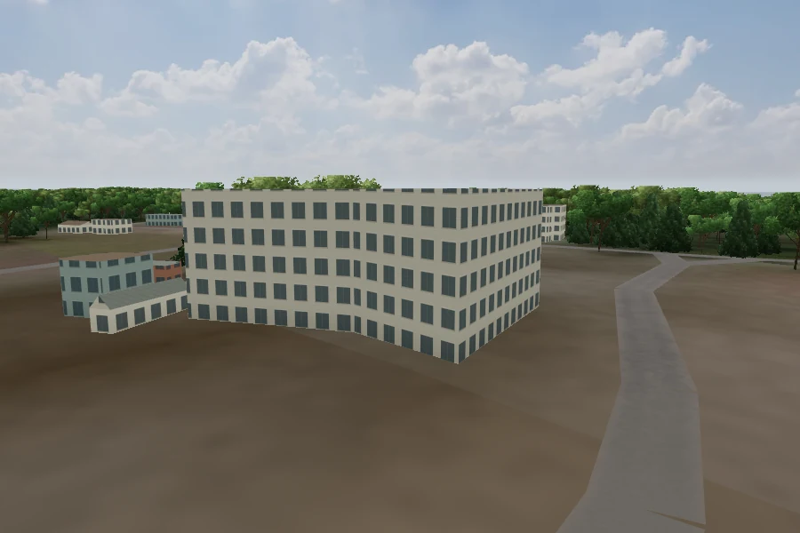
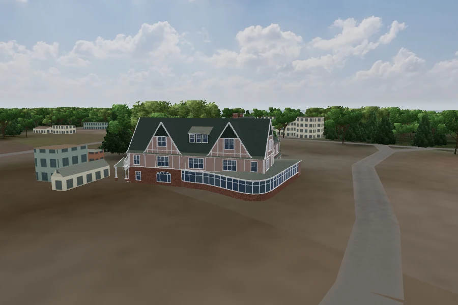

# Dalvay-by-the-Sea exterior study

Look across Dalvay Lake on the north shore of Prince Edward Island. The hotel has a long green roof and two flared gables facing the water. A lower, three-window dormer sits between them. Beneath the upper rooms, a masonry plinth follows the dining room around the lake-facing corner. The model uses recessed windowpanes, three-dimensional mullions and a green double entrance door; the roof, stone, timberwork and glazing are geometry and original materials, not photographs on a box.

## Fly the comparison

Start **Dalvay Lake coastal pass** with Standard scenery. Append `?departure=dalvay-lake-coastal-pass&dalvayExteriorStudy` to the game address for the manor and the ordinary lake. Append `&stockDalvayExterior` to the same address to restore the original building. The optional lake reflection preview has its own `dalvayWaterOptics` switch and is not required for the building. An ordinary launch without the study, an unsupported scenery profile, unverified data or loss of either original ground tile keeps the existing building.

## Matched view from the lawn

The game camera was locked before review. Both frames use the same original lake, terrain and trees. This camera is on the dry lawn, not over the lake.

| Stock building | Authored exterior preview |
| --- | --- |
|  |  |

## What informed the model

* [Parks Canada’s national designation](https://www.pc.gc.ca/apps/dfhd/page_nhs_eng.aspx?id=582) and [the federal heritage building record](https://www.pc.gc.ca/apps/dfhd/page_fhbro_eng.aspx?id=3242) informed the two-and-a-half-storey Queen Anne Revival massing and mixed masonry, upper wall finish, galleries and roof features. [The heritage character statement](https://parkscanadahistory.com/series/hcs/dalvay/dalvay-by-the-sea-hotel-e.pdf) identifies the principal northern approach and distinguishes later alterations.
* [Fralambert’s northwest exterior photograph, August 2010](https://commons.wikimedia.org/wiki/File:Dalvay-by-the-Sea.jpg) informed the principal facade, veranda, projecting upper bay and balcony. Six undated exterior views presented by the operator allowed the artist to distinguish the paired lake-facing gables, intervening dormer, continuous band of dining-room windows and north entrance. The views are one presentation, not six independent surveys. The [operator’s history](https://www.dalvaybythesea.com/history) dates the curved lakeside dining-room addition to 1999–2000.
* The inherited mapped footprint and both original terrain patches determine the game location and ground contact. Dimensions and minor architectural details are original visual estimates, not an as-built architectural or elevation survey. No source imagery was traced, used as surface texture or bundled. Interiors, exact window/pane counts, surveyed roof heights, the historic 1939 alteration and the contemporary grounds are not reconstructed.

## Cost and verification

The authenticated exterior is 504,132 compressed bytes (492.3 KiB), 24,853 triangles and five material batches. It suppresses only the original building’s 37 triangles; the other 241 footprints and their render attributes remain in place. All projected geometry stays inside the original 1,023.75 m² footprint. Surface contact was checked against actual submitted triangles on both adjacent terrain tiles, including all 27 curved plinth segments, 28 veranda piers and three entry treads. Those checks establish registration to the simulator, not a field survey. The asset is fetched on a qualifying local approach; it adds no collision, shoreline or gameplay surface.

Rebuild the signed packet with `node --experimental-strip-types tools/art/pack-dalvay-exterior.mjs /tmp/dalvay-rebuild` and compare it with `public/art/dalvay-manor-exterior-v2.dvx`. To inspect the actual submitted positions, index arrays, material ranges and transforms, run `node --experimental-strip-types tools/qa/dalvay-exterior/export-submitted.mjs /tmp/dalvay-geometry`.

The [independent visual review](dalvay-exterior/v2-independent-review.md) compares the formed roof and dining wing against held photographic references. The [eight native camera matches](dalvay-exterior/v2-independent-native.json) keep the old terrain, trees, and lake identical and record exact rollback. See the [original ground and footprint checks](dalvay-exterior/v2-independent-ground.json) for the documented scope. This is an architectural preview, not a photo-grade replica: the glazing, trim and surrounding estate are still simplified.

The [normal player check](dalvay-exterior/compiled-player.json) ran the public coastal departure without modified cameras or controls. It verified exact streamed asset bytes, return to the original building on an optional missing file, and no request when the study is explicitly disabled. Ordinary lake rendering stayed active in all three cases.
