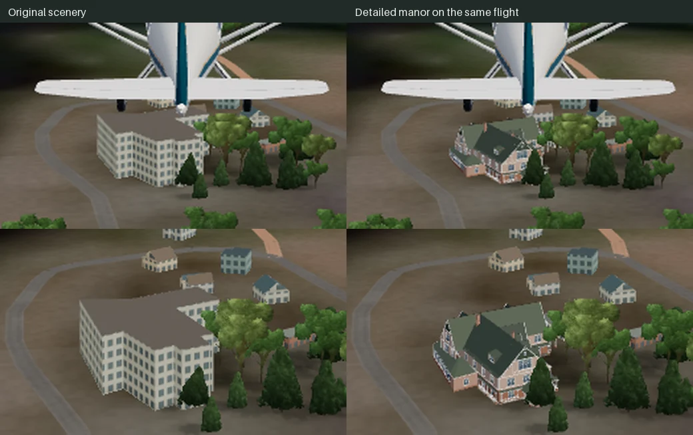

# Dalvay manor in Standard flight

Start **Dalvay Lake · coastal pass**. On the supported Standard route, the original green-gabled manor replaces the stock rectangular building on the approach. The independent lake effect remains off unless requested; the road, lawn, water, trees and other buildings keep their existing scene.

The [existing V2 model and source ledger](../dalvay-exterior.md) identify the roof, masonry, veranda and dining room references. This is the same signed 504,132-byte interpretation, not a new photogrammetric reconstruction or a building survey.

## Why this route qualifies

The ordinary Chase replay used the actual dispatch and flight simulation, without a fixed camera, position injection or altered clock. Two matched views changed 3,421 and 7,434 RGB pixels entirely within the physically projected manor geometry. Existing water and nearby scenery remained unchanged. The light, scene, and straight-ahead positions were held within each before/after pair. The two visible comparisons added five draws and 24,816 net triangles, replacing only the original 37-triangle manor record. Alpha and restoration were exact. When the house went out of frame, both pictures were byte-identical.

The tested cold start made no art request in Dispatch. Its first replacement occurred early in the ordinary flight, in a 15 × 7-pixel area (79 changed pixels at 780 × 500), before the manor occupied the close view. A missed or refused prep window keeps the old building. The effect is limited to this departure in Standard on the verified renderer, with the two original terrain receivers, exact signed asset and admitted material programs. It is not a guarantee of frame rate, no loading hitch, or similarity from every other direction.

Append `?departure=dalvay-lake-coastal-pass&stockDalvayExterior` for the original building. Detail, an unsupported renderer, nonlocal departures and refused sources keep stock. The old explicit exterior and separate lake-study configurations retain their own admission rules.

[Native flight, classifying the scope, cold entry and fallback results](standard-route-receipt.json)
