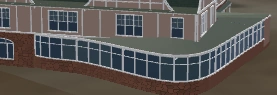
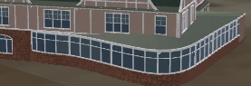

# Dalvay manor: glazing study

This optional Three.js finish changes the original glazing batch on the authored Dalvay-by-the-Sea exterior. It leaves the panes, mullions, roof and other mesh geometry where they were. The same terrain, lake switch and contact surfaces remain in use.

- Start with `?departure=dalvay-lake-coastal-pass&dalvayExteriorStudy&dalvayGlazingStudy` in Standard scenery.
- Add `&stockDalvayGlazing` to compare the original panes without disabling the manor or changing the lake setting.
- The finish returns to the original pane material if a matching authenticated panorama or supported viewing setup is unavailable.

## What the change does

The finish applies a restrained angle-dependent response with near-camera and pixel-footprint guards. For a reflected direction above the horizon, it can sample the simulator's existing authenticated CC0 maritime panorama. It does not add an environment image, scene render, cabin interior, or reflection of terrain and objects. For reflected directions below the horizon it uses a neutral ambient response instead. This is authored glass, not a measurement of the real window panes or a claim of photorealism.

That distinction matters in flight: from the registered lawn, northwest and near approach views the raised camera sees mostly the softened below-horizon appearance, not clouds. The far opposite-bank view has only a small upward component. The dark pane color, modeled glazing bars and load arrangements are kept independently.

## Engineering checks

The optical preview is confined to the original fifth material batch on the certified exterior. The original mask, triangle counts, depth behavior and scene remain unchanged. In the pinned Three.js renderer the shader's uniform record is associated with its material. To avoid leaving the wrong texture binding when switching from original back to the optical shader, only that material's program is invalidated at an eligibility change, never during steady rendering.

## Matched pane detail

Both images use the same 1:1 crop of the same registered simulator camera. The before/after framing and color conversion are identical.

| Original panes | Optional glazing |
| --- | --- |
|  |  |

The nearest locked view changed 3,294 independently identified clear dining-wing pixels by more than two RGB levels, with no new clipped pixels. The farthest view stayed identical at this resolution. Across all four locked views, 2,127,492 exterior pixels beyond the conservative true-glazing margin were untouched. Gate transitions and eight steady repeat draws introduce no extra draw calls, asset requests or texture allocations in these tests.

The separate same-location eye-level test also did **not** justify a visible-cloud claim: substituting the authentic sky sample for neutral changed no pane pixel by more than two RGB levels there. A detached WebGL control with the same shader and authenticated sky demonstrated actual sample routing for a fixed upward reflected ray, and no sky contribution for the below-horizon and near-clip controls. This demonstrates a narrow part of the shader, not how the real windows look.

[Independent verification](dalvay-exterior/glazing/README.md) separates the four in-world captures, the technical sky control, and ordinary player tests. It checks the no-option path, explicit glass veto and fallback to the original panes after an unverified panorama.
