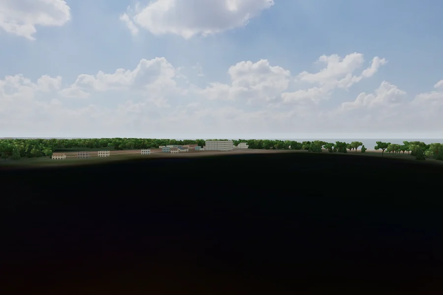

# Dalvay Lake optical preview

This optional Three.js preview changes the appearance of the verified interior of Dalvay Lake. It adds directional surface ripples and Fresnel reflection of the simulator's existing sky, without replacing a single terrain triangle. The surrounding cover, shore, buildings and flight model stay as they were. This is not a new water level, a modern shoreline survey, object reflections, or a changed collision surface.

- Enable: `?departure=dalvay-lake-coastal-pass&dalvayWaterOptics` in Standard scenery.
- Compare at the same departure: `?departure=dalvay-lake-coastal-pass&dalvayWaterOptics&stockDalvayWaterOptics`. Leaving the option absent keeps the stock renderer and makes no preview asset requests.
- The option stays off on an unrecognized terrain, an unreadable asset or an unexpected ground material.

## What the sources support

The [National Hydro Network](https://open.canada.ca/data/dataset/a4b190fe-e090-4e6d-881e-b87956c07977) supplies Dalvay Lake polygon `dc8e389aae854b958fc06b02e2b9b011` (validity 1987) and is available under the [Open Government Licence – Canada](https://open.canada.ca/en/open-government-licence-canada). [ESA WorldCover 2021 v200](https://doi.org/10.5281/zenodo.7254221), cell class 80 (permanent water), independently fences the modern satellite classification at its native 10 m resolution. The game does not ship or project source imagery. © ESA WorldCover project 2021 / Contains modified Copernicus Sentinel data (2021) processed by ESA WorldCover consortium ([CC BY 4.0](https://creativecommons.org/licenses/by/4.0/)).

The selected lake polygon is eroded by 12 m. Each 4 m mask cell passes only if all four corners fall inside the eroded polygon and every associated 3×3 source pixel neighborhood is classified as water. The kept component is connected, covers 131,360 m², and feathers inward before the geometric boundary. Bilinear support stays inside the conservative fence. This method excludes uncertain shoreline rather than colouring all water around it.

A separate attempt to estimate a water elevation found only 48 m² of conservative overlap between two original lidar passes against a preregistered 5,000 m² requirement. It stays on hold. No unknown lidar elevation, depth or revised contact surface entered this asset.

## Asset and rollback

The in-app preview fetches one local 1,091-byte mask only after verifying the exact atlas and both eligible original terrain owners. The opaque `.dlb` suffix prevents servers from implicitly removing the internal gzip encoding before its packed SHA-256 can be verified. The renderer checks both packed and decoded bytes before allocating a texture. If either owner withdraws, both original shader and uniform sets are restored.

- Packed SHA-256: `149ee965bc52ca42e75f506a5f688dd9b3f2420264ff427c5c23e7496d190f56`
- Unpacked SHA-256: `104b60f2dfc6d0f299a7fcff0169992f5d9c51a03b7dfbfdb81ad85b871fa139`

## Matched views

These are registered Three.js captures from the opposite bank, not photographs. The old manor and surroundings are unchanged in this preview.

| Standard terrain | Standard with the lake preview |
| --- | --- |
|  |  |

At an extreme grazing terrain edge, multisample interpolation could evaluate ordinary world coordinates beyond a triangle. The preview now uses a covered centroid for its own position, leaving the original atmosphere, lighting and terrain shader inputs alone. Its height guard uses the existing drawn game geometry only. It makes no assertion about Dalvay Lake's actual height.

Rebuild the opaque mask with `tools/geodata/rebuild-dalvay-lake-optics.py`, using the original [NHN 01CC000 archive](https://ftp.maps.canada.ca/pub/nrcan_rncan/vector/geobase_nhn_rhn/shp_en/01/nhn_rhn_01cc000_shp_en.zip) and [WorldCover N45W066 COG](https://esa-worldcover.s3.eu-central-1.amazonaws.com/v200/2021/map/ESA_WorldCover_10m_2021_v200_N45W066_Map.tif). The rebuilder checks source and decoded payload hashes rather than accepting updated source bytes silently.

## Verification

[Independent pixel coverage](dalvay-lake-optics/independent-views.json) checks three fixed views against the entire physical source footprint and a two-pixel antialiasing margin. Across the three frames, all 1,160,482 exterior pixels stayed byte-identical. The lake effect redraws the same terrain with the same triangle and draw-call counts. It restores the original shader and uniforms when either eligible tile is no longer present.

The [route check](dalvay-lake-optics/independent-route.json) starts above the Gulf, reaches the mapped estate, then crosses the named lake. Under stock inputs and wind, the sampled route crosses 102.78 m of the historical lake outline, 37.90 m of the registered mask and 33.24 m that passes all of the shader’s optical thresholds. This flight path is for sightseeing in the simulator, not real-world navigation.

The [compiled-game flight check](dalvay-lake-optics/compiled-flight.json) flew 1.77 km from the new departure and verified the cockpit, wide chase and pause controls. A deliberate missing-mask response left stock scenery working; the explicit stock comparison requested neither the preview module nor its mask.
