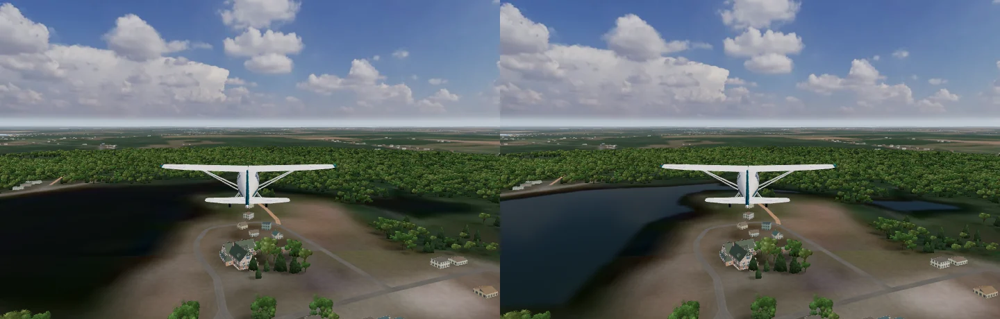
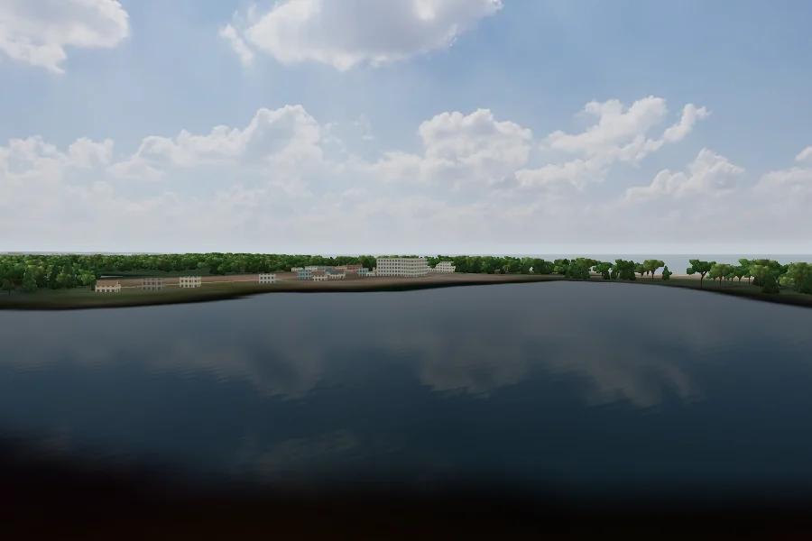

# Dalvay Lake reflections

In **Standard** scenery, choose **Dalvay Lake · coastal pass**. Wait for **Dalvay Lake reflections ready** before pressing **Begin flight**. From the Chase camera, sky reflections and directional ripples become visible on the approach to the lake. The treatment fades in between about 1.2 km and 900 m from the camera, on signed interior water only. No new water elevation, shoreline, collision surface, or object reflections are implied.

- Compare with `?departure=dalvay-lake-coastal-pass&stockDalvayWaterOptics` for the original water without disabling the detailed manor.
- `?departure=dalvay-lake-coastal-pass&stockDalvayExterior` keeps the lake treatment available but uses the stock building.
- `?departure=dalvay-lake-coastal-pass&dalvayWaterOptics` retains the older explicit water-only study. Other departures do not request the default lake mask.

Start immediately if you prefer: beginning before readiness, or failing verification, leaves the stock lake for the whole flight. This does not change the aircraft, route or ground contact.

## What the sources support

The [National Hydro Network](https://open.canada.ca/data/dataset/a4b190fe-e090-4e6d-881e-b87956c07977) supplies Dalvay Lake polygon `dc8e389aae854b958fc06b02e2b9b011` (validity 1987) and is available under the [Open Government Licence – Canada](https://open.canada.ca/en/open-government-licence-canada). [ESA WorldCover 2021 v200](https://doi.org/10.5281/zenodo.7254221), cell class 80 (permanent water), independently fences the modern satellite classification at its native 10 m resolution. The game does not ship or project source imagery. © ESA WorldCover project 2021 / Contains modified Copernicus Sentinel data (2021) processed by ESA WorldCover consortium ([CC BY 4.0](https://creativecommons.org/licenses/by/4.0/)).

The selected lake polygon is eroded by 12 m. Each 4 m mask cell passes only if all four corners fall inside the eroded polygon and every associated 3×3 source pixel neighborhood is classified as water. The kept component is connected, covers 131,360 m², and feathers inward before the geometric boundary. Bilinear support stays inside the conservative fence. This method excludes uncertain shoreline rather than colouring all water around it.

A separate attempt to estimate a water elevation found only 48 m² of conservative overlap between two original lidar passes against a preregistered 5,000 m² requirement. It stays on hold. No unknown lidar elevation, depth or revised contact surface entered this asset.

## Asset and rollback

The ordinary departure and explicit study both use the same 1,091-byte mask, fetched only after verifying the exact atlas and both eligible original terrain owners. Standard links a detached shader variant for each of the two original N112 terrain meshes. It borrows their existing lighting and time uniforms and restores both original materials after each draw. It withdraws for the rest of the flight if either original receiver becomes ineligible. The opaque `.dlb` suffix prevents servers from implicitly removing the internal gzip encoding before its packed SHA-256 can be verified. The renderer checks both packed and decoded bytes before allocating a texture. If either owner withdraws, both original shader and uniform sets are restored.

- Packed SHA-256: `149ee965bc52ca42e75f506a5f688dd9b3f2420264ff427c5c23e7496d190f56`
- Unpacked SHA-256: `104b60f2dfc6d0f299a7fcff0169992f5d9c51a03b7dfbfdb81ad85b871fa139`

## Standard flight comparison

The pictures are two draws from the same live Chase frame, with the authored manor unchanged. The [native flight receipt](dalvay-lake-optics/standard-flight.json) records the same-frame stock, reflection and restored draws, including the original terrain and camera transforms. Three close samples at 900 × 570 changed 30,390, 52,810 and 52,385 pixels by more than two RGB codes. The departure and late sample were byte-identical. The independent pixel projection found no change outside the signed water support, no alpha change, and identical draw and triangle counts; the separate unaltered-clock run checked the lake with the authored manor loaded. These are visual isolation checks, not device performance measurements.

## Original water-only study

These are registered Three.js captures from the older explicit study on the opposite bank, not photographs. The stock manor and surroundings are unchanged in these images.

| Standard terrain | Standard with the lake preview |
| --- | --- |
|  |  |

At an extreme grazing terrain edge, multisample interpolation could evaluate ordinary world coordinates beyond a triangle. The preview now uses a covered centroid for its own position, leaving the original atmosphere, lighting and terrain shader inputs alone. Its height guard uses the existing drawn game geometry only. It makes no assertion about Dalvay Lake's actual height.

Rebuild the opaque mask with `tools/geodata/rebuild-dalvay-lake-optics.py`, using the original [NHN 01CC000 archive](https://ftp.maps.canada.ca/pub/nrcan_rncan/vector/geobase_nhn_rhn/shp_en/01/nhn_rhn_01cc000_shp_en.zip) and [WorldCover N45W066 COG](https://esa-worldcover.s3.eu-central-1.amazonaws.com/v200/2021/map/ESA_WorldCover_10m_2021_v200_N45W066_Map.tif). The rebuilder checks source and decoded payload hashes rather than accepting updated source bytes silently.

## Earlier explicit-study verification

[Independent pixel coverage](dalvay-lake-optics/independent-views.json) checks three fixed views against the entire physical source footprint and a two-pixel antialiasing margin. Across the three frames, all 1,160,482 exterior pixels stayed byte-identical. The lake effect redraws the same terrain with the same triangle and draw-call counts. It restores the original shader and uniforms when either eligible tile is no longer present.

The [route check](dalvay-lake-optics/independent-route.json) starts above the Gulf, reaches the mapped estate, then crosses the named lake. Under stock inputs and wind, the sampled route crosses 102.78 m of the historical lake outline, 37.90 m of the registered mask and 33.24 m that passes all of the shader’s optical thresholds. This flight path is for sightseeing in the simulator, not real-world navigation.

The [compiled-game flight check](dalvay-lake-optics/compiled-flight.json) flew 1.77 km from the new departure and verified the cockpit, wide chase and pause controls. A deliberate missing-mask response left stock scenery working; the explicit stock comparison requested neither the preview module nor its mask.
