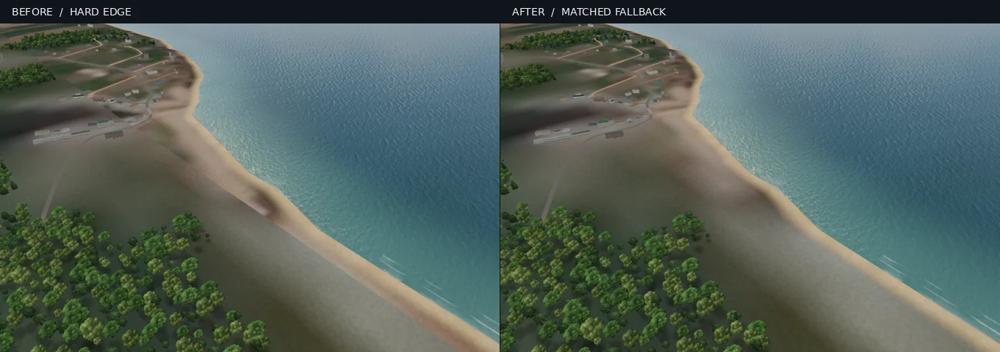

# Aerial imagery: fallback without a hard tile edge

The simulator streams the 10 m Sentinel-2 colour tiles over a lower-resolution
province-wide atlas. Previously, one ready tile would replace its whole
rectangle immediately, even if the next tile timed out or had not arrived.
That could draw an artificial straight line through fields and shore.

The two image layers now meet on the same base atlas at a loaded/unloaded
border. The ready tile returns to full detail within 72 m; a newly decoded
image fades in over 380 ms. All four cardinal and all four diagonal readiness
states constrain the feather around shared corners. Both sides therefore use
the same blend amount on a shared edge, including during an uneven arrival.
Where all relevant images are ready the existing imagery remains unchanged.
No new imagery, geometry, coastline, flight contact, requests or draws are
added by the transition. There is one additional image sample only for a
pixel actively blending the images. The existing long-range texture release
policy is unchanged.

## Render check

The matched Three.js flight views below are locked over the border between
detail tiles 25-11 and 25-12. The QA server omits the same tile in both
mixed runs and compares original and new shader output. It also runs the
same camera again with the complete catalog.



- With both tiles settled, **all 476,000 RGB pixels** matched.
- In the mixed case, **29,441 pixels** changed by more than two RGB levels.
  Outside the rendered transition mask with a 3-pixel antialias/foliage
  allowance, **427,195 pixels** matched exactly.
- Both cases used 22 draws and 283,635 submitted triangles. This is an
  optical scope check, not a GPU latency benchmark.
- This fix addresses transitions between streaming resolutions. It does
  not retouch the captured colours, resurvey the shoreline, or claim
  that all discontinuities between the original satellite acquisitions
  are gone.

```sh
python tools/qa/detail-boundary-frames.py --base /path/to/pre-change-checkout \
  --checkout . --chromium /path/to/chromium --out /tmp/pei-detail-boundary
npm run check
```
