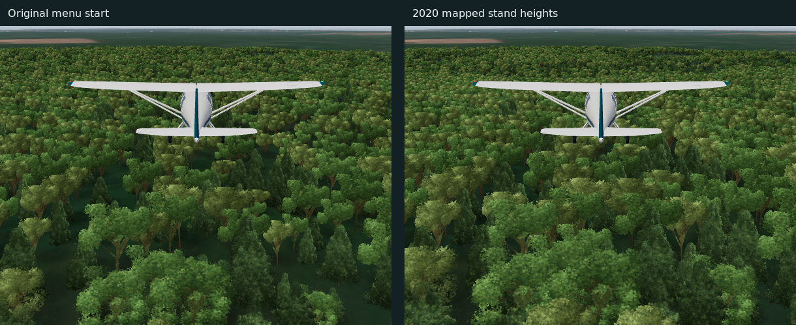

# Mapped woodland heights from the Kings County departure menu

In Standard, choose **Kings County · inland meadow pass** from the departure
menu. If the panel says “Survey-based woodland sizes ready” before **Begin flight**,
the nearby trees use the dated mapped stand heights as soon as the flight
starts. Starting while the source is still being checked uses the original sizes
for the already cached trees. This menu preflight will not resize them later;
ordinary streaming still applies to new, uncached areas. Missing, altered,
or unsupported data and the 0× antialiasing profile retain the original launch. Use `?stockDispatchWoodland` for the previous menu-launch
behavior; this does not turn off the province’s established woodland stream.



## What changed

This restores signed dimensions on one verified segment of the existing
woodland renderer. An older path already warmed the correct regional stand
tiles for bookmarked departures. The normal in-game menu could build and
keep the same tree slots with fallback heights before the tile finished
loading. The revised menu preflight applies the ready sizes at Begin, not
to the Dispatch backdrop or late to an existing flight. Bookmarks, other
departures, Detail and explicit studies keep their prior behavior.

No new trees were placed. The existing inferred positions constrained by
mapped land cover, terrain, canopy art, forest shade policy, roads, contact,
and flight model remain. Existing foreground tree proportions and shade support follow the
same stock height-to-width function; there is no new model, texture, shader,
draw, or network request. Trees already expanded by ordinary streaming away
from this launch remain under the existing scheme.

## Source

Contains information licensed under the [Open Government Licence –
Prince Edward Island](https://www.princeedwardisland.ca/en/information/finance/open-government-licence-prince-edward-island).
The provincial **Enhanced Forest Inventory 2020** ([official catalogue](https://data-princeedwardisland-peigov.hub.arcgis.com/datasets/8a7638bdc09648358e0b6fd14be6117a))
combines airborne and field inventory in a 20 m source grid. It estimates
stand-level dominant and co-dominant tree heights, not surveyed positions,
heights or species for individual rendered trees. It is not a current
vegetation or flight-clearance inventory. See [existing archive provenance](forest-height-stream.md).

Only the already shipped height tile **28-12** participates in this menu
cohort. The exact stored range is 52,460 bytes at offsets 478492–530951
inclusive in `heights-03.pack`; 104,976 decoded bytes, SHA-256
`b97ea5e14d74ddd8cedb900f41d717e592761c63e1131ed8a5895eaebf106171`.
The departure itself begins in tile 27-12; the positive camera view is
toward 28-12, not evidence for modifying 27-12.

## Render check

Matched Standard 1,200 × 760 draws used the ordinary stock WebGL context
with 4× coverage and the same actual camera, renderer and neutral flight
controls at each checkpoint. The comparison
uses real flight updates with the test capturing fewer frames between
checkpoints; it is not a frame-rate benchmark. Both original geometry and
new shade/crown coverage were marked separately in diagnostic draws. Stock
and survey-dimension images used the unmodified shaders.

| Genuine Chase checkpoint | Rescaled original slots | Pixels >2 RGB codes | Exact changes outside the two canopy/shade roles | Alpha differences |
| --- | ---: | ---: | ---: | ---: |
| First frame (n1) | 9,926 | 63,208 | 0 | 0 |
| About 6 seconds (n180) | 9,926 | 440,676 | 0 | 0 |
| About 8 seconds (n240) | 9,926 | 446,159 | 0 | 0 |

Neutral markers and full restored images were pixel-exact at all three
checks. Both modes used 153 draws in each pair and equal triangle counts.
Independent rederivation from the signed height data verified all changed
CPU submission words. Separate rendered role masks and an independent
projected enclosure verified the changed pixels. At 1:1 scale the close
canopy reads less uniform without adding crowns.

| Native fallback control | Resized slots at n1 / n48 | Signed height accepted at n1 / n48 |
| --- | ---: | ---: |
| Begin immediately; healthy exact range delivered after the first frame | 0 / 0 | No / Yes |
| One altered byte in the authenticated range | 0 / 0 | No / No |
| Explicit previous menu behavior | 0 / 0 | Yes / Yes |
| Actual 0× antialiasing context | 0 / 0 | Yes / Yes |

All eight native fallback captures had zero WebGL errors. Controls check
the existing geometry and source admission, not pixel equality between
separately ticking application sessions. See the [native receipt](dispatch-woodland-native.json).

The [uninstrumented production build](dispatch-woodland-production.json)
used the regular menu, Begin button and browser timing. The ready case
retained all 9,926 resized slots through 98.85 m of ordinary Chase flight.
The early case kept zero resized slots through 95.26 m even after the
correct range arrived. Both cases accepted the same signed decode and
paused normally. The recorded software-browser timings are not device
performance or frame-rate claims.

Run the geometry regression in the repository with Node and the usual
dependencies. It uses only the already committed local inputs.

```sh
node --experimental-strip-types --test test/dispatch-stand-height.test.ts
node --experimental-transform-types --no-warnings tools/qa/dispatch-stand-roster.mjs
npm run check
```
