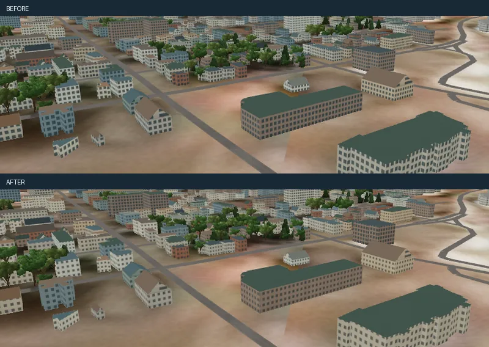

# Downtown Charlottetown façade materials

Downtown buildings no longer all use one identical storey and window
pattern. Original material families use the existing building height to
distinguish lower façades with siding from taller wall and window
rhythms. Window surrounds, casework, mortar and sill details fade with
distance. The building shapes, heights, roofs, stream coverage, and
the existing landscape outside downtown are not replaced or reclassified.
This is a material pass, not an inventory of real addresses or the
architectural reconstruction of any particular building.

The dated [July 1](https://commons.wikimedia.org/wiki/File:Charlottetown,_Prince_Edward_Island,_Canada.jpg)
and [July 18](https://commons.wikimedia.org/wiki/File:Aerial_view_of_Charlottetown.jpg)
photographs by Quintin Soloviev ([CC BY 4.0](https://creativecommons.org/licenses/by/4.0/))
are overview references for mixtures of scale and materials. The game captures
are paired to each other from a fixed camera, not precisely registered to a photo.
No photograph or building imagery was added to the runtime.

Run `tools/qa/facade-poses.py --checkout . --out /tmp/pei-facades --views peakes-wharf,west-outside-control`
with the optional local Chromium path. The development comparison is the
same preceding geometry at `c59bb62`. The fully loaded downtown view
changed 69,080 pixels by more than four RGB levels, with the same
100 draws and 422,269 triangles. West Point stayed at 129 draws and
338,423 triangles; 54 pixels exceeded four levels along the distant
horizon, with no material family assigned there. These fixed-render
statistics do not establish real-device performance.
