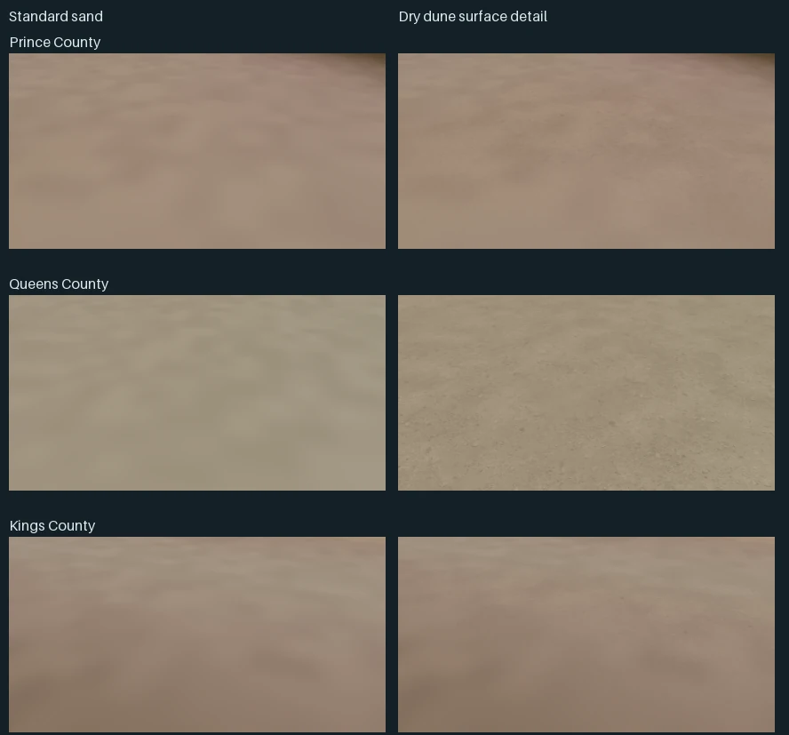

# Dry dune surface detail

In **Standard**, select one of the Prince, Queens or Kings County dry
dune passes. Use `?stockDuneSand` to compare the original surface. The material adds close sand grain and surface lighting to
source-checked dry patches. It does not build new dunes or change terrain
height, collision, water, shorelines, or buildings.

## Where it applies

The provincial [Wetland and Sand Dune Inventory](https://gis.princeedwardisland.ca/server/rest/services/Hosted/Wetland_and_Sand_Dune_Inventory_2020/FeatureServer/0)
is based on 2020 imagery and field observations, with a September 2026 service
update. The study reads the polygon classification, not the imagery.
It keeps only fully classified, non-forested sand-dune rows, then intersects
them with bare or sparse ground in [ESA WorldCover 2021](https://doi.org/10.5281/zenodo.7254221),
the simulator’s dry land mask, and the separately attributed
[road, building, and path exclusion atlas](seated-forest-shadow.md).
Both existing coastal LiDAR survey terrain owners are protected and use the
original materials. The game does not use this mask to classify wetlands or
suggest access to dunes.

The final pack has **24,270 nonzero five-metre samples** across **29 world
tiles**. The whole bilinear footprint of each sample was checked with a 50 mm
numerical reserve. The smallest signed clearance from the simulator’s dry
threshold surface was +27.001 m; no checked footprint crosses the mapped
exclusion cells or its owner seam. The mask has margins and is not intended
to shade the whole coast. Large inland or alternate survey studies take
precedence over it.

## What the material does

The two repeatable photographic materials are
[Sand 03 by Charlotte Baglioni](https://polyhaven.com/a/sand_03) and
[Coast Sand 02 by Rob Tuytel](https://polyhaven.com/a/coast_sand_02), both CC0.
Their two- and fifteen-metre texture scales contribute grain, local relief
lighting and fine roughness. They are generic material scans, not photographs
of Prince Edward Island. Regional colour, the existing landscape texture, and
lighting still come from the simulator. The addition fades to stock by 105 m
from the camera.

High or distant flight does not download a dune mask or texture. A low
nearby approach first verifies the existing in-memory land-cover raster,
building, road, sidewalk and parking sources. Only nearby masks can load;
at most three may be resident at once. The 29 gzip masks
total 14,669 bytes on the wire. The two packed CC0 textures total 576,239
bytes and are requested once on the first qualified near approach. Missing
or altered content leaves stock visible. These are sizes and renderer counts,
not a hardware-wide FPS guarantee.

Data: Resource Inventory and Modelling Section, Forests, Fish and Wildlife
Division, Department of Land & Environment, PEI. Contains information
licensed under the [Open Government Licence – Prince Edward Island](https://www.princeedwardisland.ca/en/information/finance/open-government-licence-prince-edward-island).
WorldCover is © ESA WorldCover project 2021, with modified Copernicus
Sentinel data, under [CC BY 4.0](https://creativecommons.org/licenses/by/4.0/).

## Proof

- [Sources and material fingerprints](dry-dune-surface-source.json)
- [Independent physical sampler bounds](dry-dune-surface-support.json)
- [Matched Three.js comparisons](dry-dune-surface-render.json)
- [Original packaged material and corruption checks](dry-dune-surface-flight.json)
- [Standard render, ordinary flight, distance and fallback checks](dry-dune-standard-gate.json)

The three low matched cameras added no draws or triangles. In each comparison,
RGB outside the authorized screen mask remained unchanged. The high control
was pixel-identical and requested no study assets. All three packaged county flights
used Dispatch, Cockpit and Pause over 380 to 385 metres. A same-length
corrupted photographic asset preserved stock through a separate Queens replay.



## Rebuild the packs

The pinned source files and photo checksums are in the source receipt. With
GDAL, NumPy, SciPy and Pillow installed, rebuild into scratch directories:

```sh
python tools/geodata/dune-sand/qualify-sand-exact.py \
  --world public/world --inventory /data/sand-dune-source.geojson \
  --worldcover /data/N45W063.tif --worldcover /data/N45W066.tif \
  --out /tmp/dry-dune-qualified
python tools/geodata/dune-sand/pack-dry-sand-reviewed.py \
  --qualified /tmp/dry-dune-qualified/sand-qualified-exact.npz \
  --out /tmp/dry-dune-pack
python tools/geodata/dune-sand/pack-materials.py \
  --input /data/poly-haven-sand --out /tmp/dry-dune-grain
```

The runtime accepts only the exact reviewed payloads. New source data
or atlas revisions must pass selection, scope and render checks again.
