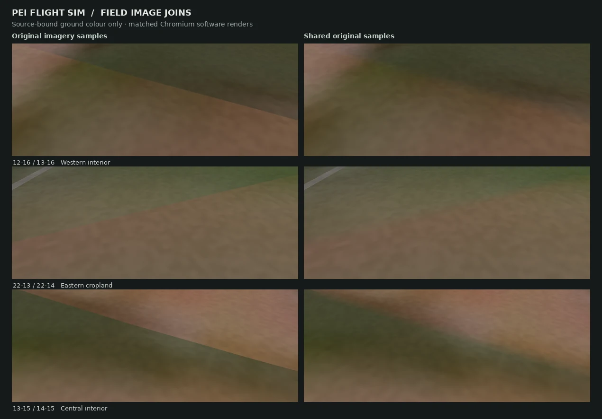

# Three dry interior field-image joins

Three straight edges in the streamed aerial imagery cut across otherwise
continuous ground. Standard now shares original neighbouring texels
across the verified strip at each edge. It does not replace a photograph,
edit mapped field boundaries, increase the source resolution, or change
terrain elevation or flight contact.



| Exact tile pair | Half-open along-source window | Median RGB8 step, first view | Median RGB8 step, reciprocal |
| --- | ---: | ---: | ---: |
| `12-16 / 13-16`, west/east | `[603,623)` north-origin rows | 19.61 → 2.01 | 19.20 → 1.87 |
| `22-13 / 22-14`, north/south | `[63,83)` west-origin columns | 13.24 → 1.61 | 13.30 → 1.56 |
| `13-15 / 14-15`, west/east | `[300,320)` north-origin rows | 34.86 → 3.82 | 36.97 → 3.94 |

The strip is 2.5 source texels across. Both two-texel end tapers stay
inside each listed window. The [signed source receipt](dry-interior-field-joins/source.json)
lists the exact donor images, the 20-texel window (16-texel core plus two two-texel tapers)
and the 22-texel filtered donor support. Every Cover tap reached by a shaded position is dry
and classified grass or cropland in the signed layer. This source check
is not a survey of field ownership, current planting or fences.

The independent two-colour sky check found no stock terrain hole in six
near captures. The matched RGBA comparison found no alpha change or
change outside the marked sampling strip. High, mirrored and lateral
control frames remained stock. Four pre-existing adjacent imagery
windows retained their positive picture results. Motion checks sampled
normal Chase while flying across each strip, then showed no change once
the strip left the sampled footprint. The
[private test corridors](dry-interior-field-joins/virtual-corridors.json)
are not route or navigation changes. These are Chromium software-render
checks; no gameplay FPS or device coverage is claimed.

No new image request, draw or terrain mesh. Incompatible shader
sampler configurations preserve the older neighbour lane rather than
adding a partial new lane. `?stockInlandOrtho` switches back to the
unmodified source treatment.

[Native pixel checks](dry-interior-field-joins/render-checks.json)
· [Moving Chase checks](dry-interior-field-joins/chase-frames.json)
· [World data and attribution](../WORLD.md)

```sh
python tools/qa/verify-eastern-aerial-sources.py --guard-donors \
  --window edge-12-16e --window edge-22-13s --window edge-13-15e
python tools/qa/tracadie-frames.py --checkout . --cohort inland \
  --views edge-12-16e,edge-22-13s,edge-13-15e \
  --chromium /path/to/chromium --out /tmp/pei-dry-field-joins
```
