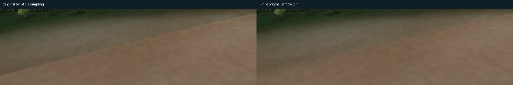

# East-central PEI field imagery join

One existing near-detail aerial seam crosses an inland cropland strip.
Standard shares the bordering original texture samples across that narrow
join. The imagery itself, field boundaries, terrain, roads, and flight
contact are not edited. Use `?stockInlandOrtho` to compare the older
sampling.

This is **not** the earlier [terrain rim repair](regular-terrain-rim.md).
The two operations happen at the same tile boundary, but solve different
visible problems: the rim removes sky showing through a geometric gap,
while this change removes a hard colour line in the original aerial
sampler. Both validations retain the product's existing terrain repair.

| Signed aerial donors | Along-edge source columns | Source ground class |
| --- | --- | --- |
| `20-16 / 20-17` | [384,404), [386,402) centre | Cropland only |

The correction uses 2.5 texels of total cross-edge support and retains a
two-texel taper at each end. The [signed source receipt](east-central-field-image-join/source.json) records
the two original image payloads and the cover mask. Its 35.54 RGB median
step across the raw tile boundary versus 13.27 within the tile edges was a
screening result, not a replacement image or ground survey. The existing
[building and road context](east-central-field-image-join/existing-geometry-context.json) does not verify
actual crop or land boundaries.



| Native 4× view | Median RGB step before | After | Pixels differing by >2 RGB codes |
| --- | ---: | ---: | ---: |
| Low forward | 18.14 | 2.12 | 15,508 |
| Steeper reciprocal | 17.89 | 2.09 | 29,625 |

The [fixed views](east-central-field-image-join/native-fixed.json)
had no alpha differences or changed pixels outside the exact role
witness. Both positive views retained the verified terrain-rim lease and
had no samples of visible sky. High and outside comparisons were
pixel-identical. The earlier lower reciprocal view saw the natural
horizon and one isolated sky sample well above the projected field. It
was present in both old and new renders and is not reported as a pass.
The separately [preregistered steeper reciprocal](east-central-field-image-join/fixed-preregistration.json)
kept the same source locus and azimuth and used the stricter whole-frame
zero-sky control.
The [current-source replay](east-central-field-image-join/current-source-replay.json)
also checked the real stock switch: no local color correction and no sky
leak, with the existing terrain-rim draw still in place.


| Actual moving Chase checkpoint | Changed pixels >2 RGB codes |
| --- | ---: |
| +16.60 m | 4,805 |
| +40.91 m | 4,212 |
| +322.10 m | 0 |

The [moving capture](east-central-field-image-join/moving-flight.json)
used an isolated virtual departure, the regular camera and neutral
controls without time or pose overrides. It reached Cockpit and Pause.
Role, rollback, alpha and draw-count checks stayed exact. Neither this
verification nor its [private test location](east-central-field-image-join/moving-corridor.json)
establishes a real flight route. The independent rim's geometry and
flight contact were not changed.

To reproduce the focused checks with the usual development dependencies:

```sh
python tools/qa/verify-eastern-aerial-sources.py --guard-donors --window east-field-colour-20-16s
python tools/qa/tracadie-frames.py --checkout . --cohort inland   --views east-field-colour-20-16s,east-field-colour-20-16s-reciprocal-steep,east-field-colour-20-16s-high,east-field-colour-20-16s-outside   --chromium /path/to/chromium --out /tmp/pei-east-field-fixed
python tools/qa/aerial-moving-chase.py --corridors docs/qa/east-central-field-image-join/moving-corridor.json   --chromium /path/to/chromium --out /tmp/pei-east-field-moving
```
