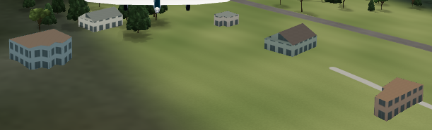
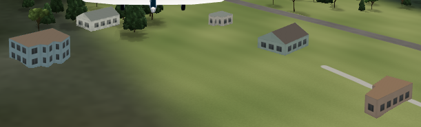

# East Point · optional façade finish

The **East Point · lighthouse pass** can show a local experimental wall
finish on twelve existing village buildings. These are the same
approximate boxes, outlines, roofs and building heights as Standard
scenery. The finish makes the wall-window pattern and lower trim more
coherent in the close Chase view. It is not a survey of those windows,
tenants, entrances or materials, and does not make the existing models
photorealistic.

Run the repository as usual, then open
`/?departure=east-light&eastPointWallPreview=1`
on the same simulator host. With the default Vite host this is
`http://localhost:5173/?departure=east-light&eastPointWallPreview=1`.
Wait for **East Point wall finish preview ready.** in Dispatch, then
select **Begin flight** and leave the camera in Chase. An early Begin,
an unrecognized building/cover/terrain generation, an unsupported
renderer state or an incompatible switch leaves the original
appearance. There is no in-flight replacement after a missed
verification. Returning to Dispatch gives a new verification attempt.

Remove `eastPointWallPreview=1`, or add `stockEastPointWalls`, for
the original scene. No other departure changes. The preview choice and
stock switch are removed only from the ordinary scenery policy,
not from the address currently shown. Selecting a different existing
scenery control may reload without the optional East finish. Standard
terrain, global optics and roads, the wind farms, shoreline, gameplay
and other scenery are untouched.

| Normal moving Chase frame, 259.6 m from launch | |
| --- | --- |
| Standard | Optional finish |
|  |  |

These lossless crops are exact original screen pixels from the
[corrected Standard matched-render fixture](native-correct-standard-pair.json),
not photographs or renders from a detached scene. In its 1200×760
simulator frames, the pass at 29.5 m produced no changes; the two
positive frames at 259.6 m and 323.1 m changed 6,302 and 10,076 pixels
by more than two RGB codes. All changes stayed inside the authenticated
wall fragments. Exterior RGB and all alpha were exact; both stock and
active states restored exactly. Draw counts, original mesh/roof,
camera and unaffected submissions were unchanged. This is a local
desktop rendering result, not a performance or device-wide guarantee.

[Separate ordinary-flight controls](standard-layer-parity.json) compared
the original route URL with the normalized preview fixture. Both
turbine farms (10 and 7 turbines) and the same 35 orthophoto seam entries
remained present through the three matching travel windows. The
[final ordinary URL proof](plain-url-receipt.json) used no diagnostics
or QA query, drew the linked fitted program only in flight, preserved
the other route’s Dispatch controls and stopped the optional draw
on Pause. The original material evidence and limitations remain under
[East Point wall study](../../../tools/art/east-point-ordinary-walls/).
