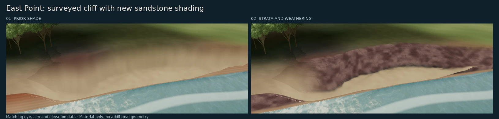

# East Point sandstone material

## Evidence

- [East Point Lighthouse from above](https://commons.wikimedia.org/wiki/File:East_Point_Lighthouse_from_above_-_Prince_Edward_Island_-_PEI_(Quintin_Soloviev).png), Quintin Soloviev, August 2023, [CC BY-SA 4.0](https://creativecommons.org/licenses/by-sa/4.0/). The aerial photograph is a qualitative art reference only. It shows the dark red-brown exposed faces, discontinuous near-horizontal ledges, paler tidal rock and the sharp transition to mown grass. Its pixels are not copied, packaged or fetched by the game.
- [Canadian Hydrographic Service, Sailing Directions ATL 108](https://waves-vagues.dfo-mpo.gc.ca/library-bibliotheque/chs-shc-ATL108-eng-202402-4122811x.pdf), Chapter 1, describes East Point as a red sandstone cliff. [Prince Edward Island State of the Coast](https://www.princeedwardisland.ca/sites/default/files/publications/2023_pei_state_of_the_coast.pdf) explains the island's sedimentary redbeds.

## Implementation

An original world-space material shares its palette and stratification on the steep measured terrain and on the corresponding section of the existing narrow shore curtain. Regional position, terrain slope, shoreline distance, and the survey-lighting blend bound its coverage. Height, the water/land mask, contact, vertex data and the water shader are unchanged. Low slopes, turf, distant scenery and West Point keep their previous materials. Missing the optional East Point survey refinement also disables this material. The game does not request any additional image assets.

The first art iteration was rejected: long dark joints and evenly spaced bands read as lines painted on a slope. The revised material uses weaker interrupted joints, irregular bed groups and color variation at multiple metre scales. The visual review compares it to the source photograph qualitatively; it is not a photogrammetric reconstruction or a recreation of individual visible boulders.

## Locked render checks

In the low, 52 m approach with all imagery loaded (1024 × 640, Chromium with SwiftShader), the final material changed the cliff with the same **233 draw calls and 298,438 submitted triangles**. The fixed sky and open-water strips stayed unchanged to within one 8-bit color level. Unlike the first pass, the strongest repeating brightness band stayed below 31% of the measured short-period band power in every tested cliff strip. That measures an improvement in one visual artifact, not visual similarity to the reference or a hardware performance claim.

The coast still lacks the reference's measured tidal ledges, visible boulders, and overhangs. This material does not add those shapes or darken the flat sandy strip as if it were surveyed rock.

At West Point the matched control is pixel-identical (119 draws and 337,143 submitted triangles).

The [independent report](east-sandstone-review.json) also records a matched
72 m view and the exact agreement of 131,072 terrain/contact checks. See
[the relief audit](coastal-cliff.md) for the camera workflow. For rock
appearance use `tools/qa/sandstone-poses.py` and compare with
`tools/qa/sandstone-frame-gate.py`, changing only the rock material
between checkouts so the simultaneous surf and road improvements do not
contaminate this control.
