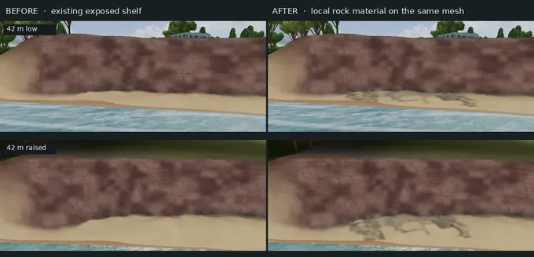

# East Point: supported tidal rock appearance

The South East Point approach has an exposed shelf below the sandstone face. This pass changes only the appearance of a surveyed part of that shelf. It does not create a second mesh, add individual boulders, move the shoreline, predict tide, or change terrain contact.

## Source and limits

- [NRCan CanElevation LiDAR Point Clouds](https://open.canada.ca/data/en/dataset/7069387e-9986-4297-9f55-0288e9676947), Prince Edward Island 2020, [tile `pei_2020_478000_711000`](https://canelevation-lidar-point-clouds.s3.ca-central-1.amazonaws.com/pointclouds_nuagespoints/PEI/Prince_Edward_Island_2020/pei_2020_478000_711000.copc.laz). The portable [cell evidence](../../data/coastal-bench/east-point-source.json) contains 207 audited one-metre cells from a bounded point-cloud probe, with return counts, median raw height, horizontal CRS, exact query bounds and source fingerprints. Contains information licensed under the [Open Government Licence – Canada](https://open.canada.ca/en/open-government-licence-canada).
- Coloring is limited to a connected group of **180** candidate ground cells. The selector requires at least two class-2 returns, no class-9 returns in that cell, agreement within 0.60 m of the existing pinned bare-earth DTM, low elevation and a positive ground-cover shoreline distance. It tapers inside the query's end instead of extending an apparently solid strip outside the measured window.
- COPC ground class is not a rock classifier and the near agreement is not independent of the source DTM. Neither the raw LAS values nor the existing game ocean provide a tidal datum or today's water level. The [licensed summer aerial](east-sandstone.md) guides the muted stone colors and irregular shapes; its pixels are not shipped or sampled at runtime.

## Rendering and repeatability

The optional **1,414-byte** mask follows that supported area. Its 25 cm texels are for antialiased paint, not additional position measurements. It is inset from unsupported cells and the game shoreline even at the texture-filter edges. The land shader applies the paint only after its unchanged shoreline discard; the ocean and coast walls keep their previous meshes and materials. The visible plates, moisture and small crevices are original procedural shading on the triangulated terrain, not added geometry. Sand, West Point and water outside the patch remain unchanged.

With Python, NumPy and GDAL available, run `/usr/bin/python3 tools/terrain/bake-east-bench.py` from the checkout to regenerate the mask and code metadata without a network connection. `npm run check` verifies the COPC-cell, DTM and coastline fingerprints; checks the whole mask's filter neighbourhoods against the current cover; and tests missing, truncated, corrupted and delayed bodies. The optional pack is installed before flight only, and any failure retains the existing East Point material.

An independent full-scene browser pass locked the 42 m approach and overhead
views at 1,024 × 640. The approach changed 8,637 pixels by more than four
8-bit levels; the overhead changed 13,835. The triangle and draw counts
stayed identical at both poses. With the bench pack corrupted, the overhead
frame was byte-for-byte equivalent in RGB to the original material.
At 131,072 measured-window centers, base/collision elevations, mask and
rendered-surface contact remained unchanged.

Rejected versions overemphasized closed cracks or a continuous dark patch.
The final version has varied weathering with softer transitions in the
same support area. Versus the harder-edged candidate, the 90th-percentile
brightness step at matched material boundaries fell from 29.67 to 16.00
levels in the lower view and from 15.67 to 9.10 overhead. Some unclassified
pockets still show the original surface. These are not holes in the mesh.
