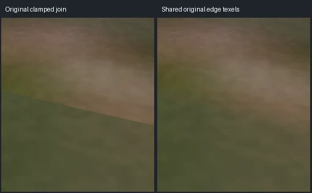

# Eastern PEI: four bounded aerial image joins

Four close-flight joins now sample adjacent original image texels instead of clamping independently. Two strips are in Kings County and two are in Queens County. The strongest visible benefit is a hard tile-aligned colour line that no longer distracts from the surrounding field during low flight.



The correction is limited to a two-sided, 2.5-texel-wide strip and a 20-texel segment of the edge, including two-texel end tapers. No new imagery, sharpening, changed land class, current crop claim, mesh or draw call is involved. [Source receipts](eastern-aerial-joins/source.json) authenticate the existing pack and exact donor texels plus all cover taps. The [province's county polygons](eastern-aerial-joins/county-scope.json) were queried over each full effect envelope. No signed NRN centreline or dated AEB building footprint crosses a strip; the [geometry check](eastern-aerial-joins/existing-geometry-context.json) does not rule out unsurveyed or later features.

Kings' new east-west colour join uses the same tile as an older north-south join. The old join keeps sampler lane 1 and the new join uses lane 2 only when the actual declared sampler count fits. Each holds at most 10,240 bytes; if either donor fails validation the affected pair stays stock on both sides. Losing an outer donor retires only its own lane. No new shader path beyond the existing join sampler is enabled and no hardware frame-rate claim is made.

The [native render receipt](eastern-aerial-joins/render-checks.json) includes both close headings, separate high, outside-window and mirrored controls, marker-bounded changed RGB, alpha and exact rollback. All eight close views improved the measured boundary step; twelve high, outside or mirrored controls were unchanged. The old Kings join’s stock, joined and two marker frames remained byte-identical against the prior build. The markers are synthetic, used only to identify where the actual renderer can sample the strip; they are not a validation of real ground colours. [Compiled-player checks](eastern-aerial-joins/compiled-player.json) exercise normal controls and absent/invalid-source controls without putting the private [test departures](eastern-aerial-joins/virtual-corridors.json) into the playable atlas. They are not suitable for real navigation.

To reproduce the source check, run:

```sh
python tools/qa/verify-eastern-aerial-sources.py --out /tmp/eastern-source.json
cmp docs/qa/eastern-aerial-joins/source.json /tmp/eastern-source.json
```

For the native replay, pass the names in the receipt to `tools/qa/tracadie-frames.py --cohort inland --views ...`. For a compiled private flight fixture, use `tools/qa/inland-aerial-joins-fixture.py --corridors docs/qa/eastern-aerial-joins/virtual-corridors.json`, build the generated directory, then run `tools/qa/expanded-aerial-player.py --fallback-target kings-central-cropland` against that fixture’s compiled player. The three names revised after county review preserve the identical source plans and generated sampler code; [93 shader probes](eastern-aerial-joins/renaming-receipt.json) check that label-only correction.
