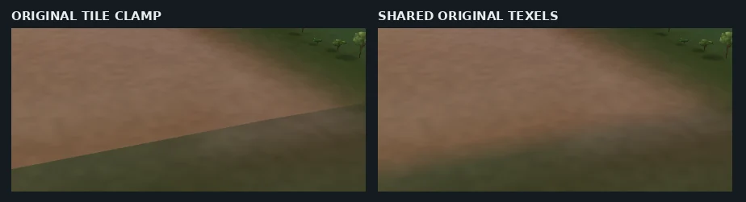

# A field-image join in eastern PEI

This part of a north–south imagery join previously produced a hard colour
line across otherwise continuous field terrain. Standard now shares the
original texels across one checked 20-texel window with a two-texel taper at
each end. The broad colour variation is retained. No new photograph,
texture sharpening, terrain vertex or collision change is included.



The technical ground reference is **46.25636364° N, 62.98221484° W**. Tiles
`18-15` and `18-16` share west-origin columns **466–486**, a half-open
interval. The effect is 2.5 source texels across the line. The [signed
imagery and cover receipt](eastern-interior-image-join/source.json)
authenticates the original donors and the full filter support. Signed
project road centrelines and dated footprints [do not cross the tested
strip](eastern-interior-image-join/existing-geometry-context.json). This
does not establish modern property, crop or fence boundaries.

The median rendered RGB8 step dropped from 42.94 to 3.25 and from
43.98 to 3.14 in the reciprocal view. The
[paired checks](eastern-interior-image-join/render-checks.json) retain
raw alpha, draw counts and exact old restoration. High, reversed-tile and
out-of-window controls are unchanged. Both scene-sky markers show zero
sky pixels across this matched field view. That distinguishes it from
the two separate terrain gaps still being investigated elsewhere.
Moving Chase shows a small foreground correction before it goes off
screen. Trees, adjacent roofs and the scene beyond the exact marked
ground role are unchanged.

The [compiled player](eastern-interior-image-join/compiled-player.json)
crossed the strip and switched into Cockpit and Pause through normal
inputs. The [oblique test corridor](eastern-interior-image-join/virtual-corridor.json)
is for verification only, not an operational route or a new Dispatch
entry. No added draw, image request or hardware FPS claim. Use
`?stockInlandOrtho` for the uncorrected view.

```sh
python tools/qa/verify-eastern-aerial-sources.py --window edge-18-15s
python tools/qa/tracadie-frames.py --checkout . --cohort inland \
  --views edge-18-15s,edge-18-15s-reciprocal,edge-18-15s-high \
  --chromium /path/to/chromium --out /tmp/pei-eastern-interior-join
```

[Source atlas screening](aerial-join-screen.md) ·
[World data and attribution](../WORLD.md)
