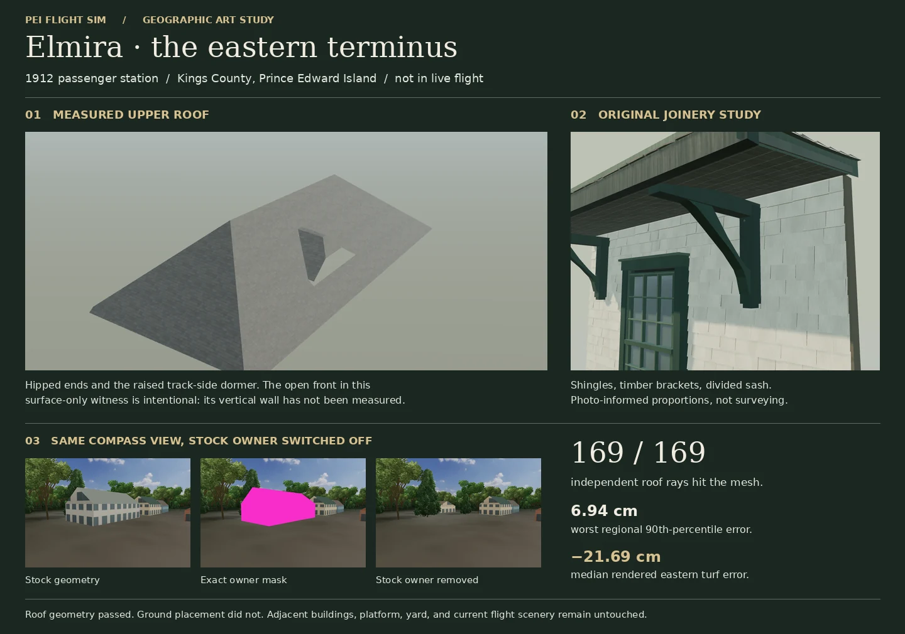

# Elmira Railway Museum: passenger station

**Disposition: keep the station in the art workshop.** The replacement roof passed all ten tested survey regions, but the unchanged ground at the eastern contact failed. Publishing the station as flyable would suggest the building and its platform were seated correctly; that is not supported.

| Question | Observed result |
|---|---|
| Which roof? | The 1912 passenger station: AEB tile `q1331`, feature 195, envelope 206.828 m². Four neighbouring features remain unchanged. The shared civic marker is 55.01 m from the envelope and is not its placement anchor. |
| What is implemented? | A 36-triangle upper roof with eight facets, including the two ends and the raised track-side dormer. A separate, source-informed bay has physical eaves, shaped timber brackets, a weathered shingle finish and an 18-pane sash. Neither is imported by the flight application. |
| How accurate is the roof? | All **169 independent overhead rays** hit the sealed Three.js mesh. Each of ten authorized regions passed; the worst region’s P90 absolute error was **0.069373 m**. The separate training aggregate is not counted as independent evidence. |
| Why no flight release? | At the eastern turf control, the existing rendered ground had **−0.216921 m** median error and **0.267089 m** P90 absolute error. The far-yard rendered control passed. Neither a roof edge nor that generic ground intersection determines the station wall, sill or platform seat. |
| What remains untested? | Western crown, eastern track eave, western dry contact, open northeast yard. These areas stayed outside approval. The chimney, as-built opening positions, walls, precise shingle profile, platform and neighbours are not certified. |

### Inspect the work

- [Three.js workshop, sources and local preview](../../tools/art/elmira-station-study/README.md)
- [Original joinery detail plate](art/elmira-trackside-joinery.webp)
- [Geometry reproduction and published independent aggregate](../../tools/art/elmira-station-study/roof/README.md)
- [Fixed stock cameras and owner verification](../../tools/art/elmira-station-study/owner/fixed-frames.json)

The Canadian Register identifies the station and its defining features in the [official record](https://www.historicplaces.ca/en/rep-reg/place-lieu.aspx?id=4604). Two [2004 provincial photographs](https://www.historicplaces.ca/en/rep-reg/image-image.aspx?id=4604) and a [provincial anniversary article published in 2025](https://www.princeedwardisland.ca/en/news/elmira-railway-museums-50th-anniversary-celebration) support the visible vocabulary, not surveyed dimensions. No source photograph was reproduced. The sealed numerical check uses [Natural Resources Canada’s CanElevation](https://open.canada.ca/data/en/dataset/7069387e-9986-4297-9f55-0288e9676947) under the [Open Government Licence – Canada](https://open.canada.ca/en/open-government-licence-canada); it tests a spatially withheld part of the same 2020 acquisition, not a new acquisition.
