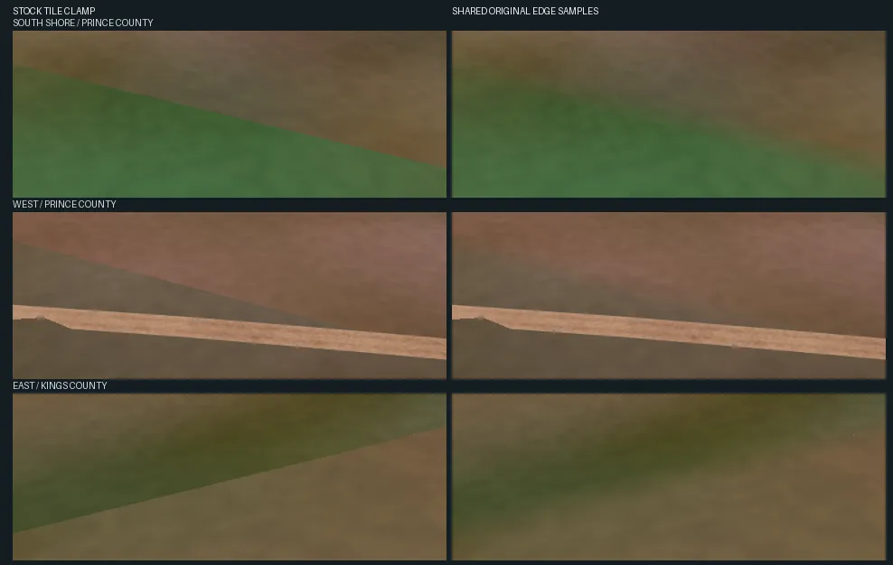

# Three more low-altitude aerial joins

Standard now shares the original aerial-image edge samples over three short
crossings. Before the change, sampling each 640-pixel tile in isolation left a
hard, ruler-straight break at the boundary. Real field colour is retained. No
new imagery, terrain geometry, lighting colour, or flight behavior was added.



| Registered window (lat, lon) | Original image pair and direction | Full window, original texels |
| --- | --- | --- |
| Prince County south shore: 46.22958807, −63.51750000 | `11-16` / `12-16`, west/east | North-origin rows 315–335 |
| Western Prince County: 46.59068750, −63.91437500 | `6-9` / `7-9`, west/east | North-origin rows 412–432 |
| Kings County: 46.20363636, −62.72585840 | `21-16` / `21-17`, north/south | West-origin columns 613–633 |

Texel windows are half-open, including two-texel tapers at either end. County
names come from the [provincial county boundary service](https://gis.princeedwardisland.ca/server/rest/services/county_zones/FeatureServer/0),
not from inferring a county by the tile name. These coordinates are technical
view locations, not new departures or real air navigation.

## Native WebGL results

The test fixes the aircraft-independent camera, stock terrain, lighting and
scenery streaming. The reciprocal check looks across the same edge from the
other direction. The metric is Euclidean RGB8 distance across stock ground
point pairs 0.70 m apart. It measures the sharpness of the rendered join, not
image resolution, land surveying, or performance on a player's computer.

| Window | First heading, median old → joined | Reciprocal, median old → joined |
| --- | ---: | ---: |
| Prince County south shore | 30.60 → 2.48 (74 pairs) | 26.47 → 2.40 (70 pairs) |
| Western Prince County | 17.80 → 1.72 (65 pairs) | 19.95 → 1.90 (62 pairs) |
| Kings County | 23.81 → 2.22 (74 pairs) | 23.70 → 2.36 (70 pairs) |

The six close frames changed only in their native strip witness, with no
change to the visible alpha, draw/triangle counts, or exact stock rollback.
There is no additional imagery request. A resident pair uses a **10,240-byte**
strip of the already authenticated parent textures; it drops out if either
parent evicts, cover bytes differ, or a required source is unavailable. The
existing fade reaches exact stock by 330 m from the eye. The switch
`?stockInlandOrtho` still compares all inland windows against stock. The
[older two inland windows](inland-aerial-joins.md), [earlier county joins](county-aerial-joins.md)
and [Tracadie](tracadie-aerial-join.md) retain their original coordinates and
sampling. The [Queens County additions](queens-aerial-joins.md) are on two
separate signed tile pairs.

To rerun from a built source tree with Python Playwright, Pillow, NumPy and
Chromium:

```sh
python tools/qa/tracadie-frames.py --checkout . --cohort inland \
  --views south-central-fields,west-forest-fields,east-fields \
  --chromium /path/to/chromium --out /tmp/pei-inland-joins
```

Add `-reciprocal`, `-high` or `-outside` to a view name for the corresponding
control. Western Prince and Kings also have `-flipped`; the south-shore
centre is close to the tile midpoint so its well-separated negative is
`south-central-fields-north-control`.
[Candidate scan and source custody](aerial-join-screen.md) ·
[World data and attribution](../WORLD.md).

## Flight controls and fallback

The [15 fixed-view checks](expanded-inland-aerial-joins/render-checks.json)
include the six close positive views and nine unchanged controls for the
distance cut-off, out-of-window positions and orientation. The
[compiled replay](expanded-inland-aerial-joins/compiled-player.json) flew all
three private test corridors and switched to Cockpit and Pause. It also
replayed the south-shore corridor with the inland switch off and with one
signed donor intentionally corrupted; neither control activated that strip.
All five cases travelled more than 150 m without a scenery warning. These
are in-game tests, not navigation or instrument guidance.

To reconstruct the test-only departure positions and repeat the compiled
replay, run from the project root (choose an unused directory for the fixture):

```sh
C=docs/qa/expanded-inland-aerial-joins/virtual-corridors.json
python tools/qa/inland-aerial-joins-fixture.py --checkout . --corridors "$C" \
  --out /tmp/pei-joins-fixture
(cd /tmp/pei-joins-fixture && npm run build)
python tools/qa/expanded-aerial-player.py --corridors "$C" \
  --dist /tmp/pei-joins-fixture/dist --chromium /path/to/chromium \
  --out /tmp/pei-joins-flight.json
```
