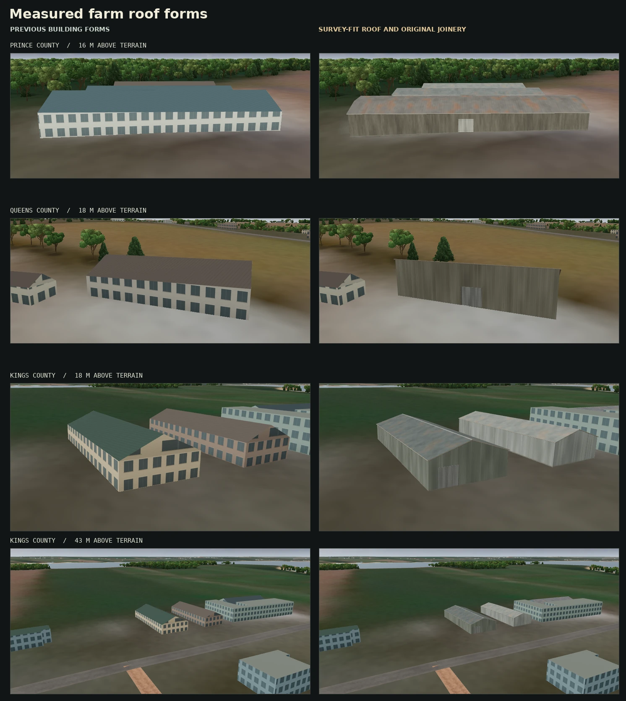

# Farm countryside scenery



A 2020 survey-supported pass replaces selected rural window-grid boxes
with estimated roof planes and original agricultural-building detail. It
covers all three counties without asserting that all PEI buildings, barns
or farms have been reconstructed. Farmsteads can include residences and
other uses. This pass considers only large or elongated rural shells;
no private or local business identities are assigned.

| County | Accepted roofs |
| --- | ---: |
| Prince | 376 |
| Queens | 359 |
| Kings | 194 |
| **Total** | **929** |

The accepted roofs include 866 gables, 43 gambrels, 14 sheds with a
single roof slope and six flat forms. Fully ambiguous, irregular, or
undersampled outlines keep their old buildings. Selected roofs keep the
exact source plan. The new partitions follow the measured shape rather
than treating building minimum and maximum values as a sideways gable
assumption. The mesh includes a neutral foundation, fascia and real
soffits where the plan permits them. Some large wall sections use one
inboard, weathered, closed access panel as artistic joinery. This does
not establish that a particular real building has that opening, timber,
steel, roof cap, finish, or colour.

## Evidence and constraints

The [PEI 2020 Corporate Land Use Inventory (CLUI)](https://gis.princeedwardisland.ca/server/rest/services/Hosted/CLUI2020_OpenData/FeatureServer/0)
gives dated farmstead areas, not a census of individual barns. The
[province’s earlier CLUI report](https://www.princeedwardisland.ca/sites/default/files/publications/2002_corporate_land_use_inventory.pdf)
explains the area-level farmstead concept. Each selected building is a
2020 [NRCan Automatically Extracted Buildings](https://open.canada.ca/data/en/dataset/7a5cda52-c7df-427f-9ced-26f19a8a64d6)
outline. The screening joins exact full farmstead polygons, holes
included, at ≥95% overlap; it also checks mapped road proximity,
area, width, near-rectangularity, atlas heights and neighboring
footprint overlap. 2,028 buildings qualified for shape screening; this
pass read 1,490 eligible DSM/DTM windows in spatially balanced bands
from west to east, not the whole source mosaic.

Planes were fitted from the 1 m native
[CanElevation HRDEM](https://open.canada.ca/data/en/dataset/0fe65119-e96e-4a57-8bfe-9d9245fba06b)
mosaic DSM and DTM. A profile is fit using the same rendering
coordinate system with approximately 20% of the 3 m survey blocks held
out. A row cannot enter without passing the held-out sample error test,
plausible full-height checks and guard rails at the raster edge. Input
raster samples and bivariate ground interpolation are in the same
2020 product, so this holds out measurements, not a different survey
flight. The fit does not classify exact roof details. Runtime
elevations are relative to the existing game ground anchor as for the
other survey roofs; ground atlas error remains at very low flight.

Across the 929 accepted shapes, the median of building-level held-out
90th-percentile residuals is 0.563 m before and 0.104 m after. Across
buildings, the upper tenth percentile of those per-building residuals
moves from 1.351 m to 0.198 m. This uses 58,700 withheld roof-interior cells
and does not measure accuracy at exterior walls. The roof metrics are
relative to local ground. Independent rays against the actual Three.js
mesh reproduced the result at all 58,700 withheld centres, without
missing or duplicate roof hits. Absolute elevation remains constrained
by the simulator's coarser ground anchor; the median building-level
absolute p90 against the source DSM improved from 0.855 to 0.680 m.
This is not a new absolute terrain survey. The
[fit report](../../data/farm-architecture/fit-report.json) and
[per-roof evidence](../../data/farm-architecture/native-window-evidence.json.gz)
pin exact source windows and include results.

The original palette and joinery were built after reviewing photographs
of [Darlington's working barn](https://commons.wikimedia.org/wiki/File:Potato_barn,_Darlington,_PEI_(27307594907).jpg),
[a Kensington-area red frame](https://commons.wikimedia.org/wiki/File:Potato_Barn_near_Kensington,_PEI_(30440862).jpg),
[Miscouche's weathered exterior](https://commons.wikimedia.org/wiki/File:Miscouche,_PEI_(29523939048).jpg)
and [Watervale's rusted roof](https://commons.wikimedia.org/wiki/File:Watervale,_PEI_(9702242534).jpg),
all by Larry Tweed, [CC BY 2.0](https://creativecommons.org/licenses/by/2.0/).
The Canadian Register's [Doyle Barn](https://www.historicplaces.ca/en/rep-reg/place-lieu.aspx?id=24096)
and [MacEachern Barn](https://www.historicplaces.ca/en/rep-reg/place-lieu.aspx?id=19744)
records separately support the regional range of gambrel, gable, shingles,
steel and large framed agricultural doors. References guide original
materials only. None is a claim of a geographic match to the tested
farm sites, and no photo pixels are shipped.

## Runtime and reproduced checks

The 929 exact ordered outline keys are tied to the existing atlas
fingerprint. A different atlas or row falls back cleanly. Their profile
table is about 27.5 kB gzipped, in the application; there is no new
runtime service or external asset request. Compared with the exact
previous form, the 174 affected atlas chunks have 69,156 additional
triangles in total, at most 1,748 in any one chunk. Runtime streams and
frustum culls the existing tiles; it does not submit the whole province's
geometry at once. The same batch material avoids extra draw calls.
Every unchanged vertex attribute among all 3,050,115 unrelated vertices
in those chunks was compared numerically without tolerance, including
normals. Roof caps fill the original footprint; no inboard trim or
decoration extends outside it. Terrain, water, roads and flight surfaces
are unmodified.

Matched 1,024 × 640 views at 16–18 m and 43 m above the rendered
landscape show the low exterior and airborne silhouettes. Both
halves use the same camera, landed ortho tiles and exact complete
building stream. A/B adds 1,092 triangles (232 calls both) at the
Prince low view, 1,786 (119 calls both) at Queens, and 1,792 (43 calls
both) at the two Kings views. All selected samples of the physical
surface and the top 97,280 sky pixels per view matched exactly.

Rebuild with GDAL/OGR, NumPy, SciPy and the optional Python Playwright QA
dependencies. Sample scripts range-read relatively small windows from
830 separate native COG regions. They'll cache source windows in the
external working directory and never fetch them when the game runs.
Source changes require re-review. From the repository root:

```sh
work=/tmp/pei-farm-review
python tools/geodata/fetch-clui-farms.py --out "$work/native-clui"
cmp "$work/native-clui/receipt.json" data/farm-architecture/clui-farmsteads-receipt.json
/usr/bin/python3 tools/geodata/select-farm-shells.py --scratch "$work"
OPENBLAS_NUM_THREADS=1 /usr/bin/python3 tools/geodata/farm-roof-samples.py --scratch "$work" --jobs 3
OPENBLAS_NUM_THREADS=1 /usr/bin/python3 tools/geodata/fit-farm-profiles.py --scratch "$work"
python tools/geodata/bake-farm-shells.py --source "$work" --root . \
  --out "$work/farm-shells.generated.ts" --report "$work/fit-report.json"
cmp "$work/farm-shells.generated.ts" src/render/farm-shells.generated.ts
cmp "$work/fit-report.json" data/farm-architecture/fit-report.json
npm run check
```

The last Python command also requires NumPy. Use the same system Python
as the fitting script if NumPy is unavailable in the default interpreter.
`tools/qa/farm-architecture-frames.py` generates fixed, matched local
Three.js views with only the farm form toggled; it does not replace
terrain or the material renderer. Low views do not establish that the
rest of the rural scenery has photoreal resolution: shadow casting
across the barnyards and native-colour ground detail remain especially
visible limitations. Rendering checks are from local Chromium /
SwiftShader, not a device FPS or render-time benchmark.
