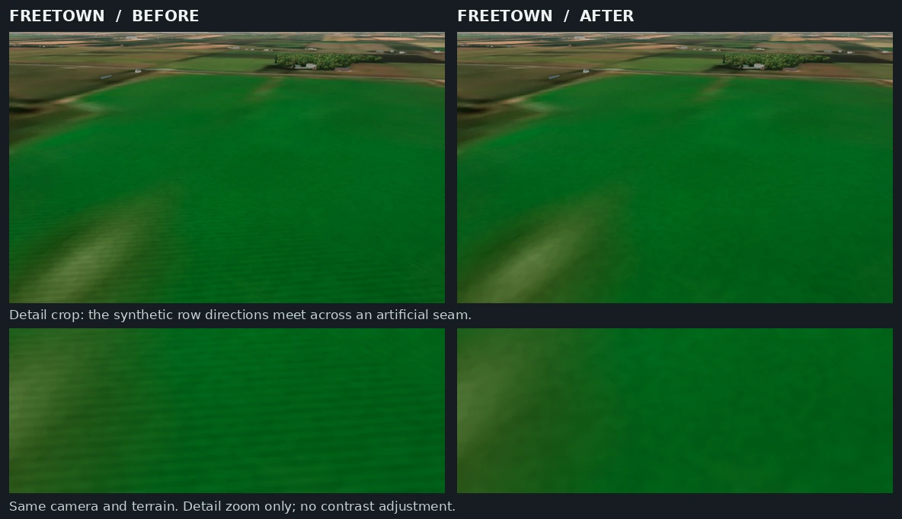

# Field patterns follow the imagery

Low-altitude terrain used to put repeating parallel stripes on a generic
land-cover class. The shader chose a new direction on a fixed 245 m grid,
without regard to field boundaries or the direction of planting. The result
could draw fictitious furrows across grass or break a real field into
unrelated angles. This pass removes only that directional multiplier. The
same georeferenced imagery, non-directional ground grain, terrain, coast
and runway materials remain in place. No new crop or row geometry is added.

A reviewer compared independent [PEI 2020 land-use boundaries](https://gis.princeedwardisland.ca/server/rest/services/Hosted/CLUI2020_OpenData/FeatureServer/0)
with the [AAFC 2025 Annual Crop Inventory](https://open.canada.ca/data/en/dataset/89073037-d2fc-4a6d-9ce9-f0b1bcb48745).
Across three sampled areas, the old row weight exceeded one half at 3,203
of 4,108 sampled pasture/forage pixel centres. The 30 m crop classification
is a screening aid and is not fine enough to resolve planting directions;
it is not shipped as part of this change.

The matched Freetown browser run rendered 255,567 triangles in 104 calls
both before and after, with the same settled terrain tiles, camera, and
other geometry. 133,945 of 324,000 rendered pixels changed at the selected
view, by at most four RGB channel steps. An independent same-frame shader
test at another Freetown view found no changed pixels outside the old
crop contribution. This removes an artifact rather than replacing the
9–10 m source imagery with higher-resolution photography.
