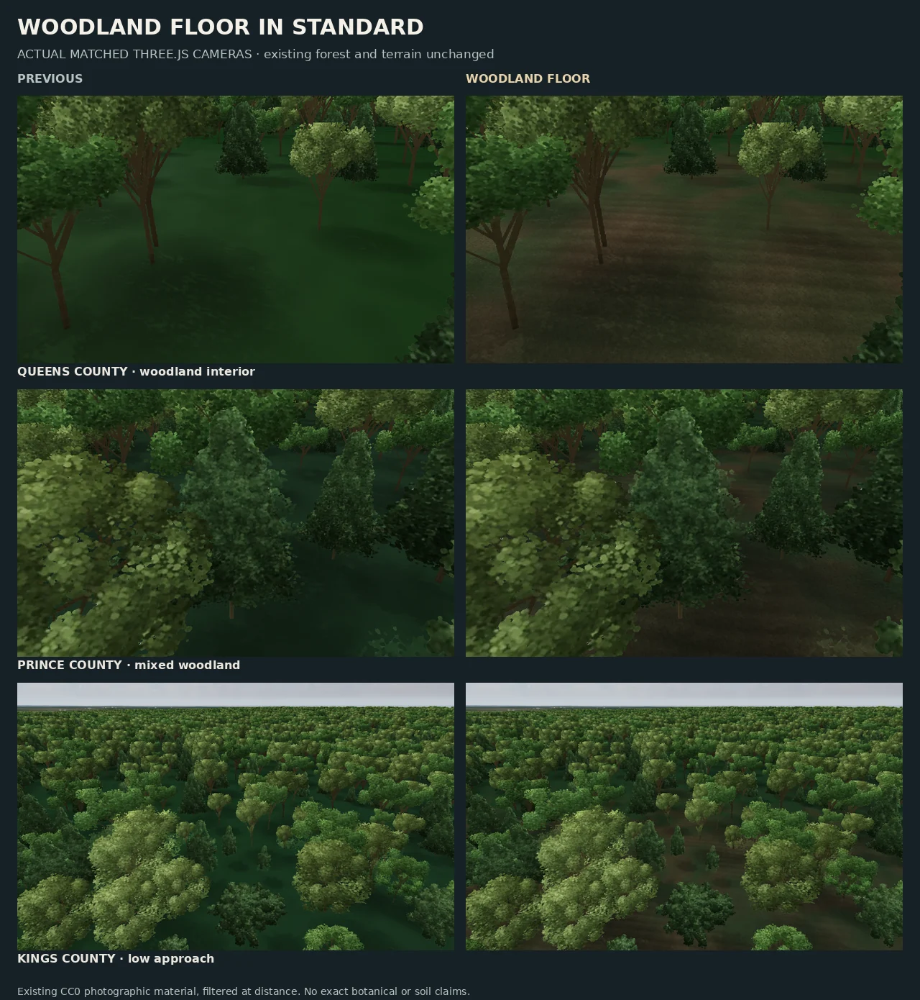

# Woodland floor in Standard

Close Standard views can now show the forest floor instead of a uniform
green satellite colour alone. The material mixes brown leaf litter, green
moss and fine surface grain into already classified forest. The textures
are licensed photographic stock samples, not maps of PEI plants, soils,
or the conditions at an individual site. The terrain mesh, tree positions,
shadows, contact surface and flight model do not change.



## When it appears

The ordinary scene checks first for a sufficiently low viewpoint near
mapped forest, then verifies the pinned decoded land-cover atlas. The two
existing stock texture files are requested together only after those
checks. If a file is unavailable or invalid, neither material installs.
High-altitude and non-forest starts do not need the material. The shader
uses exact forest class samples, a forest-side taper, low-altitude
admission, and distance, footprint and slope limits. Runways, coastal ground and surveyed
or separately composed terrain owners keep their earlier material.

The ordinary path has no new asset file and adds no geometry or draw
calls; only an eligible session fetches the two existing images,
**989,030 bytes total**. The explicit floor option, Detail mode and
separate scenery comparisons retain their existing behaviour. Add
`?stockForestFloor` to turn off the floor for an A/B comparison. This
is a close optical improvement, not a complete ground or vegetation survey.

See the [original texture source and photo credit](../../public/art/forest-floor/sources.json)
and [method behind the explicit preview](forest-floor-preview.md).


## Render and flight checks

| Actual fixed view | Pixels changed above 2/255 | New image requests | Added draws / triangles |
| --- | ---: | ---: | ---: |
| Queens County close woods | 295,852 | 2 | 0 / 0 |
| Prince County dry interior | 122,934 | 2 | 0 / 0 |
| Kings County low approach | 93,043 | 2 | 0 / 0 |
| Queens County at 360 m AGL | 0 | 0 | 0 / 0 |
| East Point coastal control | 0 | 0 | 0 / 0 |
| Prince County protected tile | 0 | 0 | 0 / 0 |

Each pair was rendered in the same Standard Three.js scene. Complementary
diagnostic colours checked the actual forest-only mask through antialiasing;
no outside RGB pixel changed. The high, coastal and protected controls
were byte-identical in RGB. The comparison also replayed alongside the
new close canopy finish without altering its trees. These are browser
regression checks, not a claim about end-user frame rate.

The ordinary Queens County woodland departure advanced and paused with
the normal material, the floor turned off, or the second texture
intentionally corrupted. The bad pair stayed off, without breaking flight.

[Machine-readable gates](forest-floor-standard-gate.json). Reproduce with
Node dependencies, NumPy, Pillow, Playwright and Chromium:

```sh
python tools/qa/forest-floor-standard-frames.py --checkout . --deps node_modules   --out /tmp/pei-forest-floor --chromium /path/to/chromium
npm run check
python tools/qa/forest-floor-standard-flight.py --dist dist   --out /tmp/pei-forest-flight.json --chromium /path/to/chromium
node tools/verify-world.mjs
```
