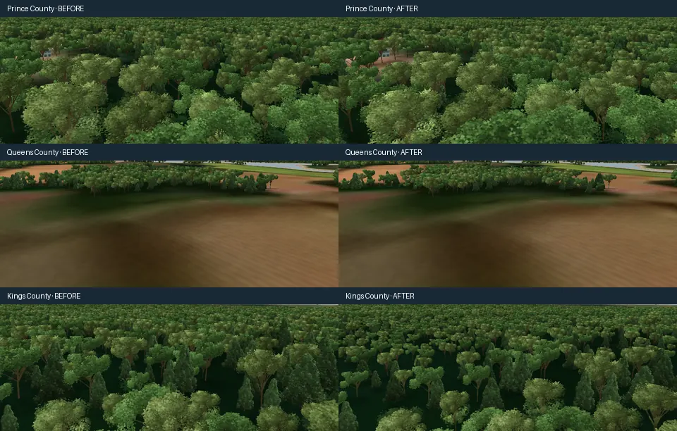

# Data-conditioned woodland heights in three counties

The current province map already places inferred trees using ESA WorldCover.
Until this pass, every stand used the same height distribution. Three
woodland windows now use dominant-tree heights estimated by the province's
2020 forest inventory. This is a test of geographically grounded canopy
structure, not a survey of individual trees or a province-wide height rollout.
The windows cover roughly 0.34 km² each in Prince, Queens and Kings counties.

## Source and use

- [PEI Enhanced Forest Inventory 2020, layer 0](https://gis.princeedwardisland.ca/server/rest/services/Hosted/EFI2020/FeatureServer/0) via the [official open data catalogue](https://data-princeedwardisland-peigov.hub.arcgis.com/datasets/8a7638bdc09648358e0b6fd14be6117a). The `domht` field is the estimated height of large dominant/co-dominant trees. The inventory combines 2020 LiDAR with 2020–21 ground plots at about 20 m cells; it does not supply the position, height or species of each individual model.
- Contains information licensed under the [Open Government Licence – Prince Edward Island](https://www.princeedwardisland.ca/en/information/finance/open-government-licence-prince-edward-island). The sample archive preserves the accepted polygons, height field, source fingerprints and bounding boxes.
- Run `/usr/bin/python3 tools/terrain/bake-forest-heights.py` with GDAL and NumPy to reproduce the optional small asset offline. The 64 × 64 grids merely resample the source (they do not increase its detail). The compressed runtime asset is 2,098 bytes.

The same terrain ground positions, trees and procedural species choices are
retained. The local stand estimate changes the original canopy dimensions
only where supported; the renderer tapers the edge to the previous
distribution. Existing cover classes, roof clearances, runways and
lighthouse exclusions remain authoritative. If the optional pack is
missing or corrupt, the original heights are used.

An independent projection check matched all 12,288 runtime texel centers to
the pinned polygons. The four-neighbor filter crosses a negligible 5.64 m²
boundary sliver in Queens, but no sampled canonical stem is outside the
positive source polygons. This scope check must be repeated before a wider
data release.

## Fixed browser views

`tools/qa/forest-poses.py` uses the actual Three.js forest file and the same
three poses and the same completed imagery tile IDs on both builds. In the 800 × 500 renders, Prince, Queens and Kings
had 197,102, 19,671 and 205,146 pixels respectively change by more than four
RGB levels. The top 110 rows did not change at any of the three viewpoints.
Triangles and draws were unchanged: 290,121/31, 281,877/85 and 326,830/37.
This compares the visual effect of a height field, not performance on a
player's hardware or the realism of individual leaves/trees.

An independent browser capture compared all 77,289 submitted crown instances
in four views. All stem XYZ coordinates and variant/tint values were
byte-identical. Only 4,055 height/width pairs changed: 1,254 in Prince, 459
in Queens and 2,342 in Kings. Across those changed trees, the mean absolute
gap to their native dominant stand estimate fell from 3.69 to 1.37 m, 4.03 to
1.41 m and 3.58 to 1.11 m, respectively. These are differences against the
input stand statistic, not independent observations of individual trees.
Browser tests with both an HTTP 404 and a malformed optional response
restored every original stem and shape value.
