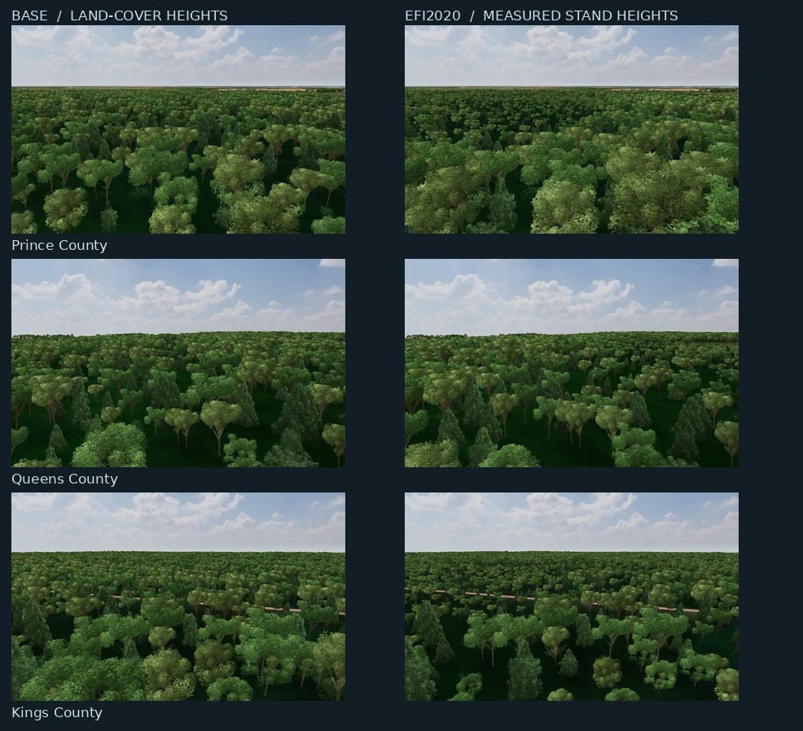

# Province-wide woodland height streaming

See [mapped woodland heights from the Kings County departure menu](dispatch-woodland.md) for the separately verified manual launch. Other departures keep the existing streaming behavior.

This expands the [three-county pilot](forest-height-pilot.md) to every
built woodland tile supported by the published provincial inventory. It
uses estimated large-dominant/co-dominant stand heights to size the
existing trees. No new tree positions, species, density, terrain or
collision are inferred. An uncovered area uses the previous model.

## Source and exact reprojection

- [EFI2020 on the PEI open data portal](https://data-princeedwardisland-peigov.hub.arcgis.com/datasets/8a7638bdc09648358e0b6fd14be6117a),
  distributed by the PEI Resource Inventory & Modelling Section. The
  underlying 20 m field combines 2020 LiDAR and field inventory; it does
  not identify individual trees. See the [provincial State of the Forest report](https://www.princeedwardisland.ca/sites/default/files/publications/state_of_the_forest_2020.pdf).
- Contains information licensed under the [Open Government Licence – Prince Edward Island](https://www.princeedwardisland.ca/en/information/finance/open-government-licence-prince-edward-island).
- Download the official shapefile from the above catalogue and run
  `/usr/bin/python3 tools/terrain/bake-forest-stream.py --archive EFI2020.zip --out public/world/woodland/stream-v1`
  using GDAL and NumPy. The archive's SHA-256 is pinned by the generator.
- There are 7,202,307 original inventory features and 6,796,814 usable cells
  after the native field filter. The warped raster contains 7,781,099
  positive pixels (a resampled count, **not** additional observations).
  Nearest-neighbor donor selection uses an exact transform rather than
  GDAL's approximate transform. An independent 219,893-point comparison
  A clean rerun reproduced all eleven compressed packs byte for byte.
  detected no incorrect donor or no-data conversion. Adjacent packed
  tiles have identical two-pixel halos for seamless interpolation.

## Runtime and availability

The player requests only nearby cover tiles. There are 239 tile records
in 11 packs, 5,426,831 compressed bytes in total. When a server honors
byte ranges, the three-county traversal downloads only selected slices.
Plain static hosts that ignore Range send at most one complete copy of
a touched pack, which is at most about 0.55 MB. Two requests can be in
flight at a time, and at most 26 decoded tiles are resident. Imagery,
land and existing tree clearance remain independent. A missing,
malformed or unneeded woodland layer does not prevent flight or alter
the original tree roster. Already-visible cache entries are not rebuilt
just because a late optional response arrives; a relocation can show
the base heights until those entries are replaced by normal travel. A [bookmarked departure](forest-departure-preflight.md) now warms the
chosen region instead of Cavendish; already visible trees still stay fixed.

Run `npm run check`; the full asset test decodes and hashes all 239
chunks and checks all adjacent halos. For browser cases, run
`tools/qa/forest-stream-browser.py` on the production build with
`--mode range`, `full`, `corrupt` and `absent`. It exercises the initial
Cavendish view, Summerside and East Point in the healthy scenarios. The
test validates data and flight readiness, not FPS on the user's device.

### Matched flights

The native layer was ready at all three non-pilot comparison sites.
The camera position, settled terrain tiles, draw count and triangle
count matched for each pair. Only tree sizing is driven by the new layer.
High sky pixels were identical; new heights change the woodland silhouettes,
the gaps below the canopy and the shadows cast by the trees.

The separate three-county routing check requested 34 ranges carrying
550,918 bytes of woodland pack data. On a real server without range
support the same route fetched four whole packs (2,129,764 bytes).
Missing-index and damaged-chunk tests both kept the aircraft and
unrelated terrain active while falling back to existing tree heights.

The [canopy closure audit](forest-canopy-closure.md) quantifies a separate
limitation: sizing existing crowns from EFI does not recover the measured
stand-level canopy cover.
