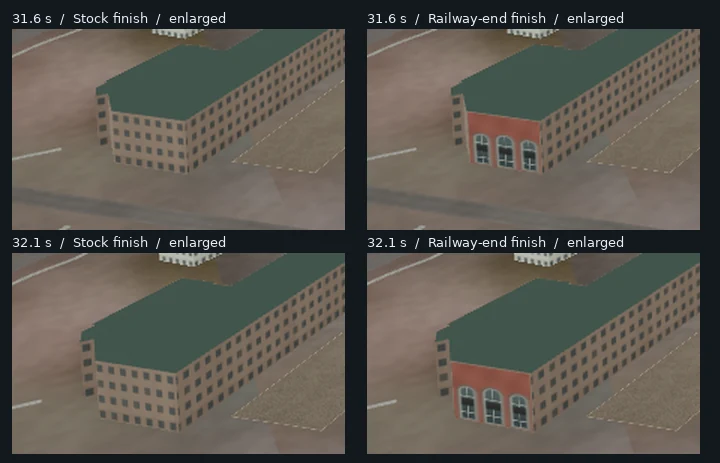

# Founders’ Food Hall · Prince Street end

The Charlottetown waterfront low pass shows three rounded bays on the
former railway shop’s Prince Street end. The finish replaces the generic
rectangular window pattern on that face only. It leaves the roof, terminal
link, other façades and the existing surrounding model untouched.

This is an **opaque material**, not new window glass, a carved doorway or a
model of the entire Food Hall. The finish runs on the same two original
triangles in the same draw. No mesh, silhouette, shadow geometry, road,
terrain or flight-contact change is included. Use `?stockFoundersWestWall`
to compare the old finish.

The City’s [existing-conditions plan, Attachment B, p. 57](https://www.charlottetown.ca/common/pages/DisplayFile.aspx?itemId=17314596#page=57)
locates the railway end relative to Prince Street. [SableARC’s dated exterior
photos](https://sablearc.com/founders-food-hall/) informed the round heads,
muted framing and dark middle bands. All paint, glazing cues and masonry
detail are procedural. No photographic pixels, decal scans, logos or
proposed landscaping ships with this façade. Exact trim dimensions,
current paint and the height of the post-renovation roof are not established.
The separate [full exterior workbench](../../art/founders-hall-exterior.md)
remains outside the playable map.

The [matched real Chase replay](render-receipt.json) changed 1,653 and
2,009 pixels by more than two RGB code values at 31.6 and 32.1 seconds.
There were no alpha changes and no changes outside the projected face.
The old finish and original draw restore exactly. At 32.8 seconds the
target face was below the viewport and the entire image was identical.
The test used the same simulation steps and full scored frames as the
game; seven out of eight GPU submissions were skipped only during the
unscored transit. Draw and triangle counts are unchanged, which is not a
claim that the new shader costs no GPU time.

A separate native front-and-back check kept the forward images unchanged.
The face was still visible in an independent far-distance marker, but the
finish was already off. With the two original triangles isolated for a
reciprocal diagnostic, an ungated shader coloured their reverse; the
production shader did not. This rear-facing check is not a gameplay camera.
