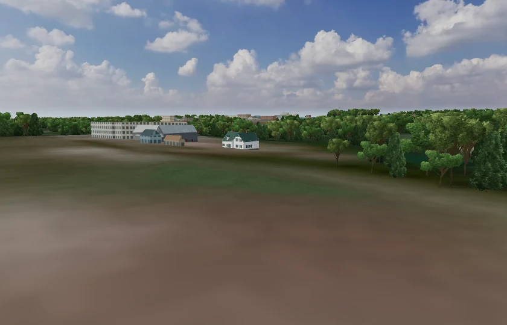

# Source-fenced fairway colour southwest of Green Gables

Add `?gablesFairwayReview` (or `&gablesFairwayReview` after other options).
This opt-in material restores the turf colour on part of a mapped fairway
southwest of Green Gables. The older court, Barn entrances, woodland
and road materials are not changed. It does not trace grass blades,
mowing stripes, property limits or the current course layout.

## What supports the material

Three independent gates agree: the [mapped fairway](https://www.openstreetmap.org/way/1353393025),
open protected survey ground from the previously [qualified dry rise](gables-southwest-grade.md),
and at least four valid vegetation observations out of six Sentinel-2
Collection 1 scenes from June–September 2024–2026. Course-wide government
land use is too broad to position turf at the courtyard. Two known gravel
paths in that mixed parcel also fall inside coarse grassland labels, so
those labels alone were not accepted.

There are 794 one-metre source cells in the intersection. The final
projected texture leaves extra margin and includes about **658 m² of mask
cell-equivalent**, with a softly weighted edge. Every nonzero sampling
footprint is kept inside independently qualified native source ground.
The median bottom-of-atmosphere reflectance is about 0.052 red, 0.078 green
and 0.039 blue after applying the documented level conversion to the
Collection 1 COGs. The original shader blends this chroma with the
existing colour and authored short-scale grain. It does not use image
pixels, introduce a grass model, change the terrain normal or alter contact.
For these six windows, independently matching raw red, green and NIR
channels measured a 1,000-DN difference between older and Collection 1
items; the older samples must not receive the offset a second time.

Contains modified Copernicus Sentinel data 2024–2026, accessed via
[Earth Search Sentinel-2 Collection 1](https://earth-search.aws.element84.com/v1/collections/sentinel-2-c1-l2a).
Contains information licensed under the
[Open Government Licence – Canada](https://open.canada.ca/en/open-government-licence-canada).
© OpenStreetMap contributors. The [source masks, sensor ledger and attribution](../../data/odbl/cavendish-fairway/)
are available under the [ODbL 1.0](https://opendatacommons.org/licenses/odbl/1-0/).
No outside image is shown in the app.

## Checks

The [matched images](gables-fairway-render.json) changed 8,988 near
pixels by more than two RGB code values, with zero change in all
326,687 protected close pixels. The full distant frame and malformed
archive cases are byte-identical to stock. Ground, contact, art and draw and
triangle counts match. No fairway asset loads without the flag. The
review also refuses alternate survey and inland ground.
The [compiled Cavendish flight](gables-fairway-flight.json) uses the
normal player controls; it is not a camera or frame-time benchmark.

Reproduce the 1,785-byte packed mask with
`tools/geodata/fairway/bake-cavendish-fairway.py --help` and the included
native mask, requiring its SHA-256 from the source ledger. The
`--verify` option verifies both the serialized pack and extent by bytes.
