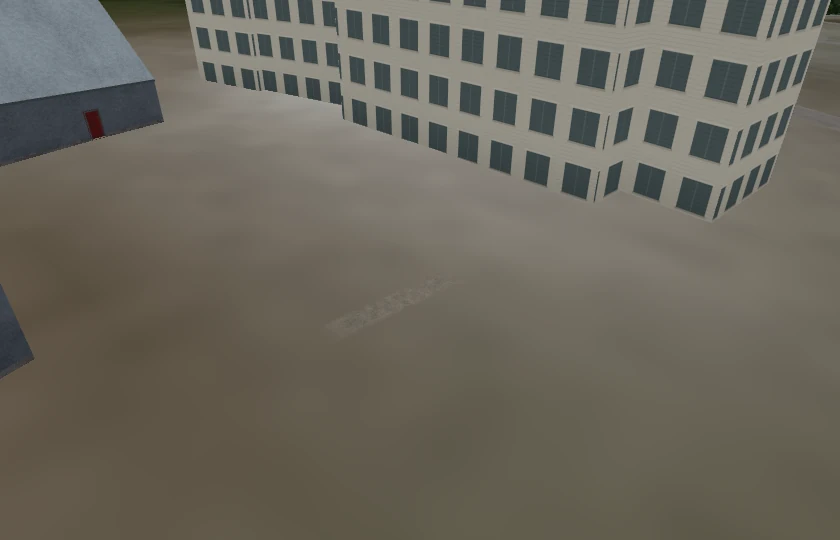

# Green Gables packed gravel material fixture

Add `?gablesGravelReview` (or `&gablesGravelReview` after other options)
to view the development fixture for one small, independently supported span of gravel near the Barn.
The effect paints fine aggregate on the existing terrain. It neither
constructs a walkway nor changes its height, position, lighting normal,
route access, or collision. Outside the short section, the earlier ground
remains. This is not a restoration of the courtyard.

## Scope and sources

- [OpenStreetMap way 1037469196](https://www.openstreetmap.org/way/1037469196)
  records a gravel footway. Only the corroborated centreline interval at
  7.625–15.50 m along the source is drawn. The authored visibility band
  is no more than 1.4 m wide, including the faded edge. No surveyed tread
  width, access, endpoint condition or local gravel colour is inferred.
  © OpenStreetMap contributors. [Adapted centreline and licence](../../data/odbl/cavendish-gravel/).
- [Parks Canada](https://parks.canada.ca/lhn-nhs/pe/greengables/visit/services)
  describes fine gravel and hard-packed dirt paths separately from the
  paved and concrete areas. No guide or donor texture is used. This doesn't
  identify the present material for every path or authorize replacing a yard.
- [NRCan CanElevation point clouds](https://open.canada.ca/data/en/dataset/7069387e-9986-4297-9f55-0288e9676947)
  and [HRDEM](https://open.canada.ca/data/en/dataset/957782bf-847c-4644-a757-e383c0057995)
  corroborate the open 2020 ground of the short span, without tracing
  through the canopy at other ends. Contains information licensed under the
  [Open Government Licence – Canada](https://open.canada.ca/en/open-government-licence-canada).

The paint remains inactive unless the original decoded terrain, Cover,
roads and building sources match their reviewed releases. It does not
combine with the alternate inland or adaptive ground modes. It fades
before the fine grain aliases and is absent beyond 180 m.

## Verification

[Matched close and distant frames](gables-gravel-render.json) preserve all
414,323 close-range pixels outside the projected strip and all 453,600
pixels of the distant frame. The actual app painted 2,257 close pixels
above two RGB code values. The original draw/triangle counts, ground,
contact, building and tile diagnostics match. The original artist gravel
is generated in the shader, not downloaded as an additional asset.

The [compiled player check](gables-gravel-flight.json) used the public
Cavendish departure with the other adopted scenery present.
