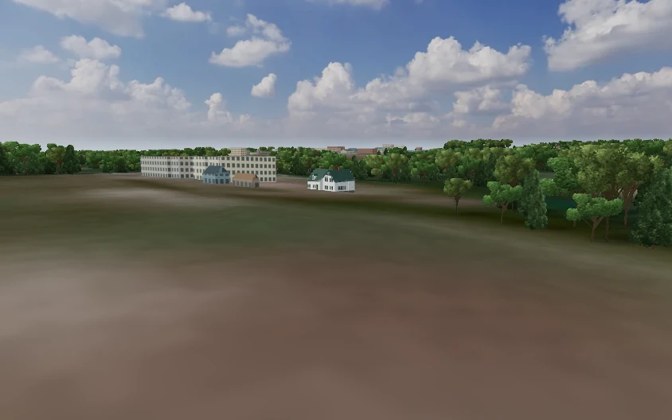

# Survey-supported dry rise southwest of Green Gables

Append `?gablesGradeReview` (or `&gablesGradeReview` after other options).
This independent terrain study corrects part of one dry rise about 84 m
southwest of Green Gables House. It works with **Green Gables House** and
**Dunelands freshwater**. It is not a reconstruction of the entire site,
its footpaths, or the modern terrain.

At close terrain resolution, the engine stitches a 65 × 65 near-grid into
two by two of the existing coarse parent cells. The approximately
1.7 m game samples are constrained against the surrounding inherited ground,
so the approximation neither extends the raised surface beyond the measured
support nor creates the steep artificial shoulder of an unrestricted blend.
At the highest sampled correction the rise reaches 0.95 m. Terrain
shading uses the existing materials. The contact model follows the same
near mesh at fully weighted points and eases back to the original contact
in the transition. Roads, paths, building foundations, water, and terrain
outside the support retain their prior height. The release keeps its original
lower-detail geometry, and refuses to combine with alternate inland/adaptive
terrain or building-shadow settings.

## Source and support

[NRCan CanElevation LiDAR](https://open.canada.ca/data/en/dataset/7069387e-9986-4297-9f55-0288e9676947)
and [one-metre elevation models](https://open.canada.ca/data/en/dataset/957782bf-847c-4644-a757-e383c0057995)
support the admitted dry surface. The [2020 PEI acquisition notice](https://www.princeedwardisland.ca/en/news/photos-taken-from-the-air-will-map-entire-island-landscape)
places this measurement in the summer 2020 provincial program. The source
uses CGVD2013 heights. Contains information licensed under the
[Open Government Licence – Canada](https://open.canada.ca/en/open-government-licence-canada).
No external photographs or textures are included.

An independent pass used measured bare-earth support, surface-model height,
actual streamed geometry and supports of trees in the engine. The source
work held out the existing paths, roads, both nearby known structures,
runways, trees, and the separate ravine. This landform is not a survey of accessible paths.

## Reproduce

With NumPy, SciPy and pyproj available, use the processed ledger in
`data/green-gables-grade/` with **shape-bounded-grade.py** and
**bake-bounded-grade.py** under `tools/terrain/`. The first tool fits from
the measured shape to the existing boundary; the second registers to the
actual game mesh, validates the interpolation reserve, and serializes the
signed centimetre corrections and physical blend weights. The original
source and output hashes are separate. Do not substitute the broad historical
surface or a rendering reference for the qualified ground.

## Verification

The [Triangle check](gables-grade-triangle.json) compares 4,355 native
stations with the registered production geometry. Within the 2,030
admitted stations, the median residual to the source falls from 0.869 m
to 0.615 m. This is a partial correction, with a deliberately gradual
transition to the inherited surroundings. No new ground is accepted from
the audit layer just by looking similar. The independent source sweep
checked 19,088 candidate cell-box intersections and found none on
unqualified native cells.

The [matched actual render check](gables-grade-render.json) found 4,923
changed pixels above two RGB values from the low view and 575 from the
wider view. All 383,807 protected pixels outside either conservative
projection were exact. A malformed local pack reproduced both stock
frames and their local physical probes. The [ordinary flight check](gables-grade-flight.json)
used the published Cavendish departure with both existing studies active,
not a camera or flight override. This is not a device FPS result.

The original dense near tile added 8,432 submitted triangles, including edge stitches, and
no draw calls in these two scenes. The optional signed pack is 1,146 bytes
compressed, independently verified before installation. No grade assets
are requested in the Standard atlas without this flag.

### Sparse near mesh

The current renderer keeps every corrected microtriangle and replaces only
coplanar subdivisions of the inherited terrain. At the unchanged outer
border, all fine edge segments are retained to weld the insert to its
neighbours. Lower terrain levels and collision data are unchanged.

The [matched dense/sparse render and ray test](gables-grade-sparse.json)
confirms 6,354 fewer triangles in both comparison views, with the same draw
calls. The 5,041 terrain rays differed by at most 0.007 mm. Across the two
locked browser views, two pixels changed by two values; no channel
changed by more than two. This is a draw-work reduction, not a device FPS claim.
