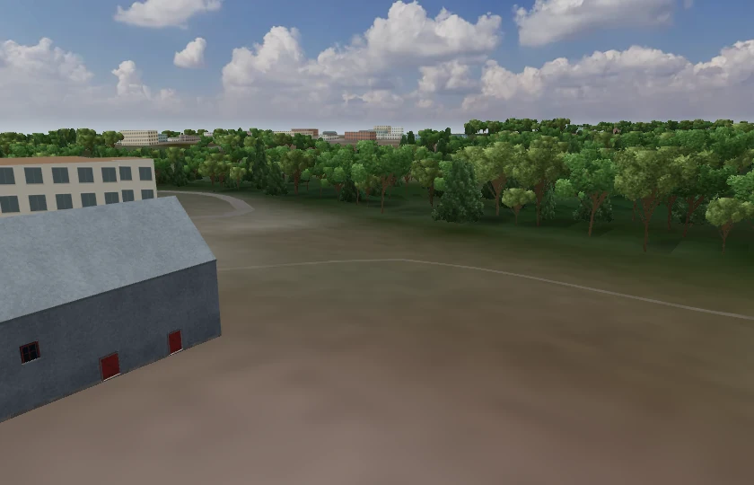

# Source-supported gravel connection near Green Gables

Add `?gablesTrailReview` to the simulator URL (or `&gablesTrailReview` after
other options). This optional material puts a readable gravel trace on an
existing mapped connection near Green Gables, not a route you can follow
for real-world access. It leaves the underlying geometry and flight
surface unchanged, and does not fill in the general courtyard or the
Visitor Centre’s separate paved and brick entrance.

OpenStreetMap [way 704985291](https://www.openstreetmap.org/way/704985291)
records a gravel path about 86.91 m long in the native projection. The
independently qualified material portion is the inboard 10.625–86.65 m
interval (about 75.23 m in the game's tangent coordinates). Faded end
shoulders reserve the unqualified joins. Its maximum 1.4 m shader band
is an authorial visibility limit, including its feather, not a measured
tread width. The [adapted trace](../../data/odbl/cavendish-gravel-connection/)
is © OpenStreetMap contributors, [ODbL 1.0](https://opendatacommons.org/licenses/odbl/1-0/).

Native open ground from [NRCan CanElevation](https://open.canada.ca/data/en/dataset/957782bf-847c-4644-a757-e383c0057995)
and the direct location from mapped material keep the change off the nearby
building, parking and road meshes. Contains information licensed under the
[Open Government Licence – Canada](https://open.canada.ca/en/open-government-licence-canada).
[Parks Canada](https://parks.canada.ca/lhn-nhs/pe/greengables/visit/services)
independently distinguishes fine gravel and hard-packed dirt paths from
entrance paving. No reference pixels or proprietary terrain are included.
The original slope remains; it is not a surveyed, regraded walk.

The shader grades down centimetre grain by pixel footprint as well as
distance, with no new mesh, receiving-normal changes or additional asset
download. It does not combine with the alternate inland and adaptive
terrain settings. A mismatch on the decoded terrain, Cover, roads or
buildings keeps the material inactive.

## Verification

The [matched renderer checks](gables-trail-render.json) changed 1,630
pixels in the low view and 3,050 in the angled view above two RGB code
values. All 605,833 protected pixels outside those projections and every
pixel in the distant scene matched their earlier frames. Ground contact,
draws, triangles and visible building registrations are unchanged. The
[normal flight replay](gables-trail-flight.json) used the regular
Cavendish departure and verified that no asset was downloaded for this
material. These are matched picture and state checks, not an FPS claim.
