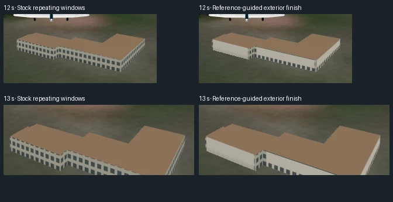

# Georgetown school: reference-guided wall finish

The three observed faces now keep a more credible single-storey reading. The former shaded bands simulated a second row of office windows. The Kent side and the sash-bearing Grafton wall keep the existing lower window cues, while the mostly blank west wing has much less repeated contrast.

## Evidence and limits

Two [October 2024 Kent Street](https://www.google.com/maps/place/Georgetown+Elementary+School/@46.1837587,-62.5334621,13a,75y,247.66h,90t/data=!3m7!1e1!3m5!1s8npG2oxU-wvyab1rAVmc5w!2e0!6shttps:%2F%2Fstreetviewpixels-pa.clients6.google.com%2Fv1%2Fthumbnail%3Fcb_client%3Dmaps_sv.tactile%26w%3D900%26h%3D600%26pitch%3D0%26panoid%3D8npG2oxU-wvyab1rAVmc5w%26yaw%3D247.65835816060886!7i16384!8i8192!4m6!3m5!1s0x4b5e6eb864f96e7f:0xf2ed816abb3e6ecc!8m2!3d46.1831291!4d-62.5345581!16s%2Fg%2F1tdp4mw6?entry=ttu&g_ep=EgoyMDI2MTEyMy4wIKXMDSoASAFQAw%3D%3D) and [Grafton Street](https://www.google.com/maps/place/Georgetown+Elementary+School/@46.1822539,-62.5343674,11a,75y,90t/data=!3m7!1e1!3m5!1sNvZa89nL06Nhlq4ifCc_gA!2e0!6shttps:%2F%2Fstreetviewpixels-pa.clients6.google.com%2Fv1%2Fthumbnail%3Fcb_client%3Dmaps_sv.tactile%26w%3D900%26h%3D600%26pitch%3D0%26panoid%3DNvZa89nL06Nhlq4ifCc_gA%26yaw%3D0!7i16384!8i8192!4m6!3m5!1s0x4b5e6eb864f96e7f:0xf2ed816abb3e6ecc!8m2!3d46.1831291!4d-62.5345581!16s%2Fg%2F1tdp4mw6?entry=ttu&g_ep=EgoyMDI2MTEyMy4wIKXMDSoASAFQAw%3D%3D) Google Street View panoramas were inspected as exterior references only. They show a long pale lap wall with muted teal fascia, a separate wall with one row of light sash groups, and a mostly blank wing. The [PEI library annual report](https://www.princeedwardisland.ca/sites/default/files/publications/pls_annual_report_2024_eng.pdf#page=11) also shows the pale siding and dark fascia. No Street View pixels, photo textures or imagery downloads are in this release.

The signed simulator building and independent provincial outlines both distinguish the three faces from the recessed notch and short return. Only q11220's original vertex intervals `[2127,2133)`, `[2133,2139)` and `[2145,2151)` can receive the treatment. The Grafton sash finish fades before the less certain end of the outline. The material is an original approximation, not measured paint, sash positions or an as-built survey. Roof, envelope, ground, shadows and flight contact stay stock. The existing broad roof and the virtual wall height are still simplified.

## Flight and source gates

The [fixed native comparison](georgetown-school-walls/render-check.json) locked two actual neutral Georgetown flight positions. At 720 × 480, 3,879 and 5,425 pixels changed by more than two RGB codes. Neither view changed alpha or a pixel outside the two-colour depth witness. Rollback was byte-identical; draws and triangles matched at each position. This is not a performance benchmark: the local shader still does extra fragment work.

The [compiled replay](georgetown-school-walls/compiled-player.json) reached the same flight position with the wall finish active in Standard and off under the explicit veto. St. David’s exterior was active in both cases. No extra art payload was requested.

The original streamed attribution, all six typed owner buffers, mount, exact stock program, and unchanged church-only index path must validate before the detached material can be used. An incompatible mode or source keeps stock. Compare the same flight with `?departure=georgetown-low&stockGeorgetownSchoolWalls`. That switch does not turn off the existing St. David’s exterior.
