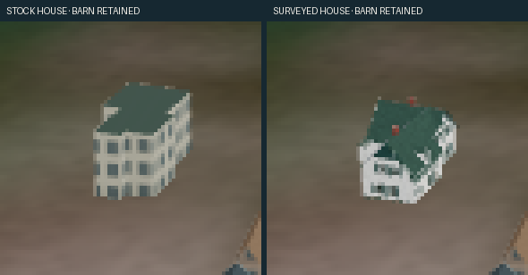

# Green Gables House on the Dunelands pass

Select **Cavendish Dunelands · coastal pass** in Standard to see the
[2020 survey-informed exterior](../../art/green-gables-house.md). The
house and Barn share a base drawing batch but can be compared independently.
Append `?stockGreenGablesHouse` to veto only Standard’s new House replacement.

The [pixel receipt](render-receipt.json) compares four House/Barn states on
the same pair of neutral-input flight poses (25.0 and 26.0 s; 900 × 600).
The real Three.js render changed 522 and 786 pixels by more than two RGB
code values when the House changed, whether or not the Barn was enabled.
No RGBA value outside the projected old/new House envelope changed, no alpha
value changed anywhere, and restoring the same state reproduced the exact PNG
and index view. At these poses the House added 14 draws and a net 10,103
triangles; this is a renderer count, not a frame-rate measurement.

A separate live route probe verified one House request in Standard, no
request with the stock override, no request on the shore low pass even near
the House, and that an invalid same-length House payload leaves the Barn
visible and the House in stock. The captures use fixed-step flight with
no camera override. The local test harness skipped seven out of eight WebGL
draws during unscored transit to reduce software-rendering time; it ran
every simulation and scene update and fully rendered the scored frames.
