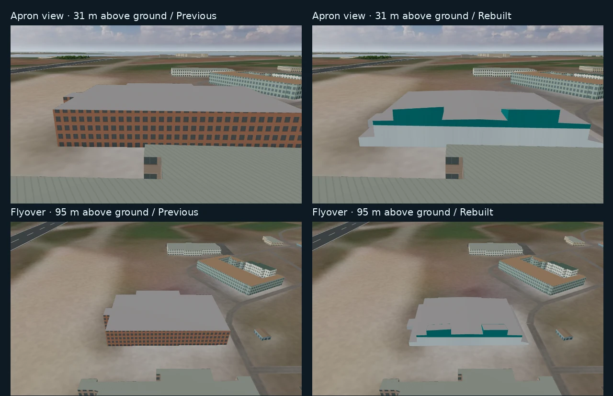

# Hangar 4, Slemon Park

The Standard map replaces one brick-like, repeated-window placeholder at
Slemon Park (around **46.43957° N, 63.83014° W**) with the measured
form of Hangar 4. A broad shallow ridge, lower side roofs and rear
annex, and two raised sections break up the original flat outline.
The pale roof retains the dated satellite colour already assigned to
this building. The painted fascia and restrained panel variation are
original art, not textures cut from photographs.



## Sources and limits

- The [Slemon Park property listing](https://slemonpark.com/available-properties/40-aerospace-blvd/)
  identifies the building and shows the characteristic exterior. Its
  photo is a visual reference only. No photograph, logo, aircraft,
  building contents, or access details are included, and the finish
  is not a statement about current paint or materials.
- The [NRCan AEB footprint](https://open.canada.ca/data/en/dataset/7a5cda52-c7df-427f-9ced-26f19a8a64d6)
  and [NRCan 1 m surface and bare-earth models](https://datacube.services.geo.ca/stac/api/collections/hrdem-mosaic-1m/items/10_3-mosaic-1m)
  are the geographic inputs. The match requires the exact atlas
  digest, owner chunk, row, and complete ordered outline. No other
  building is assigned this form.
- The fitted planes describe the larger masses, not vents, awnings,
  openings, structure, or precise eave details. The geometry does not
  change any runway, ground, road, or flight surface.

Contains information licensed under the
[Open Government Licence – Canada](https://open.canada.ca/en/open-government-licence-canada).
Contains modified Copernicus Sentinel data 2025.

## Checks

| Check | Result |
| :--- | :--- |
| Actual Three.js roof, 819 spatially withheld 1 m observations | 90th-percentile error **6.60 m → 0.50 m**; 95th-percentile **9.79 m → 0.95 m**. Largest residual **4.12 m**. |
| Actual Float32 roof projected to plan | About **4,360 m²** in game coordinates; missing **0.012 m²**, spillage **0.003 m²**, no measurable overlap. |
| Neighboring building vertices | **15,231** vertices and all six attributes byte-exact. |
| Support on simulator terrain | **1,593** samples along 30 wall bases, all buried by at least **0.416 m** in reachable terrain detail; also tested against the source bare-earth model. |
| Two matched 4×MSAA renders | **572,100** off-building pixels byte-exact; same draw calls at both distances. |
| Render cost | **34 → 148** triangles for the one building in the existing batch; no new texture or material pass. |

[Validation receipt](hangar-4-review.json) records the mesh and image gates.

The spatial holdout tests how the fitted planes generalize within the
same source survey. It is not a new survey or an as-built accuracy claim.

## Reproduction

With Python's GDAL bindings, NumPy and SciPy, and the pinned Node dependencies:

```sh
python tools/geodata/bake-hangar4.py --scratch /tmp/pei-hangar4 --verify
node --experimental-strip-types tools/qa/hangar4-mesh.mjs \
  /path/to/predecessor . /tmp/pei-hangar4/hangar-holdout.json /tmp/hangar4-mesh.json
```

The baker reads and checks a small window of the published elevation
rasters. For actual matched renders, run
[`kings-frames.py`](../../tools/qa/kings-frames.py)
with [the recorded poses](../../data/hangar4/poses.json) on each
checkout. Use `--pose-baseline` to match the candidate's camera.
[`hangar4-flight.py`](../../tools/qa/hangar4-flight.py) verifies the
normal departure on a production build, without the fixed-camera fixture.
