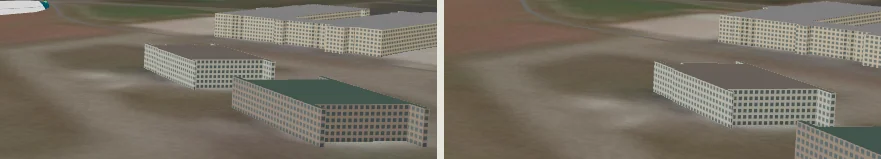
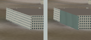
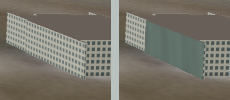

# Hangar 9: fixed Summerside scenery baseline

**This records the existing simulator. It does not replace Hangar 9, add
a runway feature or change flight physics.** The current block at 900
Aerospace Boulevard has a flat cap and a repeated procedural office-window
pattern. [Slemon Park's directory](https://slemonpark.com/wp-content/uploads/2018/04/Slemon-Park-Tenant-Map-2018-1.pdf)
and [property listing](https://slemonpark.com/available-properties/900-aerospace-blvd/)
identify it as a standalone aircraft hangar. The existing model is not a
reference for the real roof, doors, or exterior finish.



This baseline checks two views from the ordinary **Summerside runway
departure** and one later frame in which the hangar is outside Chase.
The capture uses the simulator's standard analog controller path, its own
90 Hz flight model, and its unaltered Chase camera. To shorten software
replays, transit draws are spaced one simulation second apart while
inputs, physics, camera and scenery updates continue. All three target
frames draw the actual game with four samples at 1200 × 760.

| Flight time | Hangar 9 | Flat stock roof | Northwest face | Southwest face |
| --- | ---: | ---: | ---: | ---: |
| 56 s | 4,454 | 1,190 | 1,059 | 1,690 |
| 58 s | 8,884 | 2,476 | 2,075 | 3,010 |
| 64 s | 0 | 0 | 0 | 0 |

Figures count visible pixels from exact old-draw roles, not projected
boxes. Two red diagnostics mark only the original vertex ranges while
keeping depth, alpha and geometry. Green, blue and alpha are byte-exact
everywhere; red does not change off-role. Restoring the original material
reproduces the full old RGBA frame. The measured q47 roof and its
independent ground-light settings stay active in the same source batch.
Software rendering counts are not performance figures or flight advice.

The owner is row 64 in q0322 from NRCan's [Automatically Extracted Buildings](https://open.canada.ca/data/en/dataset/7a5cda52-c7df-427f-9ced-26f19a8a64d6).
The [operator brochure](https://slemonpark.com/wp-content/uploads/2021/04/900_Aerospace.pdf)
shows a shallow gable and lower wings. Its door clearance is not an exterior
height measurement. A dated exterior-ground check supports the existing seat,
but the one-metre data did not have enough independent positions for a complete
roof test, particularly on the southwest wing and its join. No roof from that
intake is installed. No photography, plans or raw survey points are packaged.

## Northwest apron wall study

The [detached finish](../../tools/art/hangar9-nw-finish/) removes the
repeated office-window appearance from **one northwest plane**. It is
not installed or available as a player option. The unchanged adjacent
walls still use generic stock finishes.

Left: original over the runway. Right: original Three.js enamel study.
Both images are unscaled pixel crops of the same flight frame.

| 56 seconds | 58 seconds |
| --- | --- |
|  |  |

In the matched 4× Chromium test, all colour changes were confined to
the authenticated northwest face (1,059 and 2,075 pixels). The late
Chase view at 64 seconds was unchanged. Alpha and the full stock image
were restored exactly; the southwest wall, roof, neighbouring q47 and
flight controls were unchanged. The test began from the ordinary
Summerside runway via the actual **Begin flight** button and used a
repeatable analog input. The paint is an approximation; these captures
do not establish a reconstructed door, other exterior faces or a
measured roof. [Native receipt](hangar9/northwest-finish-native.json).

## Replay

With local project dependencies, Python Playwright and Chromium:

```sh
python tools/qa/hangar9-native-stock.py --checkout . \
  --out /tmp/pei-hangar9-stock --chromium /path/to/chromium
```

The tool runs a temporary diagnostic page and saves its receipt outside
the checkout. It deliberately rejects other stock layout hashes rather
than tagging another building. Retain the [pinned stock checkout](https://github.com/cheshmakzanoon-ops/PEI-Flight-simulation/tree/abcf321ed6b2a57a50690a20021bbb77b5301aea)
when comparing a future real geometry replacement.

[Native receipt](hangar9/stock-receipt.json)
