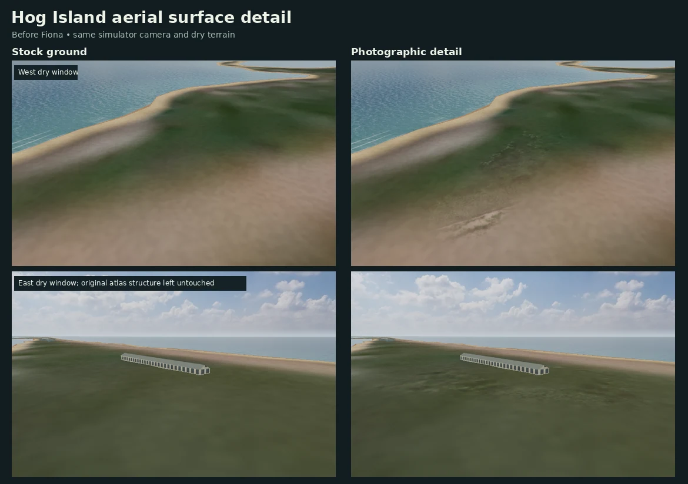

# Hog Island: dated aerial surface detail

These two dry-land strips add photographic texture to the existing Hog
Island terrain, in the Pituamkek Sandhills. In **Standard**, enable
**Hog Island aerial detail** under Optional scenery studies. Select
**Hog Island · west dune pass** or **Hog Island · east dune pass** for an
offshore start. This is simulator scenery, not a visit or access guide.
[Parks Canada](https://parks.canada.ca/pn-np/cnpn-cnnp/pituamkek) provides
geographical and cultural context for the wider area.

## Source and registration

The [CC0 Borealis archive](https://doi.org/10.5683/SP3/KE5YRM) includes
the public pre-Fiona orthomosaic from September 19, 2022. The [original
study](https://doi.org/10.1029/2023JF007551) documents how the dune changed
later that month. The September image is a dated visual reference, not a
present-day coastline. No post-storm elevation or shoreline is blended
into the 2020 simulator atlas.

The released file is a row-stripped GeoTIFF with 0.02609 m native pixels.
Only two small windows were read by HTTP ranges. The embedded WGS 84
UTM zone 20 coordinates are used, but the archive README describes the
datum generically as NAD83. The alternate transform compares within
about 1.1 m for these windows; absolute sub-metre positioning is not
asserted. The west image was area-downsampled to about 0.21 m/texel;
the east image uses horizontally averaged rows at about 0.38 m/texel.

The source windows cover **11,697 m²** before feathering and exclusions.
All source sample centres are in the simulator's dry land under both
datum interpretations, with a signed margin of about 58 m or more. The
eastern window masks the exact nearby atlas structure, with a second
bounds check in the terrain shader. The stock rendered structure is
unchanged. The mapped road widths and
building ownership still have to match the pinned sources. This
does not establish the real current condition of the site.

## What actually changes

Fine-scale photographic variation is mixed into the existing colour,
while the larger existing colour and coastline transitions remain.
This is a bounded material pass, not new terrain. The current elevation,
land mask, water, structures, controls and collision are unchanged.
Two signed derived textures load only when requested; a failed image or mismatched
atlas retains the ordinary scene. The far camera does not render the patch.

## Verification

The two packaged offshore routes flew over 715 m with both texture packs
authenticated. A same-length corrupt response to the east file left
both areas in their stock presentation. The frame checks used the same
camera and atlas state for before and after; they kept existing draw and
triangle counts and changed no pixels outside the photo masks. A high
control was unchanged everywhere.

See [the exact source, terrain, frame and flight checks](hog-island-photo-check.json).
