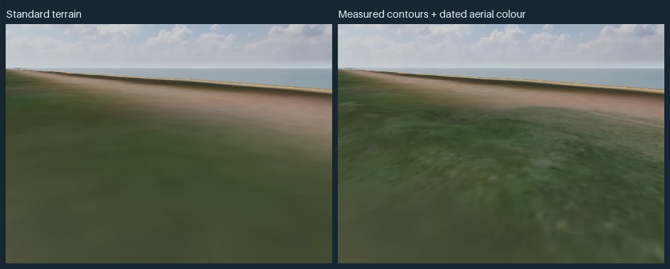

# Western Hog Island dune ground

In **Standard**, enable **Hog Island dune ground** under Optional scenery
studies, then take **Hog Island · west dune pass**. For a direct configuration
use `?departure=hog-island-west-pass&hogIslandWestGround`. The optional
**Hog Island aerial detail** study remains independent, including its eastern
window. Neither study updates the current coastline or denotes public access.

This western window uses measured ground contours rather than lifting the
whole island. The relief changes one 2×2 cell inset in its existing near
terrain mesh. A separate dry colour layer adds the sand and green scrub
pattern from a dated airborne photo. The measured grade and the colour layer
install together, only with verified source hashes. If either optional download
or the building, road, terrain or cover check fails, the ordinary scene remains.

## Source and scope

- The geometry uses Natural Resources Canada’s [1 m CanElevation HRDEM mosaic](https://open.canada.ca/data/en/dataset/0fe65119-e96e-4a57-8bfe-9d9245fba06b)
  DTM and DSM under the [Open Government Licence – Canada](https://open.canada.ca/en/open-government-licence-canada).
  The original 2020 classified point cloud supplied an additional check against
  individual Class 2 measurements across four flight lines from the same survey.
  It is not an independent survey or a new chart datum.
- The colour uses a small window from the [CC0 Borealis archive](https://doi.org/10.5683/SP3/KE5YRM),
  September 2022, before Fiona. The downsampled working data use native
  source rows, not invented detail. The texture retains an inner dry margin
  under both datum interpretations; no post-Fiona or present-day state is
  inferred. The photo does not supply terrain height.
- Water classification and shoreline geometry are unchanged. The numerical
  mask also protects the earlier western photo window. The coarse land-cover
  class can disagree with native bare ground near a narrow dune, so the release
  does not claim that every pixel is always dry. Direct source Class 9 water
  returns do not fall inside the changed terrain support.
- The eastern mapped building remains unchanged. The confirmed western dry
  correction does not make a claim about what the eastern roof-like record
  represents, or about heights beneath the eastern vegetation crown.

## Measurement and cost

The area of changed fine terrain faces is about 4,158 m². The largest change
is +2.29 m and the largest lowering is 0.75 m. Against the 27,342 raw Class 2
returns in the measured core, the 90th-percentile absolute elevation error
fell from 1.68 m to 0.31 m. Each of 1,327 moved vertices had a surveyed ground
return within 1.75 m on at least three flight lines. The conservative collar
eases into existing ground contact rather than applying the finest corrections
under an unmeasured transition.

In 2,339 actual Three.js rays, all 2,230 protected samples, including 244 wet
samples, changed by less than 0.007 mm. The optional mesh adds 4,284 triangles
to the existing close terrain submission; there is no extra draw. The terrain
payload is 2,384 bytes compressed and the photo payload is 136,660 bytes. These
are bounded scene measurements, not hardware-wide frame-rate guarantees.



## Reproduce and check

See the [terrain and LiDAR source receipt](hog-island-west-native-ground-source.json),
[photo source and safe sampling bounds](hog-island-west-dune-photo-source.json),
and the [actual Three.js ray checks](hog-island-west-dune-rays.json).
The photo uses mip-filtered colour but keeps its permission to paint anchored
to native-level alpha. All 41,783 checked bilinear support centres stayed at
least 37.83 m inside the simulator's signed dry mask, and above 1.27 m in the
measured bare-earth model under both datum interpretations.

In the [same-scene browser comparisons](hog-island-west-dune-render.json),
the western approach changed 11,259 pixels by more than two RGB byte values,
with zero changes outside the projected study. The eastern control was
pixel-identical across all 155,480 pixels. A separate closer camera gives
the comparison above; its camera intersects the study bounds and is not an
exterior-mask test.

The [packaged normal-control tests](hog-island-west-dune-flight.json) verify
that Standard makes neither optional request; the Dispatch checkbox enables
the pair through a 644 m flight. A same-length HTTP 200 response with damaged
bytes was tested separately for each asset. In both cases neither the graded
terrain nor the photo activated and flight controls remained usable.

```sh
python tools/geodata/bake-hog-west-grade.py   --dtm /path/to/pinned-west-dtm.tif   --dsm /path/to/pinned-west-dsm.tif   --output /tmp/pei-west-ground.g11.gz
```
