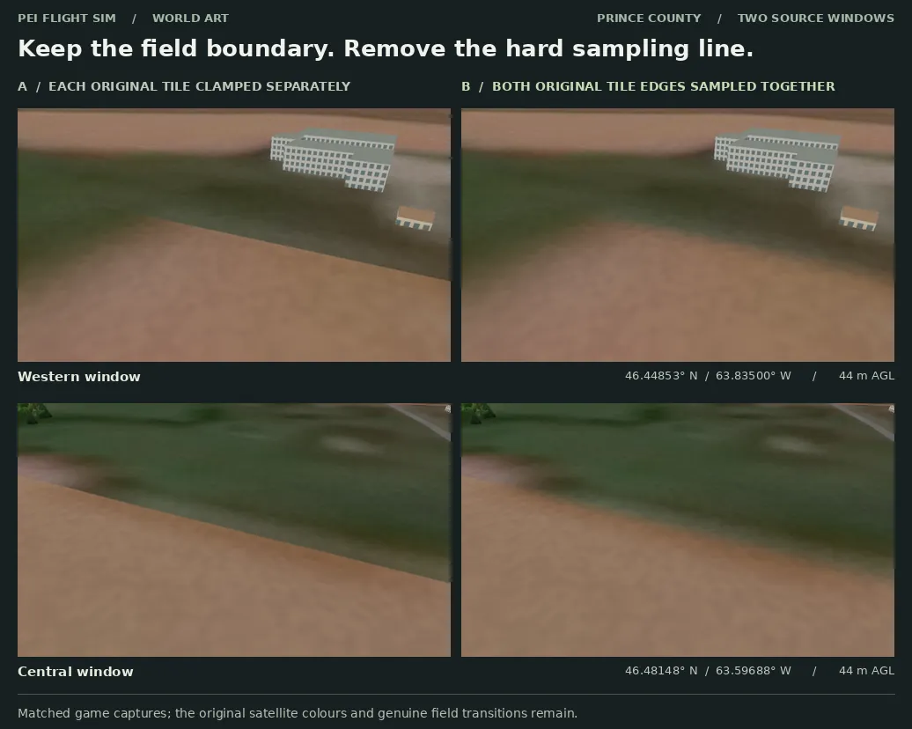

# Low-altitude field boundaries in Prince County

Two short sections of the existing satellite imagery had a straight, hard line where the terrain renderer read neighbouring images separately. The underlying transitions between reddish fields and green vegetation are real in the source. Standard now interpolates across the **original** edge samples in just these two places. It does not recolour the fields, replace buildings, add image resolution, or change the entire tile edge.



Both rows use the same 44 m-above-ground camera for the two frames shown. To compare in the simulator, use `?stockInlandOrtho`. It restores the old sampling at these two windows only. The [three earlier county joins](county-aerial-joins.md), the [Tracadie join](tracadie-aerial-join.md), and the historical opt-in aerial study keep their previous scopes. The coordinates below identify the actual image windows; there is no new named departure.

| Window | PEI coordinates (lat, lon) | Existing source tiles, west/east | Native source rows from north |
| --- | --- | --- | --- |
| Western | 46.44853, −63.83500 | `7-12` / `8-12` | Interior 219–234; tapers 217–218 and 235–236 |
| Central | 46.48148, −63.59688 | `10-11` / `11-11` | Interior 459–474; tapers 457–458 and 475–476 |

Each full window is about **183 m along its boundary**, not the roughly 5.9 km height of a terrain tile. Its maximum across-edge influence is under 12 m to either side. The unchanged source colours are sampled continuously near the seam; the surrounding terrain outside the window stays on the ordinary path.

The [expanded joins](expanded-inland-aerial-joins.md) describe three further
windows on separate source pairs. The two historical views above are unchanged.

## How it is bounded

The matching parts of two existing 640-pixel Sentinel tiles must already have their exact encoded hashes, be uploaded at the normal near-terrain resolution, and have completed their usual detail fade. A small check of the **actual** local ground-cover bytes protects the qualified area without reading another map or hashing the entire cover at startup. Across the full footprint the only sampled cover classes are grass and cropland. If one window’s local cover changes, that window is withheld independently. A missing or altered source image leaves stock sampling in place.

No additional image URLs are requested. A resident pair uses a 4 × 640 RGBA GPU strip (**10,240 bytes**) assembled from its original neighbours. The horizontal centre samples remain from their proper parent tile; only interpolation between them changes. The north-oriented source-window gate takes account of the browser bitmap’s upload orientation. Its distance weighting fades from 205 to 330 m from the eye; beyond that the output is unaltered. There are no new terrain draws or collision meshes.

[Inspect the 4 × 20 donor RGB matrices and local cover](inland-aerial-joins/source-matrices.json). An [independent GPU readback](inland-aerial-joins/gpu-original-texels.json) compared all **5,120 original texel centres** in the two physical strips against the already-loaded donor textures and independently decoded signed source images. Every centre matched byte-for-byte.

## What changed on screen

We measured RGB8 colour differences between paired terrain points 0.35 m to either side of the registered join. A smaller difference across that sub-metre gap means the abrupt sampling line softened, **not** that the photographed field boundary disappeared.

| Window / direction | Height above ground | Ground sample pairs | Median step, old → joined |
| --- | ---: | ---: | ---: |
| Western, first heading | 44 m | 71 | 53.69 → 3.18 |
| Western, reciprocal | 38 m | 68 | 56.40 → 3.87 |
| Central, first heading | 44 m | 78 | 49.42 → 3.63 |
| Central, reciprocal | 38 m | 67 | 49.25 → 3.50 |

The four close views had **zero changed pixels outside their exact shader marker**, with matching terrain draw and triangle counts. Six other controls stayed bit-identical even with the relevant source strip resident: an unqualified high-contrast row near each site, the deliberately north/south-flipped row for each, and each site at 550 m. These are matched WebGL captures, not a device frame-rate claim. [Ten matched-camera checks](inland-aerial-joins/matched-camera.json) · [Independent true-terrain, shader-link and held-out-window controls](inland-aerial-joins/independent-frames.json).

The [compiled control and streaming flight](inland-aerial-joins/player.json) starts from a private, offset virtual test position in Prince County. It checks the real flight, imagery requests, optional fallback and camera controls. The four runs travelled 151.58–155.18 m. The near-eye flight kept at least 42.98 m final ground clearance, including when the independent comparison was disabled or a selected donor was corrupt. The airframe could enter Cockpit and Pause; the faulty tile allocated no strip. See the [virtual test corridor](inland-aerial-joins/virtual-corridor.json). There is no new departure in the player.

To reproduce the output from the source checkout, install the repository’s locked Node dependencies and Python Playwright, NumPy and Pillow, then run:

```sh
npm run check
node tools/verify-world.mjs
python tools/qa/inland-ortho-sources.py --checkout . --out /tmp/pei-inland/source.json
python tools/qa/tracadie-frames.py --checkout . --cohort inland \
  --chromium /path/to/chromium --out /tmp/pei-inland/frames
python tools/qa/tracadie-frames.py --checkout . --cohort inland --views west-field,central-field \
  --stock --chromium /path/to/chromium --out /tmp/pei-inland/stock
python tools/qa/tracadie-frames.py --checkout . --cohort inland --views west-field,central-field \
  --peer-stock --chromium /path/to/chromium --out /tmp/pei-inland/only-inland
```

To exercise the controllable flight (QA-only Dispatch fixture, no new public destination):

```sh
python tools/qa/inland-aerial-joins-fixture.py --checkout . --out /tmp/pei-inland-flight-fixture
(cd /tmp/pei-inland-flight-fixture && npm run build)
python tools/qa/inland-aerial-joins-player.py --dist /tmp/pei-inland-flight-fixture/dist \
  --out /tmp/pei-inland-player.json --chromium /path/to/chromium
```

Imagery comes from the simulator’s existing [open geographic sources](../WORLD.md). No new aerial capture or higher-resolution imagery was added.
