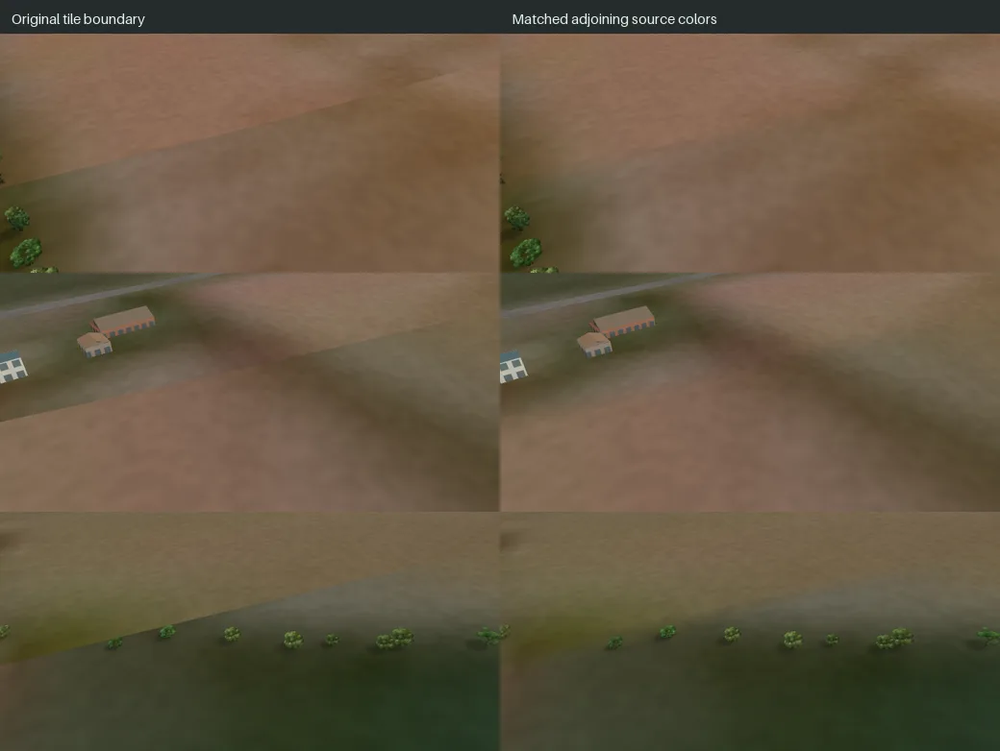

# Three close-flight field-image joins

At three inland sites, straight lines from tile boundaries cut across otherwise continuous fields. The repair samples the original adjacent Sentinel-2 texels together in short, independently checked windows. It preserves the broader field colors, tree belts and agricultural boundaries. It adds no imagery or changes to the underlying geometry, collision, road network, or flight dynamics. This is a local defect repair, not new high-resolution aerial coverage.

| Existing texture owners | Source coordinate window | Close cross-edge RGB distance, before → after |
| --- | --- | --- |
| `17-14 / 17-15` | Columns `[482, 502)` | 15.37 → 1.67 forward; 14.41 → 1.60 reciprocal |
| `9-13 / 9-14` | Columns `[600, 620)` | 15.19 → 1.81 forward; 16.96 → 2.06 reciprocal |
| `6-10 / 6-11` | Columns `[536, 556)` | 18.22 → 2.15 forward; 21.17 → 2.40 reciprocal |

The three windows use six distinct source tiles. The original WebP payloads, all relevant 30/40 dry land-cover taps, and along-axis filter donors were independently authenticated. Both fine tiles must be ready and verified. At range, outside the narrow end tapers, on a missing or corrupt donor, or with `?stockInlandOrtho`, the sampler leaves the original surface in place.

At the 9‑13 site, the nearest mapped building is 3.47 m clear of the applied rectangle. The far donor row approaches the building but the inner samples across the boundary do not. Neither fixed heading changed any pixel inside the three nearby stock-height building envelopes with a conservative raster margin. This is a check of the dated stock geometry and the two tested views, not a current field or building survey.

The six matched fixed comparisons at 840 × 540 with 4× antialiasing found no old ground-to-sky gap and no changed pixels beyond the independently marked terrain or in the alpha channel. High, outside and mirrored views remained exact stock. Separate compiled Chase flights crossed the signed edge at each site, with two visible before/after improvements and exact restoration at all sampled positions. No draw calls or triangles were added. This is not a device frame-rate benchmark. A fourth fixed-view candidate at the 13–12 edge is not included: one of its two planned moving views did not show a meaningful improvement.

[Signed source, native comparison and flight receipt](inland-close-field-joins-proof.json) · [World data and Copernicus Sentinel attribution](../WORLD.md)
