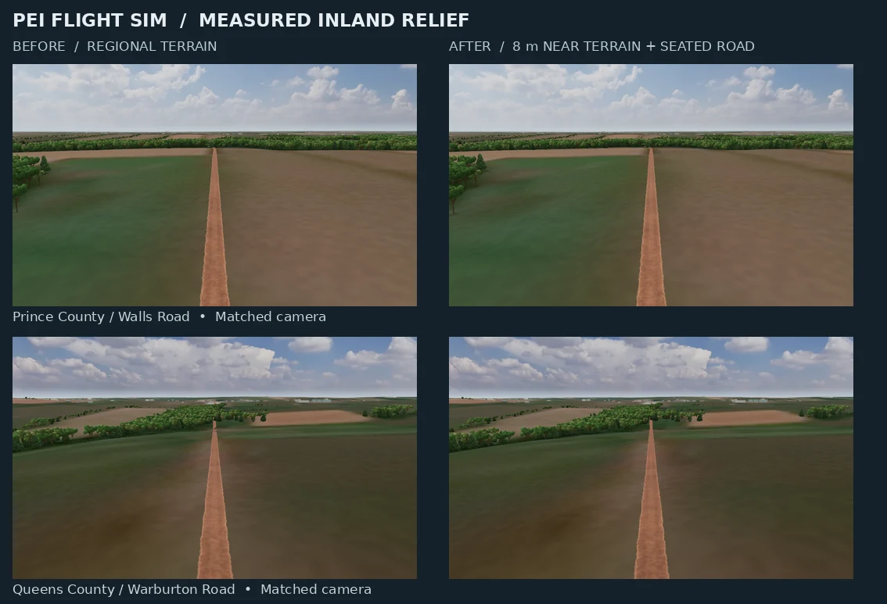

# Measured inland relief: three-county preview

Append `?inlandRelief` to the simulator URL or use
`&inlandRelief` after an existing query. This previews one measured
area in **each** county: Walls Road in Prince, Warburton Road in
Queens and New Harmony Road in Kings. The rest of the province
remains on its existing terrain. These are incremental test areas,
not full-province high-resolution coverage.

The three aligned near meshes use the 8 m overview of the pinned
[NRCan 1 m HRDEM](https://datacube.services.geo.ca/stac/api/collections/hrdem-mosaic-1m/items/10_3-mosaic-1m)
and have approximately 7.8 × 7.5 m node spacing in the
simulator. Original shoreline and runway definitions are not changed.
Signed shoreline guards and a ground-height transition leave
unrelated terrain on the established mesh.

| Site | Earlier p90 absolute error | Refined p90 absolute error |
| --- | ---: | ---: |
| Walls Road | 1.966 m | 0.321 m |
| Warburton Road | 1.560 m | 0.242 m |
| New Harmony Road | 0.832 m | 0.189 m |

These are direct comparisons of the submitted near terrain triangles
with 921,600 finer samples per test area. Both resolutions derive
from the **same** survey, not an independently withheld survey.
At the matched border, near terrain and physics checks agreed to
within 0.024 mm. This numerical agreement is not a claim of
survey-grade accuracy.

The preview clips each nearby road ribbon to the actual near
triangles, keeping its plan position and recorded surface class.
All 115,788 tested points on the revised road overlays were at or
above the nearby ground; the lowest measured clearance was about
2.9 cm. When the terrain moves to medium or far LOD, the displayed
road buffers switch to their former versions. Returning to the same
near scene restores the cached refined buffers. A live runtime test
verified the 112/56/8/112 state sequence without adding a duplicate
mesh or draw. Near terrain adds about 39,000 triangles per affected
tile, so this is not a mobile performance claim. All six medium/far
site-level combinations and prior coastal patches were unchanged.

The three local packs total about 90 kB and load only in preview mode.
A clean bake reproduced all three compressed packs and their TypeScript
integrity pins byte for byte. A missing or
damaged pack preserves the earlier terrain and leaves other sites
independent. The coverage guard is not a survey of ditch depths,
shoulder widths, or the current road surface. Not for navigation.



## Repeat the checks

```sh
/usr/bin/python3 tools/terrain/bake-inland-relief.py --world public/world \
  --out /tmp/pei-inland --generated /tmp/inland-surveys.generated.ts
npm run check
python tools/qa/inland-frames.py --checkout . --chromium /path/to/chromium \
  --out /tmp/pei-inland-frames
python tools/qa/inland-motion-direct.py --checkout . --chromium /path/to/chromium \
  --views walls-road --out /tmp/pei-inland-motion
```

Contains information licensed under the [Open Government Licence – Canada](https://open.canada.ca/en/open-government-licence-canada).
