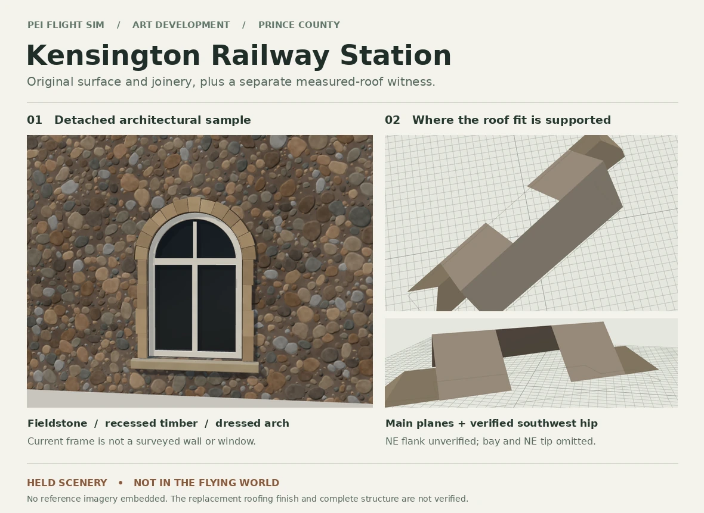

# Kensington Railway Station: partial exterior and roof evidence

Kensington’s 1904–05 stone passenger station is distinct from the former freight shed and the Summerside station. The [national designation](https://www.pc.gc.ca/apps/dfhd/page_nhs_eng.aspx?id=583) and [PEI heritage listing](https://www.historicplaces.ca/en/rep-reg/place-lieu.aspx?id=20380) establish three recognizable features: a fieldstone body, a central arched telegrapher window and open hipped shelters at both ends. This work produced an original Three.js material and full-depth arch development sample, not a traced or painted-over reference photo.

The existing PEI 2020 roof outline is stock atlas row `q032122/149`. It is not a survey of the masonry or supports. In an independent withheld partition of the [same 2020 CanElevation acquisition](https://open.canada.ca/data/en/dataset/7069387e-9986-4297-9f55-0288e9676947), 273 of 273 vertical rays hit the emitted roof witness in eight approved groups. Worst per-role 90th-percentile error: 0.262 m. The crown ambiguity in the southwest, the northeast canopy and both sides of the bay did not have complete validation. The three ground partitions were left unopened. No held result changed the sealed fit.

The Town’s [June 2020 report](https://kensington.ca/assets/COC-Tentative-Agenda-June-2020-website.pdf) confirms the storm-damaged roof was replaced before that summer’s data capture; it does not identify the replacement finish. Older shingle samples do not warrant putting that material in the simulator.

A separate [rear-ground comparison](../../tools/art/kensington-station-study/README.md#rear-ground-cross-check) used 137 usable ground-class pulses from the public 2020 acquisition without opening the old holdouts. The two new reserved blocks agreed with the stock near-terrain mesh to within 4.0 cm at the 90th percentile after a single fitted datum offset. These are archival comparison residuals behind the station, not a survey of its footings or a reason to install the incomplete roof.

**Keep stock live.** No simulator imports or scene updates, no covered-structure or grade replacement, and no neighboring properties, paths, boardwalk or rail changed. The [detached study](../../tools/art/kensington-station-study/README.md) reproduces the previews, geometry receipt, source credits and precise release holds.
