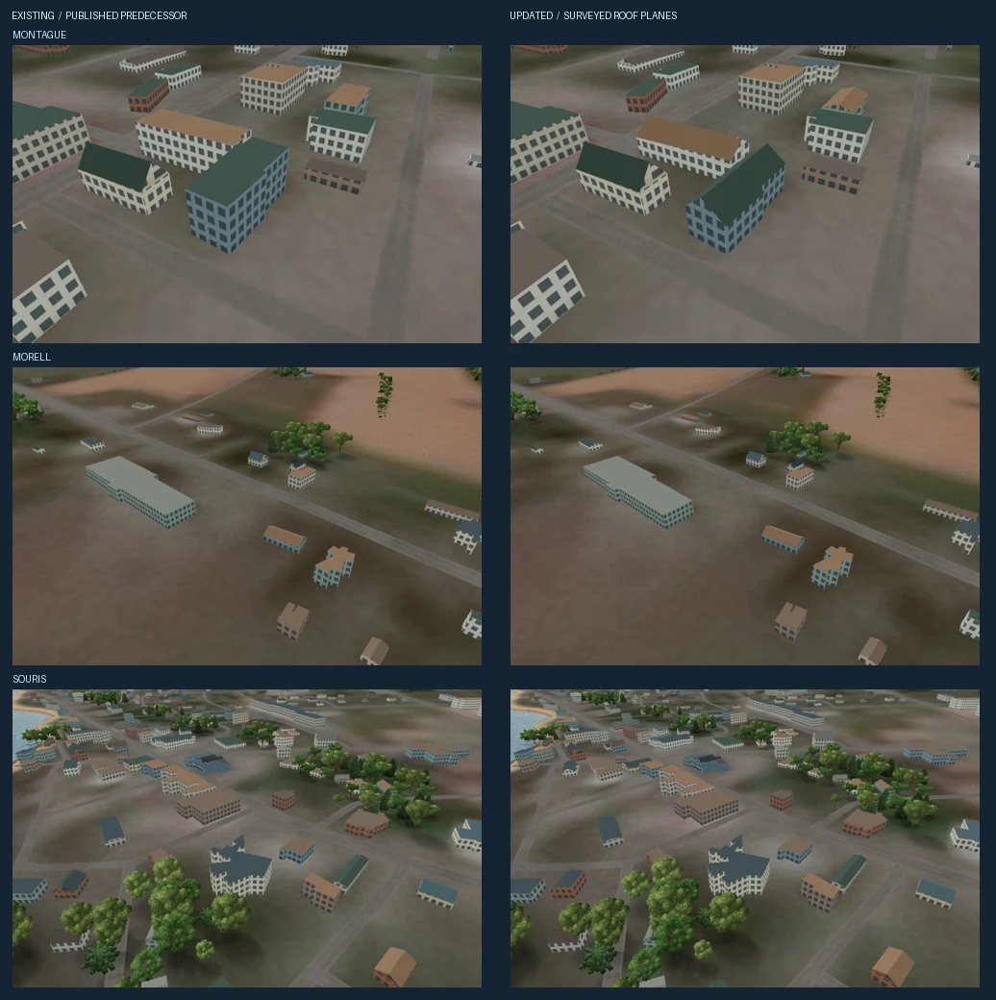

# Surveyed roof silhouettes in Kings County

Thirty-eight existing buildings have new roof geometry, distributed across
Georgetown, Montague, Morell, Murray Harbour, Souris and St. Peters Bay. The
update is part of the Standard scenery. It changes the roof silhouette and
seats the adjoining wall tops, while keeping the original footprint, wall
materials, neighboring buildings, terrain and the flight model.



This pass does not assign addresses, building types or architectural
styles. It does not turn a fitted silhouette into a claim about today's
cladding, business, or exact construction. Existing custom landmarks,
farm shells and residential models keep priority.

## What was measured

The ordered footprints come from NRCan's [Automatically Extracted
Buildings](https://open.canada.ca/data/en/dataset/7a5cda52-c7df-427f-9ced-26f19a8a64d6).
The roof geometry is derived from the [1 m HRDEM DSM and
DTM](https://datacube.services.geo.ca/stac/api/collections/hrdem-mosaic-1m/items/10_3-mosaic-1m),
not from Google imagery. A model is enabled only at the paired atlas
version, tile and ordinal, with every ordered outline coordinate equal.
The fitted triangles and walls stay inside the inherited footprint.
A game/native base disagreement greater than 0.8 m preserves the old
geometry rather than seating a new roof on uncertain ground.

Of 180 geometrically screened footprints, 69 passed the native-plane fit.
Eighteen lacked sufficient improvement, one was already an authored
outline, and twelve did not clear the absolute runtime check.

| Check | Existing mesh | Fitted mesh |
| --- | ---: | ---: |
| Median of individual roofs' absolute p90 errors | 0.814 m | 0.127 m |
| 90th percentile of those individual roof errors | 2.016 m | 0.252 m |
| Largest individual roof p90 | 3.131 m | 0.337 m |

The [ray gate](kings-roof-mesh-gate.json) casts onto the actual Three.js
Float32 mesh at 831 spatially withheld cell centres from the same survey.
Each shipped case improves its absolute p90 by at least 0.12 m. The six
full owning batches retain 172,110 unaffected vertices, byte-exact across
all six mesh attributes when the 38 intended targets are excluded.
The added geometry stays in the existing building draws; the
[matched renderer gate](kings-roof-pixel-gate.json) records exact imagery,
streamed owner IDs and draw and triangle counts. All 985,565 pixels
outside the three projected building masks remained byte-exact.
Those are not GPU performance estimates.

With optional Montague terrain enabled, 37 meshes remain identical.
One wall base seats up to 0.076 m differently on the more detailed ground
without changing any roof vertex. The [independent terrain-ray check](kings-roof-optional-seat.json) confirmed that the joined wall remains
seated on both terrain meshes that can coexist with this building.

Contains information licensed under the
[Open Government Licence – Canada](https://open.canada.ca/en/open-government-licence-canada).

## Reproduction

The [canonical candidates](../../data/kings-neutral-roofs/candidate-shells.json.gz)
pin the 180 selected sites, including the roof axes used for fitting. Use
that archive rather than reselecting for a byte reproduction of the fits;
nearly tied minimum rectangles may choose another equivalent axis on a
different numerical stack. The [sample recipe](../../data/kings-neutral-roofs/sample-plan.json.gz)
preserves the registered survey geometry and cell-window centres.

With GDAL, NumPy and SciPy, run these commands from the project root:

```sh
mkdir -p /tmp/kings-roofs
gzip -dc data/kings-neutral-roofs/candidate-shells.json.gz > /tmp/kings-roofs/candidate-shells.json
python tools/geodata/house-roof-samples.py --root . --scratch /tmp/kings-roofs --all-groups
python tools/geodata/fit-house-roof-planes.py --root . --scratch /tmp/kings-roofs
python tools/geodata/bake-kings-neutral-roofs.py --root . --scratch /tmp/kings-roofs \
  --out /tmp/neutral-roofs.generated.ts \
  --exclusions data/kings-neutral-roofs/absolute-mesh-exclusions.json
cmp /tmp/neutral-roofs.generated.ts src/render/neutral-roofs.generated.ts
```

For the exact geometry regression, unpack the compact held cells and
compare against the release predecessor, with locked npm dependencies
present in both checkouts:

```sh
gzip -dc data/kings-neutral-roofs/roof-holdout.json.gz > /tmp/kings-roofs/holdout.json
node --experimental-strip-types tools/qa/kings-roof-rays.cjs \
  /path/to/predecessor . /tmp/kings-roofs/holdout.json /tmp/kings-roofs/rays.json
```

The fixed viewport capture, projected-scope and pixel-scope tools in
`tools/qa` pair the same Montague, Morell and Souris camera and scenery loading poses.
