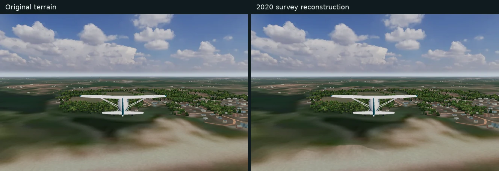

# The measured coastal ridge · Kings County

In Standard, select **Kings County · coastal ridge pass**. On a supported
4× antialiased renderer, Dispatch checks the local survey while the
ordinary world loads. Wait for **Measured terrain is ready** before
selecting **Begin flight** to use the reconstructed crest. Begin flight
is never blocked; an early departure, unsupported configuration or
failed check keeps the original ground for that flight. Direct atlas
repositioning and the in-flight restart use original ground; return to
Dispatch for a new clearance.

Choose **Use original ground** in Dispatch (or add `stockKingsRidge`)
to compare with the original. The separate
`?departure=kings-coastal-ridge&kingsRidgeGroundPreview` preview and
`kingsDryCrownStudy` remain available.

The reconstruction shows a dry, natural ridge on the original coastal approach.
It reuses the signed [2020 NRCan terrain source](../kings-dry-crown.md)
and leaves coastline, imagery, runway data, roads, buildings and
vegetation unchanged. The measured height replaces the original smooth
terrain only in the qualified local footprint. Terrain color and the
identity and material of the existing draw stay the same. This is a
dated simulator reconstruction, not current coastal conditions or
aviation guidance.

## Contact and view

This reconstruction changes local simulator ground contact. The new ground is
chosen before the first flight step, not partway through the flight or
when the camera switches. When the entire affected surface is below the
camera, the renderer can submit the old geometry for that image while
the qualified contact remains active. On the unchanged 60-second
neutral flight, the aircraft state stays identical to Standard: it
crosses corrected ground for 65 simulation steps but remains well above
it. In a separate low contact check, the aircraft hit the measured ridge
and cleared the original ground. The same result held out of view.

The supported visible surface rises by up to 11.99 m. The separate
physical sampler can raise ground contact by up to approximately
11.89 m. The centre uses the same measured terrain faces; the narrow
transition blends back into the old world and is only approximate.
Some original height and visual interpolation differ in that transition.
No new vegetation, pavement, or shoreline reconstruction is included.

## Matched flight checks

The existing [native renderer receipt](render-receipt.json) records identical
Chase flight poses, 1200 × 760 scored rendering, original shader and draw
identity, a stock fallback case, and contact at the exact points tested.
The comparison reduces unscored software-rendered submissions but runs
every simulation step and fully renders every scored view. It is not a
hardware frame-rate benchmark.

At the three approach points, 8,011, 16,791 and 27,178 pixels
respectively changed by more than two RGB code values. No alpha values
or pixels outside the actual terrain marker changed; stock restoration
was byte-identical. No draw calls were added; the visible terrain
adds 10,024 triangles. At the late checkpoint the whole image stayed
stock, and during the subsequent overflight the measured contact was
still active. All five expected building tiles were loaded throughout.

### Standard admission

The normal path checks the same survey and the exact building index,
mesh and compressed range already used by the ordinary streamer;
qualifying the range makes no extra building request. The measured
world is installed before the first fixed simulation step, not when
those bytes finish. The aircraft, original building batch and local
render material are not replaced.

The [Standard admission receipt](standard-admission.json) covers both
the direct route and selection from Dispatch in Chromium at 420 × 280.
Standard and the stock control reported identical positions and ground
heights at all 55 Chase samples. The number of draws did not change;
the reconstructed mesh added 10,024 triangles to the single existing terrain draw. Both made
one normal building range request for q12303. A test holding the
correct survey response until after Begin observed the response become
valid without changing contact on the already airborne aircraft.

The [terrain regression](../../../tools/qa/kings-ridge-flight-lens.test.ts)
runs the real Three.js World across four neighbor detail transitions.
Both surfaces change the same 24 edge heights in the coarser state
without moving the remaining vertices or changing any of six contact
samples. The contact sample at 32,170 m east, 6,936 m south rises by
9.43 m while the lease is held and restores exactly when it is dropped.

The [Standard Chase pixel receipt](standard-chase-receipt.json) uses
the normal route, not the older preview switch. At the three approach
samples, 2,427, 5,146 and 8,266 pixels changed by more than two RGB
code values at 660 × 418. No alpha or pixels outside the changed
terrain differed. After the ridge fell out of view, the image was
identical to stock while surveyed ground contact remained active.

