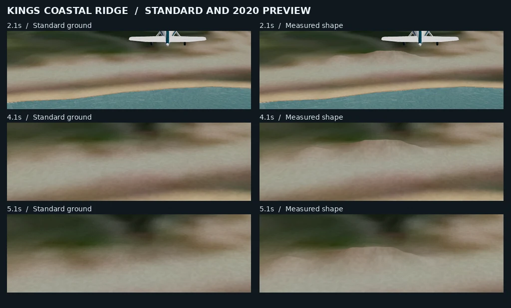

# The measured coastal ridge · Kings County

In Standard, select **Kings County · coastal ridge pass** and **Open
ridge preview**. Dispatch shows when the preview is ready. **Begin
flight** is never blocked, but if the source has not verified by takeoff
that flight keeps the original terrain. Choose **Close ridge preview**
in Dispatch to return to Standard for the next flight. The older Kings
dry crown study can still be opened as a separate comparison profile.

The preview shows a dry, natural ridge on the original coastal approach.
It reuses the signed [2020 NRCan terrain source](../kings-dry-crown.md)
and leaves coastline, imagery, runway data, roads, buildings and
vegetation unchanged. The measured height replaces the original smooth
terrain only in the qualified local footprint. Terrain color and the
identity and material of the existing draw stay the same. This is a
dated simulator reconstruction, not current coastal conditions or
aviation guidance.

## Contact and view

This preview changes local simulator ground contact. The new ground is
chosen before the first flight step, not partway through the flight or
when the camera switches. When the entire affected surface is below the
camera, the renderer can submit the old geometry for that image while
the qualified contact remains active. On the unchanged 60-second
neutral flight, the aircraft state stays identical to Standard: it
crosses corrected ground for 65 simulation steps but remains well above
it. In a separate low contact check, the aircraft hit the measured ridge
and cleared the original ground. The same result held out of view.

The supported visible surface rises by up to 11.99 m. The separate
physical sampler can raise ground contact by up to approximately
11.89 m. The centre uses the same measured terrain faces; the narrow
transition blends back into the old world and is only approximate.
Some original height and visual interpolation differ in that transition.
No new vegetation, pavement, or shoreline reconstruction is included.

## Matched flight checks

The [native renderer receipt](render-receipt.json) records identical
Chase flight poses, 1200 × 760 scored rendering, original shader and draw
identity, a stock fallback case, and contact at the exact points tested.
The comparison reduces unscored software-rendered submissions but runs
every simulation step and fully renders every scored view. It is not a
hardware frame-rate benchmark.

At the three approach points, 8,011, 16,791 and 27,178 pixels
respectively changed by more than two RGB code values. No alpha values
or pixels outside the actual terrain marker changed; stock restoration
was byte-identical. No draw calls were added; the visible terrain
adds 10,024 triangles. At the late checkpoint the whole image stayed
stock, and during the subsequent overflight the measured contact was
still active. All five expected building tiles were loaded throughout.
