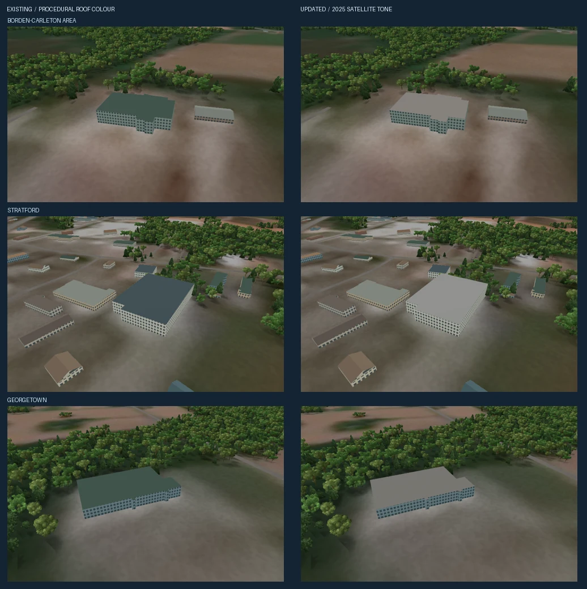

# Large roofs: 2025 satellite colour

The Standard atlas takes the broad colour of 59 existing large roofs from
the 2025 satellite mosaic instead of a generic palette. The change is
limited to the roof faces. Normal maps, façade materials, shape, ground,
roads, runway paint, authored landmark assets and flight remain unchanged.



This is a coarse, dated colour cue, not aerial or street-level photo
projection, a roof material classification, or an observation of present
paint and condition. It does not invent lines, rooftop equipment,
terraces or signs.

## When a colour is admitted

The source is the checked [Copernicus Sentinel-2 near-colour atlas](../WORLD.md#near-detail-scenes)
(roughly 9–10 m samples) and the pinned
[NRCan building plans](https://open.canada.ca/data/en/dataset/7a5cda52-c7df-427f-9ced-26f19a8a64d6).
A centre at least 16 m inside a single roof ring qualifies only for
the preliminary screen. The release then identifies the first valid
non-vegetated source observation (Sentinel scene-class code 5), checks
the true ground quadrilateral of all four original TCI input pixels,
and rejects support that extends beyond the roof plan. On the
[NRCan 1 m DSM and DTM](https://datacube.services.geo.ca/stac/api/collections/hrdem-mosaic-1m/items/10_3-mosaic-1m),
at least 97.5% of the native cells touching that quadrilateral must be
more than 2.65 m above ground, with bounded vertical spread. The complete
building plan must also clear the atlas shoreline and protected runways.

Every emitted roof retains at least four coherent samples. The final
source-support and perimeter review held six of the 65 preliminary
candidates. High colour variability, weak coverage, holes and other
unsupported shapes keep the original palette.

The median colour uses the same 25%-reflectance TCI transfer as the
atlas ground before scene lighting. The aircraft still sees Three.js
lighting and the existing roofing detail. The renderer verifies the
exact atlas, tile, ordinal and every ordered outline coordinate. Existing
authored assets take precedence.

## Verified scope

- All **3,300 target vertices** receive only the three new roof colour
  channels. No positions, normals, UVs, wall colours, classes or visible
  silhouette changed.
- The other rows in the affected real mesh batches kept **890,181**
  vertices byte-exact across all six attributes
  ([mesh replay](roof-tone-mesh-gate.json)).
- The [three matched renders](roof-tone-pixel-gate.json) kept the same
  draw and triangle counts, and all **990,590** pixels outside the projected
  roof scope remained exact. They are not hardware performance estimates.
- No new texture download or material pass is used.

Contains modified Copernicus Sentinel data 2025. Contains information
licensed under the [Open Government Licence – Canada](https://open.canada.ca/en/open-government-licence-canada).

## Reproduction

Use Python with GDAL, NumPy and Pillow, plus the locked Node dependencies:

```sh
python tools/geodata/scan-large-roof-tone.py --root . --out /tmp/pei-large-tone
python tools/geodata/verify-large-roof-tone.py --root . --scratch /tmp/pei-large-tone
gzip -dc data/roof-tone/raw-source-support.json.gz > /tmp/pei-large-tone/source-quads.json
python tools/geodata/verify-original-roof-tone-support.py --root . \
  --scratch /tmp/pei-large-tone --trace /tmp/pei-large-tone/source-quads.json \
  --dry-fence data/roof-tone/exact-cover-and-runway-fence.json
python tools/geodata/bake-large-roof-tone.py --root . \
  --input /tmp/pei-large-tone/strict-release-roof-tone.json \
  --out /tmp/roof-tone.generated.ts
cmp /tmp/roof-tone.generated.ts src/render/roof-tone.generated.ts
node --experimental-strip-types tools/qa/large-roof-tone-mesh.mjs \
  /path/to/predecessor . /tmp/roof-tone-mesh.json /tmp/pei-large-tone/strict-release-roof-tone.json
```

[Small exact receipts](../../data/roof-tone/) retain the initial pixel
selection, the native height confirmations, and the camera and projection
witnesses. Pass the roof-tone pose list via `--poses` to the existing
Three.js capture and use `--roofs-only` on the protected-image projection tool.
